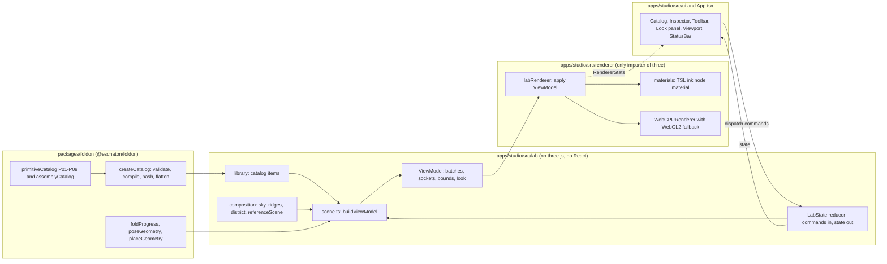

# Architecture overview (Phase 0)

This describes the code as it is at the end of Phase 0 and compares it with the target architecture in [master plan §8](../master-plan.md). The plan's diagram shows runtime data flow, not imports; the diagram below shows both for the part that exists.

## What exists

Three projects. Only the first two are product code.

| Project | Package name | Role |
|---|---|---|
| `packages/foldon` | `@eschaton/foldon` | Pure TypeScript domain library: ids, `Result`, definitions, validation, geometry recipes and hinge posing, placement transforms, the P01–P09 catalog, assembly recipes, the catalog registry. No DOM, no three.js, no runtime dependencies. |
| `apps/studio` | `@eschaton/studio` | Vite + React 19 laboratory: lab state, view-model building, the reference-scene generators, the renderer adapter, UI panels. |
| `experiments/wfc-placement` | `@eschaton/exp-wfc-placement` | Throwaway solver comparison. Nothing imports it. See [ADR 0004](../decisions/0004-multi-cell-encoding.md). |

## Module table: now versus §8 target

| §8 module | Phase 0 status | Where it lives | Notes |
|---|---|---|---|
| contracts | **Merged into foldon** | `packages/foldon/src/{ids,result,issues,vec}.ts` | Branded ids, `Result<T,E>`, `ValidationIssue`. No commands or transactions yet. ([ADR 0001](../decisions/0001-package-layout.md)) |
| foldon | **Exists** | `packages/foldon/src/` | Catalog, geometry recipes, assembly validation, canonical hashing. Owns definitions; does not own placement in a world. |
| generation | **Experiment only** | `experiments/wfc-placement` | 2D throwaway; the Phase 2 solver will be new code. |
| simulation | **Absent** | none | Component *data* exists on definitions; no system reads it ([ADR 0007](../decisions/0007-component-data-and-system-order.md)). |
| world | **Absent** | none | The only mutable state is `LabState`, a UI reducer (`apps/studio/src/lab/state.ts`). There are no transactions, revisions or clock. |
| renderer | **Inside the Studio** | `apps/studio/src/renderer/` | Adapter from `ViewModel` to three.js; the only code that imports `three`. ([ADR 0005](../decisions/0005-renderer-webgpu-tsl-webgl2-fallback.md)) |
| presets | **Absent** | none | The look palette and scene constants are code (`lab/look.ts`, `lab/palette.ts`, `lab/composition/`). |
| studio | **Exists** | `apps/studio/src/{App,ui,lab}` | Sends commands to the reducer; never mutates domain definitions. |
| persistence / replay | **Absent** | none | Definitions round-trip through JSON in tests; nothing is saved. |

## Dependency direction

```text
@eschaton/foldon          (imports nothing from the workspace)
      ▲
apps/studio/src/lab       (imports foldon; never imports renderer or ui)
      ▲
apps/studio/src/renderer  (imports foldon + lab types and look/palette; imports three)
      ▲
apps/studio/src/ui, App   (import lab, renderer, foldon; React)
```

- `lab` has no import of `three`, `react` or `renderer`. `ViewModel` (`lab/viewModel.ts`) is the only type that crosses into the renderer.
- `ui` and `App.tsx` import `renderer/labRenderer` for the `RendererStats` type and to create the renderer in `Viewport`.
- The dependency graph is acyclic. This is checked by reading imports, not by a tool; there is no dependency-cruiser or similar gate yet.
- Tests of `@eschaton/foldon` import only its entry point (lint-enforced). The Studio is covered by Playwright specs, not unit tests.

## Runtime data flow



Solid arrows are data or calls that cross a module boundary. The dotted arrow is the one place where the renderer reports back (frame statistics shown in the status bar); it carries no domain state.

## Data flow in words

1. **Catalog.** `defaultCatalog` (`packages/foldon/src/assemblies.ts`) runs `createCatalog` over the nine primitives and four assembly recipes at module load. The Studio's `loadLibrary()` turns the result into the item list; a validation failure renders a fatal error panel instead of the lab.
2. **State.** `App.tsx` owns `LabState` through `useReducer(labReducer)`: selected item, fold progress, crease overrides, overlays, look settings, camera mode, seed, reduced-motion flag, play state. UI components only `dispatch` commands.
3. **Posing and placement.** `lab/scene.ts` resolves the selected item. Assemblies are expanded with `catalog.flatten` into leaf placements; each leaf definition is posed at the current crease targets (`foldProgress`, then `poseGeometry`) once per definition, and the placements become per-instance affine bases (`lab/basis.ts` uses `placeGeometry` on a probe). The reference scene instead calls `composeReferenceScene(seed, …)`, which places the same definitions with arbitrary affine transforms and adds procedural sky, cloud and ridge panels.
4. **View model.** Everything the renderer needs is one immutable `ViewModel`: batches (posed geometry, instance bases, per-instance ink), sockets, footprint, bounds, camera preset, look and ink scale, a `layoutKey`.
5. **Renderer adapter.** `renderer.apply(viewModel)` rebuilds GPU content only when `layoutKey` changes (disposing the old meshes and geometries) and otherwise rewrites pose buffers in place. One `InstancedMesh` per batch; overlays and outlines are line batches. Frames are drawn only when something changed, unless `?continuous=1` is set for benchmarks.
6. **Feedback.** Per-frame `renderer.info` counters flow back to the status bar. No domain state flows back.

## Differences from the §8 target that matter for Phase 1

- There is no authoritative world. `LabState` is a UI model; placing pieces in a world with identity, occupancy and bonds is Phase 1.
- The renderer adapter takes whole batches, not patches. A patch protocol (§8 "Snapshot and patch") is not designed.
- The view-model builder in `lab/scene.ts` re-poses every definition on every state change that affects pose; it is cached only for the reference composition (per seed).
- Composition generators live in the Studio, so they are not reachable from the headless test seam ([ADR 0001](../decisions/0001-package-layout.md)).
- No Web Worker exists; all computation runs on the main thread.

## Test and measurement seams

- `packages/foldon/test` — behavioural tests through the entry point.
- `apps/studio/e2e` — Playwright against the dev server (`pnpm e2e`), using `data-testid` hooks from the status bar and inspector.
- `packages/foldon/bench` and `apps/studio/bench` — benchmarks ([`../../benchmarks/`](../../benchmarks/)). `?continuous=1` and `?stress=N` are benchmark-only URL flags read by `lab/flags.ts`.
