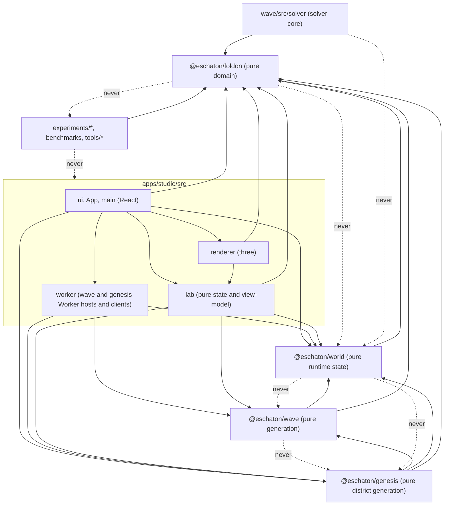
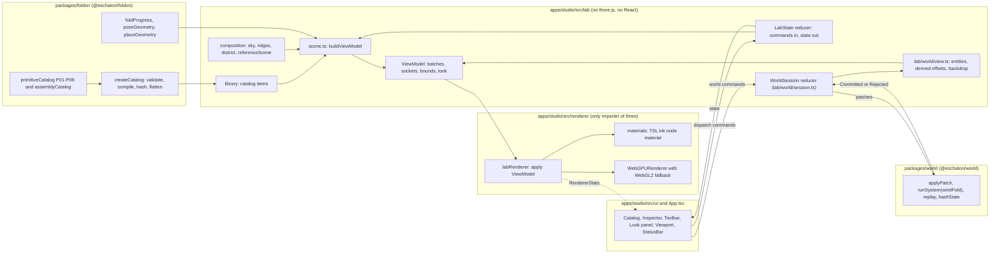
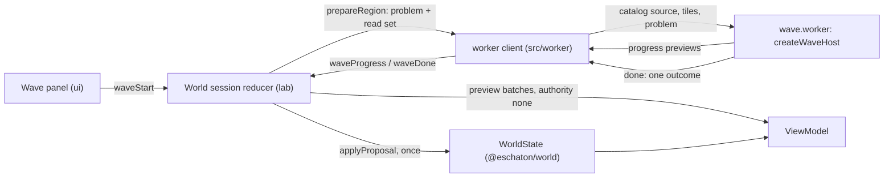
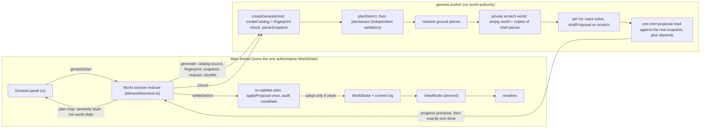

# Architecture overview (Phases 0–3)

This describes the code as it is on `main` after Phase 3 (`870ef62`, PR #4 merged): the Phase 0 foldon library, the Phase 1 runtime package `@eschaton/world`, the Phase 2 generation package `@eschaton/wave` and the Phase 3 district generator `@eschaton/genesis`, with their two Studio workers. It compares the code with the target architecture in [master plan §8](../master-plan.md). Decisions and their rationale live in the ADRs; this page links to them and does not restate them. The Phase 3 gate is still open ([`../phase-3-exit.md`](../phase-3-exit.md)). The plan's diagram shows runtime data flow, not imports; the diagram below shows both for the part that exists.

## What exists

Eight workspace projects. The first five are product code.

| Project | Package name | Role |
|---|---|---|
| `packages/foldon` | `@eschaton/foldon` | Pure TypeScript domain library: ids, `Result`, definitions, validation, geometry recipes and hinge posing, placement transforms, the P01–P09 catalog, assembly recipes, the catalog registry. No DOM, no three.js, no runtime dependencies. |
| `packages/world` | `@eschaton/world` | Phase 1 runtime state: an immutable `WorldState` (header, entities, bonds, lineage, conservation), the only write path `applyPatch` (atomic, strict base revision), replay from the commit log, canonical snapshots and hashes, invariant checks, and derived queries (occupancy, contacts). Imports only `@eschaton/foldon`. ADRs 0010–0014. |
| `packages/wave` | `@eschaton/wave` | Phase 2 generation: `src/solver` (pure placement-based WFC, imports foldon only), `src/region.ts` (world region → solver problem → inert proposal), `src/host.ts` (sliced, cancellable jobs). Holds no world state. ADRs 0015–0016. |
| `packages/genesis` | `@eschaton/genesis` | Phase 3 hierarchical generation: seeded semantic plan (`plan.ts`) with independent validators (`validate.ts`), district job over a private scratch world (`district.ts`), audit and single settlement (`audit.ts`, `settle.ts`), neighbour continuation, job host. Imports foldon, world and wave. Holds no world state. ADR 0017. |
| `apps/studio` | `@eschaton/studio` | Vite + React 19 laboratory: lab state, view-model building, the reference-scene generators, the renderer adapter, UI panels, and (Phase 1 M7) World mode, which renders a `WorldState` from `@eschaton/world`. |
| `experiments/wfc-placement` | `@eschaton/exp-wfc-placement` | Throwaway solver comparison. Nothing imports it. See [ADR 0004](../decisions/0004-multi-cell-encoding.md). |
| `tools/architecture` | `@eschaton/architecture` | Architecture test: lints virtual files against the repository ESLint config to prove each dependency rule rejects a violation. |
| `benchmarks` | `@eschaton/benchmarks` | Node benchmarks and profiles (`pnpm bench`, `profile:commit`, `profile:genesis`); recorded evidence lives in `benchmarks/phase-*/`. Nothing imports it. |

## Module table: now versus §8 target

| §8 module | Status | Where it lives | Notes |
|---|---|---|---|
| contracts | **Merged into foldon** | `packages/foldon/src/{ids,result,issues,vec}.ts` | Branded ids, `Result<T,E>`, `ValidationIssue`. No commands or transactions yet. ([ADR 0001](../decisions/0001-package-layout.md)) |
| foldon | **Exists** | `packages/foldon/src/` | Catalog, geometry recipes, assembly validation, canonical hashing, and (Phase 1 M3) the versioned socket table with the directional matcher `socketMismatches` ([ADR 0012](../decisions/0012-directional-sockets.md)). Owns definitions; does not own placement in a world. |
| generation | **Exists (Phases 2–3)** | `packages/wave/src/`, `packages/genesis/src/` (and `experiments/wfc-placement`, the 2D throwaway) | Wave: placement-based 3D WFC solver, region glue and job host ([ADR 0015](../decisions/0015-wave-solver.md), [ADR 0016](../decisions/0016-region-proposals.md)). Genesis: semantic plan, independent validators, district job, audit, settlement, continuation and job host ([ADR 0017](../decisions/0017-hierarchical-generation.md)). Each runs in its own Web Worker in the Studio. Neither holds world state. |
| simulation | **One explicit system, no tick** | `packages/world/src/systems.ts` | `runSystem` and `windFold` (Phase 1) read the `foldable` and `wind-responsive` components on explicit invocation. There is no clock, scheduler or system order; those are Phase 4 ([ADR 0007](../decisions/0007-component-data-and-system-order.md)). |
| world | **Exists (Phase 1, extended in Phases 2–3)** | `packages/world/src/` | Immutable `WorldState`, `applyPatch`, revisions and replay; region proposals (`readRegion`, `applyProposal`, `draftProposal`, `Proposal.depends`); no clock (Phase 4). The Studio's World mode holds one `WorldSession` and writes only through `applyPatch`/`runSystem`. Owner decision D4 approved the new package (ADR 0001 and ADR 0011 amendments). |
| renderer | **Inside the Studio** | `apps/studio/src/renderer/` | Adapter from `ViewModel` to three.js; the only code that imports `three`. ([ADR 0005](../decisions/0005-renderer-webgpu-tsl-webgl2-fallback.md)) |
| presets | **Absent** | none | The look palette and scene constants are code (`lab/look.ts`, `lab/palette.ts`, `lab/composition/`). |
| studio | **Exists** | `apps/studio/src/{App,ui,lab}` | Sends commands to the reducers; never mutates domain definitions or world state. World mode: `lab/world/`. |
| persistence / replay | **Snapshot and replay exist (Phase 1)** | `packages/world/src/{world,snapshot,patch}.ts` | `serializeSnapshot` and `parseSnapshot` (version-checked); `replay` re-applies recorded patches and reports the first divergence. No storage backend. |

## Dependency direction

The allowed import graph is enforced by ESLint (`eslint.config.js`: `no-restricted-imports` per directory area, plus `no-restricted-syntax` for class `extends`) and exercised by `tools/architecture` (`tools/architecture/test/architecture.test.ts`), which lints virtual probe files against the real config and asserts that a violating import is rejected and an allowed one accepted. The table below is read from `eslint.config.js` (`importAreas` and the purity rule sets `pureDomain`, `pureRuntime`, `pureGeneration`, `pureGenesis`, `solverCore`) as of `main` @ `870ef62`. Arrows point from importer to imported; the solid arrows are the imports that exist today.

The graph shows the intended direction. Only the "never" edges and the per-area restrictions in the table are lint rules; a solid arrow is allowed, not required (for example nothing lints that `ui` may import `worker`).

| Area (`eslint.config.js` `dir`) | May import | Must not import |
|---|---|---|
| `packages/foldon` | its own modules, workspace packages through their entry point | `three`, `react`, `react-dom`, Node built-ins (bare or `node:`), **any other `@eschaton/*` package** (the bottom of the graph, [ADR 0001](../decisions/0001-package-layout.md)), any app, experiment, tool or benchmark package |
| `packages/world` | its own modules, `@eschaton/foldon` entry | `three`, `react`, `react-dom`, Node built-ins, any `@eschaton/*` package except `foldon` (so not `wave` or `genesis`), any app, experiment, tool or benchmark package |
| `packages/wave` | its own modules, `@eschaton/foldon` and `@eschaton/world` entries ([ADR 0015](../decisions/0015-wave-solver.md)) | `three`, `react`, `react-dom`, Node built-ins, any other `@eschaton/*` package (so not `genesis`), any app, experiment, tool or benchmark package |
| `packages/wave/src/solver` (the solver core) | its own modules (`./…`), `@eschaton/foldon` entry | everything `packages/wave` forbids, plus `@eschaton/world` and any `../…` relative import other than `../solver` and `../solver/*` (so not the region glue `region.ts` nor the job host `host.ts`) |
| `packages/genesis` | its own modules, `@eschaton/foldon`, `@eschaton/world` and `@eschaton/wave` entries ([ADR 0017](../decisions/0017-hierarchical-generation.md)) | `three`, `react`, `react-dom`, Node built-ins, any other `@eschaton/*` package, any app, experiment, tool or benchmark package |
| `apps/studio` (all of it) | workspace packages through their entry points | `three` (re-allowed only in `renderer`), `@eschaton/exp-*` and tool packages, deep paths |
| `apps/studio/src/renderer` | `three`, `lab`, package entry points | `react`, `react-dom`, `ui`, `App`, `main` |
| `apps/studio/src/lab` | package entry points | `three`, `react`, `react-dom`, `ui`, `App`, `main`, `renderer` |
| `apps/studio/src/worker` | package entry points (including `@eschaton/wave` and `@eschaton/genesis`), `lab` | `three`, `react`, `react-dom`, `ui`, `App`, `main`, `renderer` |
| `apps/studio/src/ui`, `App`, `main` | `react`, `lab`, `renderer`, `worker`, package entry points | `three` |
| `experiments`, `benchmarks`, `tools` | workspace package entry points | any app, deep paths |
| every area above | other workspace packages only through the `exports` entry point | `@eschaton/*/<subpath>`, relative paths into `apps/`, `packages/`, `experiments/`, `benchmarks/`, `tools/` |

- **Packages never import apps, experiments, tools or benchmarks.** The list of names to forbid is read from each `package.json` under `apps/`, `experiments/`, `tools/` and `benchmarks/` when ESLint loads the config, so a new workspace package is covered without editing the config. A new layer inside the Studio needs a new entry in `importAreas`.
- **Composition over inheritance:** class `extends` is a lint error (`no-restricted-syntax`) in every first-party `.ts`/`.tsx` file. There are no exceptions today. A third-party adapter that genuinely has to subclass would get a dedicated config block for that file in `eslint.config.js` with a comment naming the dependency; interface `extends` is always allowed.
- **Tests:** every `*.test.ts` file additionally forbids relative `./` and `../` imports and the named import `vi` from `vitest`, so behavioral tests reach code only through the package entry point. This applies in every area, including `tools/architecture`, whose test imports only `vitest`, `eslint`, `typescript-eslint` and `node:` modules and lints virtual probe files.
- **Current direction:** `renderer` imports lab values (`look`, `palette`) and types; `ui` and `App.tsx` import `renderer/labRenderer` for `RendererStats` and the renderer factory. No import runs the other way.
- **Not enforced by lint (conventions):** that `new Worker(…)` appears only in `apps/studio/src/worker` (today it appears in `worker/client.ts` and `worker/genesisClient.ts`; no rule would catch a site elsewhere); that each worker file imports nothing but its package entry point (the rule only bars `three`, `react`, `ui`, `App`, `main` and `renderer`); that the genesis validators and audit share no code with the planner (a review convention, ADR 0017); dynamic `import()` and `require`; cycles inside one folder (there is no dependency-cruiser gate).
- Tests of `@eschaton/foldon`, `@eschaton/world`, `@eschaton/wave` and `@eschaton/genesis` import only package entry points. The Studio is covered by Playwright specs, not unit tests.

## Runtime data flow

Solid arrows are data or calls that cross a module boundary. The dotted arrow is the one place where the renderer reports back (frame statistics shown in the status bar); it carries no domain state.

## Data flow in words

1. **Catalog.** `defaultCatalog` (`packages/foldon/src/assemblies.ts`) runs `createCatalog` over the nine primitives and four assembly recipes at module load. The Studio's `loadLibrary()` turns the result into the item list; a validation failure renders a fatal error panel instead of the lab.
2. **State.** `App.tsx` owns `LabState` through `useReducer(labReducer)`: selected item, fold progress, crease overrides, overlays, look settings, camera mode, seed, reduced-motion flag, play state. UI components only `dispatch` commands.
3. **Posing and placement.** `lab/scene.ts` resolves the selected item. Assemblies are expanded with `catalog.flatten` into leaf placements; each leaf definition is posed at the current crease targets (`foldProgress`, then `poseGeometry`) once per definition, and the placements become per-instance affine bases (`lab/basis.ts` uses `placeGeometry` on a probe). The reference scene instead calls `composeReferenceScene(seed, …)`, which places the same definitions with arbitrary affine transforms and adds procedural sky, cloud and ridge panels.
4. **View model.** Everything the renderer needs is one immutable `ViewModel`: batches (posed geometry, instance bases, per-instance ink), sockets, footprint, bounds, camera preset, look and ink scale, a `layoutKey`.
5. **Renderer adapter.** `renderer.apply(viewModel)` rebuilds GPU content only when `layoutKey` changes (disposing the old meshes and geometries) and otherwise rewrites pose buffers in place. One `InstancedMesh` per batch; overlays and outlines are line batches. Frames are drawn only when something changed, unless `?continuous=1` is set for benchmarks.
6. **Feedback.** Per-frame `renderer.info` counters flow back to the status bar. No domain state flows back.
7. **World mode (Phase 1 M7).** The catalog's Scenes section has a **World** entry (`scene:world`). Ownership:
   - `@eschaton/world` owns the truth: `WorldState`, its revisions and the commit log records. The only writes are `applyPatch` (detach, re-attach) and `runSystem(windFold)`; a rejection leaves the state object unchanged and is shown as text.
   - `lab/world/session.ts` holds one `WorldSession` as pure data and a pure `worldReducer` (held by `App.tsx` through `useReducer`): the preset catalog, the `initial` world (seed `DEFAULT_SEED`, revision 0), the current `state`, the commit `log`, the selected `EntityId`, the last rejection, the wind slider value, the last replay result and the look-dev `offsets` toggle. The setup commit (`roof-module` at [0,0,0], a `leaf` at [3,0,0], a `P08` at [5,0,0]) is the first log record, so `replay(catalog, initial, log)` reproduces it too.
   - `homes` in the session maps a detached entity id to the pose it was detached from. It exists only so the UI can offer "Re-attach at previous pose"; it is **UI convenience, not domain truth**. It is never hashed or replayed; the re-attach itself is an ordinary `attach` op whose anchor and rotation are recorded in the log. Losing `homes` loses only the button.
   - `lab/world/view.ts` derives the `ViewModel` from the session: placed entities are posed with their own `fold` angles and placed with `basisOf(pose)`; detached entities use their `ContinuousTransform` (quaternion, position, uniform scale) as the basis; inventory and consumed entities are not drawn. Batches are grouped per definition, authority and fold pose, and labelled `authority: "logical" | "fragment"`; the reused sky, cloud and ridge generators become `authority: "none"` backdrop batches, and the viewport shows "Backdrop — not part of the world".
   - `lab/world/offsets.ts` derives decorative offsets from `(world seed, entity id)` only (ADR 0013 layer B). The envelope is zero by default; the "Decorative offsets (look-dev)" toggle switches to the illustrative ADR 0013 envelope (≤ 0.15 cell per axis, yaw ≤ 4°, pitch and roll ≤ 3°, scale ±8 % per axis), applied to placed entities only, about the footprint's base centre. Offsets are never stored in the session's world state and never enter `hashState`.
   - The renderer is unchanged and holds no world state: it receives a new `layoutKey` whenever the revision, the offsets toggle or the selection changes.
   - The Phase 0 catalog view and the reference composition are untouched and labelled look-dev in the catalog panel.

## Differences from the §8 target

- The authoritative world exists only in World mode. The catalog view and the reference composition still render definitions directly from `LabState` (look-dev).
- The renderer adapter takes whole batches, not patches. A patch protocol (§8 "Snapshot and patch") is not designed.
- The view-model builder in `lab/scene.ts` re-poses every definition on every state change that affects pose; it is cached only for the reference composition (per seed).
- Composition generators live in the Studio, so they are not reachable from the headless test seam ([ADR 0001](../decisions/0001-package-layout.md)).
- The Wave solver (Phase 2) and the Genesis district job (Phase 3) run in Web Workers (`apps/studio/src/worker`, [ADR 0015](../decisions/0015-wave-solver.md), [ADR 0017](../decisions/0017-hierarchical-generation.md)). Everything else still runs on the main thread, including every world commit, settlement and audit. That is the cost that grows with the world ([`../phase-3-exit.md`](../phase-3-exit.md) §5).
- There is no clock, scheduler or simulation package yet (Phase 4, not authorized).

## Test and measurement seams

- `packages/{foldon,world,wave,genesis}/test` — behavioural tests through the package entry points (lint-enforced).
- `apps/studio/engines` — the CI engines job: solver golden digest, preset catalog fingerprint, a generated district's state hash and real-worker cancellation, on Chromium, Firefox and WebKit.
- `apps/studio/e2e` — Playwright against the dev server (`pnpm e2e`), using `data-testid` hooks from the status bar and inspector.
- `packages/foldon/bench` and `apps/studio/bench` — benchmarks ([`../../benchmarks/`](../../benchmarks/)). `?continuous=1` and `?stress=N` are benchmark-only URL flags read by `lab/flags.ts`.

## Phase 2: generation data flow

- The worker never sees or changes world state. It gets plain data and returns placements.
- Previews are drawn and labelled "Solver preview — not part of the world". They are not entities, are not hashed and are not replayed.
- The world changes exactly once per successful solve, through `applyProposal`, and only if the region and its one-cell shell still hold what the solver was given.

## Phase 3: district generation data flow

### Authoritative world versus scratch world

| | Authoritative world | Scratch world |
|---|---|---|
| Where | The Studio session on the main thread (`WorldSession.state` and its `log`) | Inside one district job in the worker (`createDistrictJob`) |
| Contents | Every committed entity, bond and lineage record | An empty world with the same seed and catalog, plus copies (under new ids) of the pieces touching the district's one-cell shell |
| Written by | `applyPatch`, `runSystem`, `applyProposal` through `settleDistrict` (ADR 0011, 0016) | `draftProposal` per lot: the same validation as `applyProposal`, with no record and no hash |
| Lifetime | The session; replayable from its log | Discarded with the job; never logged, published or rendered |
| Why it exists | One source of truth (master plan §7.3) | So generation cost does not grow with the world ([ADR 0017](../decisions/0017-hierarchical-generation.md), "The scratch world is small") |

The job's result is still **one proposal read against the real snapshot** it was given. The scratch ids never leave the job.

### Pipeline and who enforces each step

1. **Semantic plan (2D):** river, roads with bridges, plaza, lots and roles from scoped seeds (`plan.ts`, `seed.ts`).
2. **Global validators:** `planIssues` (`validate.ts`) re-checks river continuity, gate-to-plaza connectivity, frontage and overlap without sharing the planner's code.
3. **Network pieces:** one ground Foldon per road, plaza, water and bridge cell.
4. **Local solver:** the wave solver fills one lot at a time with its role's tile set, around frozen neighbours. WFC knows nothing about roads or roles.
5. **Atomic proposal:** one `Proposal` for the district box, with `depends` (below).
6. **Settlement on the main thread (`settleDistrict`):**
   - checks the result's shape;
   - re-validates the plan;
   - runs `applyProposal` once (versions, read set, depends, write set, invariants);
   - audits the candidate state against the plan from scratch (`auditDistrict`).

   Only a clean candidate is adopted, and the world gains one revision.
7. **Rendering:** the view-model is derived from the committed state only. The plan map is labelled as the generator's semantic layer.

### Worker message contracts and where they are validated

| Message | Direction | Fields | Validated by |
|---|---|---|---|
| `generate` | session → genesis worker | `job`, `source` (catalog input), `fingerprint`, `snapshot` (`serializeSnapshot` text), `request` (preset, seed, `at`, optional continuation), `sliceMs` (12 in the Studio) | Host: `sliceMs` finite and ≥ 0; `createCatalog(source)` succeeds and its fingerprint equals `fingerprint`; `parseSnapshot` accepts the snapshot (schema, catalog, rules). Failure is one `done` with a `failed` outcome at stage `host`, never a throw |
| `cancel` | session → worker | `job` | Ignored unless that job is running; the next slice posts `cancelled` |
| `progress` | worker → session | `job`, `progress` (stage, plan preview, lots done) | Preview only. The session drops it unless the run is current |
| `done` | worker → session | `job`, `outcome` (`generated`, `failed` or `cancelled`), `timing` | `settleDistrict` takes `unknown` and checks the shape before anything else; a cancel requested on the main thread wins over a finished result. Worker crash or unreadable message: the client turns every open job into `failed` at stage `worker` |

The wave worker (`solve`/`cancel` → `progress`/`done`) follows the same pattern. Its host also checks `sliceNodes` and caches compiled tiles per fingerprint and tile set ([ADR 0015](../decisions/0015-wave-solver.md)). Messages are typed at compile time on both sides, but the worker does not validate the shape of an incoming `generate` beyond the checks above. Both ends are same-origin first-party code, and the main thread trusts nothing that comes back.

### Read sets and nonlocal dependencies

- **Read set:** the district box plus a one-cell shell. Its digest is FNV-1a over canonical JSON of the catalog fingerprint, the rules version, the conservation mode, the region, and the id, definition, anchor and rotation of every placed entity with a cell in the box or shell (`readRegion`).
  - Fold angles, bonds and detached fragments are **not** in the digest. That is enough for Phase 3; a simulation that re-solves next to damaged pieces will need structural state in the digest (a Phase 4 question).
- **`depends`:** a district that continues a neighbour (`continueFrom`) declares the first 12 cells of each neighbour road it attaches to, each as a one-cell region with its digest. `applyProposal` compares them like the read set. A change there is a `conflict`; an unrelated change in the neighbour is not ([ADR 0016](../decisions/0016-region-proposals.md), Phase 3 additions).
- **Comparison is by content, not revision** (ADR 0016, W4 amendment). A district commits after unrelated commits; an A → B → A change in its read set commits only if the contents are equal again.

### Catalog fingerprint compatibility

- The fingerprint hashes the canonical content of every definition, recipe, contract and the socket table. It is in every state header, every read-set digest and therefore every state hash. The worker refuses a catalog source whose fingerprint differs from the one the main thread sent.
- A snapshot or log from another catalog is refused as `catalog-mismatch` by `applyPatch`, `replay` and `parseSnapshot` ([ADR 0011](../decisions/0011-atomic-transactions-and-revisions.md), version policy).
- Stored recipe numbers lie on a 1e-9 grid so the fingerprint is the same on every engine. That changed the fingerprint of catalogs containing P03 or P09 once, in Phase 3 ([ADR 0017](../decisions/0017-hierarchical-generation.md), "Stored recipe numbers are engine independent"). The engines job pins the preset catalog fingerprint on Chromium, Firefox and WebKit.
