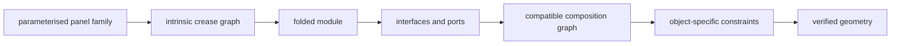

# Form construction method: a generic design procedure for any object (PROPOSED)

- Status: **PROPOSED. Not adopted.** Written under the owner's second ART-D3b ruling of 2026-11-27, which did not approve B-2 v5 and asked for a fix whose direction is "generic for all objects, not confined to the bird shape" ([decision packet](../review/art-1-raven-decision-packet.md) §0.1). Nothing here changes the adopted [Visual Bible](visual-bible.md) (ART-D2), the adopted [ART gates](../governance/art-quality-gates.md) (ART-D1) or the adopted [GEO gates](../governance/geometry-quality-gates.md). The amendments in §10 are **proposals** for the owner. If any of them is adopted, it is adopted by a separate owner decision.
- Version: **M3.1** (2026-11-28). It is the one bounded revision authorized by owner decision D-2 ([packet](../review/art-1-raven-decision-packet.md) §0.3), recorded on draft PR #14 and not adopted. It replaces §4.0, P1 and P7, adds the number classification in §6.0, and answers the M3 review's errata E1–E5 (§14).
  - **P1 and P7 are now conditional geometric diagnostics.** Each is measured against a target that the brief declares from the subject's function or form, before the artwork. Neither is a universal aesthetic pass or fail, and neither asks for shape variety for its own sake.
  - **No metric is required to label B-2 v5 ugly.** The rejection of v5 stands as a human result: the owner's ruling (§0.1) and the independent review (§7.2).
- The frozen **M3** text (2026-11-27, under the third ART-D3b ruling, §0.2) is kept in git at `8c2bd53`. That is the version the holdout check applied, and the holdout record is unchanged. Earlier versions are also kept: M1 `449406b`, M2 `09591cf` (§13.2).
  - The P1 and P7 numbers are in [`form-method-check.md`](form-method-check.md).
  - Geometry operators that could build what this method asks for are researched separately, in [`docs/research/geometry-operators.md`](../research/geometry-operators.md).
- What it is: a **design procedure**, a small **vocabulary**, and a set of **form principles**. Each principle comes with a pass example, a fail example and a **future** measurable diagnostic. It applies to concept artwork now and to geometry briefs later.
- What it is not: a new gate, a beauty score, a generator, a fixed anatomy, or a set of universal numbers. It claims nothing about foldability, collision, closure, thickness or structural support. Those stay with GEO-1, GEO-7 and the open questions Q1–Q6 and ADR 0019.
- Evidence base: the V2 and V3 lab bird and vehicle on draft PR #11 @ `616b0cf` (read-only), Concepts A, B, B-2 v3–v5 and C, and their independent reviews (packet §3, §7). The principles were derived from the **raven and vehicle** failures. The **building** and the **tree** were not used to derive them, and their studies came after the method's first commit. They are **not blind holdouts**: this text already gives building and tree examples (for instance a tiered roof, a branch collar), and the studies' before maquettes were built by the same author. They show that the procedure **can be carried out** on other categories; they do not show that the principles transfer blind ([studies](form-studies/README.md), round-1 method review B1).

## 1. The problem in one paragraph

Each attempt so far fixed what the last reviewer named, and each new version failed on something else. V3 had valid geometry and wrong forms. Concepts A and B-2 had good intent and kept failing on the same kinds of defects in different places: a plank arm, then a rectangular inner arm; a cylinder head, then a banded head; a rake hand, then fingers whose notches fall on one diagonal. The V3 car failed in the same way: a plank chassis, a tower cabin, wheels outside the body. The defects are not bird problems or car problems. They are the same few **construction habits** showing up in different subjects. Fixing the habit, not the symptom, is the generic fix.

## 2. Failure patterns and their mechanism

Each row is a defect that an independent reviewer named on actual pixels, grouped by the mechanism that produced it. The mechanism is read from the source that drew it.

Paths marked "PR #11" are on draft PR #11 @ `616b0cfd316522d038e804cab9eaf04bc715bb59` (read-only; `lab/` means `experiments/origami-lab/`, and `V3 record` means `docs/research/origami-lab-v3/gate-evidence.md`). The others are on `main`.

| # | Pattern | Seen in (category, version, view) | Mechanism in the construction | Why the existing checks let it through |
|---|---|---|---|---|
| F1 | **Homothetic sections**: every cross-section is one profile, scaled | raven: V3 "head and beak one cone, no neck" (V3 record line 14); B-2 v5 head banded from top and below, front body a block (packet §7.2, §0.1). vehicle: V3 "plank body without bonnet or cowl step … tower cabin" (V3 record line 14) | V3: the `band` module is "half of a homothetic frustum" (PR #11 `lab/src/v3/module.ts` lines 193–196); the bird body is five `keel` bands that differ only by radius, and every car `tub` band has scale 1 except the nose and tail (PR #11 `lab/src/v3/vehicle.ts` lines 98–106). B-2: `kit.loft` sweeps one five-point profile `PENT` through stations that change only width and height (`raven-concepts/source/c2f5_sumi_flight.py` lines 16 and 170–175). The V3 record states it: "Tuning cannot produce a neck from one homothetic section" (line 196) | Every numeric check is a landmark ratio or an ordinal radius check. V3's "nape waist" check is `r.nape < r.brow` on one radius per station, which a cone with a slight dip passes (PR #11 `lab/src/v3/bird.ts` lines 447–456). A scaled copy of one profile changes none of the ratios |
| F2 | **Parallel outline**: leading and trailing edges, or top and bottom edges, stay parallel | raven: V3 "rectangular arm" in the below view (V3 record line 155); B-2 v5 inner arm "close to a rectangle" from above (packet §7.2). vehicle: V3 plank chassis of constant thickness | V3: "the single rectangular arm plate" (V3 record line 197). B-2 v5: the planform comes from two separately tuned edge functions (`v_le`, `v_te`), and the chord only shrinks from about 0.40 L to 0.38 L (brief §10) | Arm : hand along the leading edge, span/L, wheelbase/length and height/length (PR #11 `lab/src/v3/vehicle.ts` lines 400–406) all pass for a rectangle and for a tapered form alike |
| F3 | **Unresolved junction**: two masses meet as a step or a ring, with no transitional plane and no stated reason | vehicle: V3 "Tower cabin, tray rear" (V3 record line 177), no cowl step. raven: B-2 v5 fingers "start abruptly after the rounded inner blades", a tail-root pinhole (packet §7.2) | V3: "a stepped cowl and a shaped cabin need the cabin to sit on a narrower body section than the hood allows today" (PR #11 vehicle brief, row 8). Parts are modelled separately and placed against each other; nothing says what happens **between** them | The brief lists segments (B-2 brief §4) and the review checks segments. Hood ratio is an x-extent and height ratio is max height over length, so a full-width tub with a tower cabin passes both |
| F4 | **Lines without a designed fold**: interior lines and tone bands whose position nobody decided | raven: B-2 v5 "lines marking no form change", head bands (packet §7.2); V2 crease roles assigned after the fact; V3 dashed ridge (bible §5) | B-2: Freestyle draws every edge whose dihedral exceeds 15° (`"crease": 165` in the spec; `kit.freestyle`), so every loft station can become a line. V2: an edge is labelled "join" or "crease" by its rest angle after the surface was cut (PR #11 `lab/src/v2/compile.ts` lines 316–323). The V3 dashed ridge is **undiagnosed** in its record (line 115); it is listed here as a line nobody designed, not as a proven sampling artefact | The bible's crease-meaning audit (§9) exists, but there is no declared list of creases to audit against |
| F5 | **Rake or comb series**: a repeated element with near-equal size, equal spacing and aligned ends | raven: V3 seed 7 "a five-tine rake" (V3 record line 172), V2 "primaries read as a rake up close", B-2 v5 near-hand widths nearly equal and notch steps on one diagonal (packet §7.2), Concept C "comb block". vehicle: V3 "fang grille", running boards that "read as loose planks" (V3 record lines 14, 176) | V3: every primary has the same width (`PRIMARY_WIDTH = 0.26`, PR #11 `lab/src/v3/bird.ts` line 77) on sockets of equal chord and fan step; fringe rows of equal tongues; two identical grille vanes. B-2 v5: one function with a linear ramp per parameter (`fingers` table, `c2f5_sumi_flight.py` lines 149–152). A linear ramp puts every end on one straight line | "Graduated" was checked as "the values differ". No check asked whether the series has a structure that the eye reads as layering |
| F6 | **Unintended negative space**: pinholes, slivers and gaps that nobody designed | raven: B-2 v5 tail-root pinhole, mouth and wrist slivers, v4 jaw gap (packet §7.1–§7.2). vehicle: V3 "fenders invisible from the side" (V3 record line 14), wheels standing proud of a plank | Separate parts placed with small offsets; their overlap is never stated | The silhouette test asks "does it read as the subject", not "is every hole designed" |
| F7 | **Shallow volume**: a primary mass that shows one or two tones from a principal view | raven: B-2 v5 shallow depth, block-like front body (§0.1); V2 "the back is still flat" (PR #11 V2 record line 98). vehicle: V3 plank in the side view | The mass is designed in the hero view. The orthographic views come from the same maquette, so they are **consistent**, but nobody designed what they show | ART-2.6 asks that views **agree**. One maquette guarantees agreement and says nothing about whether each view reads as volume |
| F8 | **Floating attachment**: a secondary element with no stated root, overlap or clearance | raven: B-2 v5 "tan tab at the hero wrist", "loose strips under the arm"; v4 floating sliver; V3 "thumb alula" (V3 record line 155). vehicle: V3 running boards as "loose planks" | Secondary parts are positioned by coordinates, not by a frame on their host | Nothing names a host, a root frame or a minimum overlap |

The building and the tree exist only in V1 (PR #11 `lab/src/objects/house.ts` and `pine.ts`), which the owner rejected as a whole ("ugly, coarse, simplistic", PR #11 `docs/research/geometry-quality-gates.md` line 4). They received no per-object review. They were **not** used to derive this method; they are not blind holdouts (see the status lines at the top).

### 2.1 Why the current workflow still lets bad form pass

1. **The checks measure landmarks, not the form between them.** Every numeric target so far (bible §9, concept README §E.0, the V3 windows, GEO-2.2 and ART-4.2) is a ratio of lengths between landmarks or an ordinal check on one radius per station. F1, F2, F3 and F7 all live between landmarks. A sedan and a brick with wheels can share a wheelbase ratio.
2. **The construction tool decides the form.** A loft with one profile makes F1. A crease-angle line renderer makes F4. A per-element linear ramp makes F5. The bible names the bad outcomes (§5) but nothing makes the author decide sections, junctions, creases and series **before** the tool decides them by default.
3. **Fixes follow symptoms.** Each round answered the reviewer's named defects (D1–D6, then the v4 list). The rounds removed the alula, reduced head rings from six to four, and narrowed the chord a little. Each answer reduced a symptom and kept the habit, so the defect reappeared in another view or another part.
4. **Views are rendered, not designed.** The hero is designed; the top, underside and front views are by-products. F1 and F7 are visible mainly in those views, so they are found last, by the reviewer.
5. **There is no artefact for the in-between.** A sheet shows the object, not its section program, its junctions, its creases or its series. A reviewer can see that something is wrong without the author having had a place to decide it.
6. **"Varies" is not "is structured".** A ramp satisfies "graduated", "each has its own width" and "fans", and still reads as a comb.

The method below closes these gaps with **decisions recorded as design artefacts**, not with more gates.

## 3. What is universal and what is not

Generic does not mean the same shape for every object, and it does not mean universal numbers. The method separates four layers. Only the first one is generic.

| Layer | Owns | Examples | Where it is recorded |
|---|---|---|---|
| **U: universal geometric relationships** | how masses, sections, junctions, series, envelopes and edges relate, whatever the subject | "a section changes shape, not only size, where the function along the mass changes"; "a junction is continuous or a stated break"; "a series has a structure, not only different values" | this document, §5 and §6 |
| **S: subject grammar** | which parts the subject has, in which order, how they connect, what they are for | raven: bill–head–neck–body–tail spine, wing tracts; car: wheelbase, wheels, arches, bonnet, glasshouse; building: base, walls, roof, openings; tree: trunk and branch generations | the Visual Bible §8 and the object's brief |
| **A: art direction** | the plane language and style | Concept B's few large folds; woodcut ink; austere close-ups | the Visual Bible §4 and the selected concept |
| **P: per-subject constraints** | numbers and functional limits for one subject or variant | raven: four fingers P6–P9, span/L about 2.0; car: wheel and track sizes, ground clearance; building: storey and door heights; tree: two or three generations | the brief and, after ART-D3c or its equivalent, ART-4 tolerances |

A principle in §6 may only use layer U. When it needs a value, the value comes from layers S and P of the object, and the principle says where. **A principle that only makes sense for a bird is bird tuning and does not belong in §6.**

## 4. Vocabulary

The smallest set of words needed to describe any object's form. Each word names something that must be **decided**, and each decision is recorded on the brief or the sheet.

| Term | Meaning | Decided as |
|---|---|---|
| **Mass** | a primary volume that carries the gesture (body, hull, trunk, tower). For P1 and P7, one mass is the run of a spine **between two declared junctions** (P3) or ends. A mass that is built as one loft but crosses a declared junction is two masses | its spine (a curve), its landmarks along the spine, its section program and its **kind** |
| **Kind** | **solid** (encloses a volume), **sheet** (a surface whose section is a curve: a plate, a leaf, a door) or **sparse** (members whose envelope carries the mass: a branching crown, a lattice) | from layer S, before modelling (§4.0). Each kind has its own P7 measure; none is an exemption |
| **Function program** | the stations along a mass's spine where the subject's function changes (raven: forehead, crown, nape, neck, breast, back, vent, tail root) | from layer S with its source, before modelling; confirmed by a reviewer (§4.0). An empty program is a claim about the subject, not a choice |
| **Section program** | how the cross-section changes along a mass: **aspect** (height to width), **peak** (where the highest point sits across the width), **camber or tumblehome** (how the sides lean or bow), **fill** (how boxy or pointed), and **size** | a short table of keyframe sections at landmarks, each with its shape and the reason for it |
| **Outline** | the plan and elevation edges of a mass or a limb (planform, profile) | edge curves with their convergence (taper) and their breaks at landmarks |
| **Landmark** | a named point or line where the form or the function changes (nape, wrist, bonnet line, eave, fork) | its position and its role, from the subject's anatomy or function (layer S), named before modelling. Planes break at landmarks, or at a structural fold with a stated role (a hem, a rachis, a pleat, a camber line), and nowhere else |
| **Junction** | where two masses, or a mass and a limb, meet | **C** (continuous: a shared plane or a tangent flow) or **B** (a stated hard break with a reason, plus a transitional element or a deliberate overlap) |
| **Envelope** | the outer shape a group of parts fills. The **positive envelope** carries the silhouette landmarks; a **negative envelope** is a designed gap (finger slots, wheel arches, eave shadow, branch gaps) | listed per view; any gap not listed is a defect |
| **Tract** | an ordered series of similar secondary elements (feathers, shingles, roof tiers, windows, branches) | the series law: size, orientation, spacing and overlap as functions of position, its **grouping** and its **terminations**, and whether it is a deliberate tessellation |
| **Attachment frame** | the root of a secondary element on its host: a position, an orientation and an overlap or clearance | which host, where, how much overlap, how much clearance through the articulation range |
| **Edge** | one of five kinds (§4.1) | declared per edge or per panel boundary |
| **Scale tier** | hero (more than 400 px), mid (96–48 px), district (24–12 px), as in bible §6 | the smallest tier at which each element must read |

### 4.0 When a declaration is legitimate (M3.1)

A **declaration** is any statement that changes what a principle asks of an element. Examples:
- a kind (§4);
- a function program, or an empty one;
- a mass partition (rule 7);
- a junction class (C or B);
- a P1 or P7 target;
- a deliberate tessellation, or a set of functionally equal elements (rule 8);
- a hidden surface;
- a fold;
- a scale tier.

A declaration is legitimate only if **all** of the following hold.

1. **Reason.** It names its reason in the subject's grammar or function (layer S) or in the approved art direction (layer A), citing the source: a reference, or a bible clause. A drawing tool, a modelling convenience or a diagnostic's outcome is never a reason.
2. **Before the artwork.** It is written in the brief in a commit that is a strict ancestor of the first commit containing the artwork or geometry it governs. This is the same rule as GEO §1.8 and ART-1.5.
3. **A late change is a new brief version, and it invalidates evidence going forward.**
   - Any change to a declaration after the artwork exists is a **new brief version** with a new identifier. It is committed before any artwork that relies on it.
   - Evidence made under the earlier declaration may not be **reused** for a later version, for the elements the change affects: read-outs, views and reviews. For that version the evidence is `NOT VERIFIED` until it is made again under the new declaration (GEO §1.10, ART §2.5).
4. **No change backwards.** The verdict already recorded for an earlier version stays exactly as recorded (GEO §1.13). A declaration added or changed later, in particular after a diagnostic or a reviewer has flagged that version, never changes it.

   *Rules 3 and 4 do not conflict. Rule 3 governs the evidence that later versions may use; rule 4 protects the record of earlier versions.*
5. **Independent confirmation.** A reviewer who did not author the brief confirms each declaration against layer S or A **before** relying on it, and may reject it.
6. **Prohibitions.** No declaration may:
   - **reproduce a bible §5 anti-pattern that nobody intended.** For example, a raven limb may not be declared a prismatic plank (its function changes along it); an accidental series may not be declared a tessellation or a set of functionally equal elements; a heraldic spread may not be declared a pose. An intentional functional prism or box, declared with its reason under owner decision D-4a, is not the extruded-slab anti-pattern (bible §5, as clarified on draft PR #14);
   - **hide something visible.** "Hidden" is measured, not asserted. A surface is hidden only if its visible projected area is zero in **every required view of the sheet at every required scale tier**, the hero tier included. A surface that shows in any one of them is visible;
   - **exempt anything from geometric truth or visual judgment.** No declaration exempts a panel from GEO-1 planarity, convexity or the crease and hinge structure, and it cannot redefine rigidity: a fold must be an edge in the crease map, a "bend" whose angle defect or dihedral exceeds the allowance is a fold or a seam (P4), and a hinge must articulate about a shared edge (GEO-4.2). No declaration takes any element out of the truthful visual judgment of the reviewers (ART-2, GEO-2);
   - **be broader than its element.** A tessellation, for example, covers one named field inside one named envelope.
7. **Mass partition (answers E1 and E3).**
   - **Classify every functional landmark.** The brief classifies each functional landmark on a spine, with its layer-S reason, as either:
     - a **station inside a mass**: a change of function within one continuous part;
     - a **junction between masses**: the subject names two parts with distinct functions there, and the design intends a seam or a stated break with a transitional element (P3).

     The geometry must agree. A junction is a seam or a stated break in the crease map. A station is not.
   - **Report the sensitivity.** Every P1 and P7 read-out is reported **twice**: under the declared partition, and with the whole spine as one mass. If the two disagree, the read-out is `partition-sensitive`. It then decides nothing in either direction, and the reviewer judges.
   - This removes the incentive to declare a junction at every station: a partition chosen to change a read-out cannot change a verdict.
8. **Functionally equal elements (owner decision D-4a).**
   - **What may be declared.** A set of elements may be declared **functionally equal** when the subject's function makes them equal: the same job at different stations, for example wheels, tuning pegs, frets, or a row of identical windows. The declaration names the elements and the source of the function. P5's rake flags are then expected and are not defects.
   - **What P5 still asks.** P5 still asks for:
     - placement and spacing that follow the function (for example, frets follow the scale length, and pegs follow the strings);
     - a designed envelope for the group.
   - **What may not be declared.** An **accidental rake** may not be declared functionally equal (rule 6). That means a series whose subject does not make its members equal, such as feathers, branches or roof tiers.

A declaration that fails any test is void, and the principle applies as if it had not been made. This rule is prospective. Records made under M1, M2 and M3 keep their verdicts (GEO §1.13).

**Symmetry (owner decision D-4b).**
- Mirror-symmetric geometry is allowed. P1 treats a bilaterally symmetric mass with the mirror as its admissible frame change, and no principle here asks for asymmetric geometry.
- Gesture, pose and the composition of a view or scene are judged separately, by the reviewer, under bible §4.1.3, which governs pose and not geometry.

### 4.1 Edge taxonomy

| Kind | What it is | Inked? | Typical meaning |
|---|---|---|---|
| **Boundary** | a free edge of a sheet, or the silhouette | yes | outline, trailing edge, eave, hem |
| **Fold** (mountain or valley) | a designed crease between two planes of one sheet, at a landmark | yes, if its dihedral is visible at the scale drawn (§6, P4) | forehead break, bonnet line, ridge, roof hip |
| **Hinge** | a fold that articulates | yes | shoulder, wrist, door, branch collar (a held pose only) |
| **Seam or joint** | where two modules meet | yes, if visible; a hard break is shown, a continuous joint may read as one plane | wing root, cabin to body, roof to wall |
| **Tessellation edge** | an edge created only to triangulate a plane or to approximate a gentle bend in one sheet | **never** | none: it must have no form meaning |

The rule that follows: **every visible line is a boundary, a fold, a hinge or a seam, and is declared.** A tessellation edge between non-coplanar faces is either a fold (then declared and justified) or a bend inside one panel (then the panel must be developable, §6 P4). There is no third option.

## 5. The procedure

The steps are done in this order. Steps 1–6 happen **before** modelling. Steps 7–8 happen on the model. The depth scales with the object's largest scale tier (P9): an object seen at hero scale needs every artefact; an object seen only at district scale needs steps 1, 5 and 8 (landmarks, envelopes, the read at scale) and may skip the rest.

| Step | Decide | Artefact |
|---|---|---|
| 1. Gesture and landmarks | the pose or stance, the spine of each mass, and the named landmarks along it (layer S) | a side and top gesture drawing with landmarks |
| 2. Section program | for each mass, keyframe sections at its landmarks, each a **different shape** where the function differs, with the reason | a **section strip**: the keyframes drawn in a row at one scale |
| 3. Outline | for each mass and limb, the plan and elevation edges and where they converge or break | a **planform and profile overlay** with the edges and landmarks |
| 4. Junctions | for each meeting of two parts: C or B, the reason for B, the transitional element or overlap | a **junction table** |
| 5. Envelopes and tracts | the positive envelope per view; the declared negative envelopes; for each tract, its series law, groups and ends, or a statement that it is a deliberate tessellation | an **envelope and tract diagram** |
| 6. Edges | which panel boundaries are folds, hinges, seams or boundaries; which panels may bend | a **crease declaration map** |
| 7. Model and check | build the maquette from steps 1–6; run the diagnostics of §6 as aids | renders plus the diagnostic readouts |
| 8. Read at every view and scale | each orthographic view and each scale tier, judged against steps 1–6, before any review | the sheet (ART-1 checklist) plus the four artefacts above |

The procedure does not prescribe a construction tool. It prescribes that the tool may not decide sections, junctions, series or lines by default.

## 6. Principles, examples and future diagnostics

Each principle is a layer-U relationship. Each diagnostic is an **aid**: it finds candidates for a reviewer, it does not pass or fail anything, and it is not a beauty score. The thresholds are **proposed starting values** with their reasons, and §6.0 labels the kind of each number. None is adopted. Each would need its own counterexample and negative control under GEO §1.9 before any use as a test.

### 6.0 What kind of number each value is (M3.1)

Every number in this section is one of three kinds. It is labelled as such wherever it is used.

| Kind | Meaning | Examples |
|---|---|---|
| **Data** | measured on committed geometry or keyframes with a stated method and bound; anyone can recompute it ([`form-method-diagnostics/`](form-method-diagnostics/README.md)) | P1 `d`; the measurement floor `ε_m`; P7 `D_v`, `c` and `λ`; P5 coefficients of variation; P6 hole areas |
| **Unmeasured assumption** | a perception or tolerance value that nobody has measured on viewers. It may guide a reviewer's attention. It decides nothing | P2 width ratio 0.85–1.15; P4 8° line visibility (a bound from a shading model, not a measurement); P4 2° defect allowance; P5 0.08 and R² 0.98; P6 2 px at 400 px and 1.5 px at 96 px. **The M3 "p = 2 px" visibility constant of P1 and P7 is withdrawn** |
| **Reviewer judgment** | what a person sees on the actual views at the required scales, under the neutral treatment (bible §4.6) | whether a section change, a depth, a series or a line reads; the v5 "banded head" and "block" |

A read-out that would need an unmeasured assumption to reach a verdict reports `NOT VERIFIED` and leaves the verdict to the reviewer.

### P1. Section program matches its declared targets (M3.1)

A solid mass's sections change profile where the brief, from the subject's function, says they change, and stay one profile where it says they stay one. P1 is a **conformance read-out against declared targets**, not a demand for variety.

- **Declared targets.** For each pair of consecutive declared stations, the brief states one target with its layer-S reason, before the artwork (§4.0):
  - **`change`**, saying what changes. For example: "the back rounds into the neck"; "the bonnet flattens into the cowl".
  - **`constant`**, saying why. For example: a turned vessel, a lighthouse, a fuselage of circular section, an extrusion, or a prism justified under D-4a.
- **Read-out (data):**
  - `d`, the profile distance: Hausdorff distance between the normalised section boundaries. The normalisation and frame are as in M3: bounding box to [−1, 1]², minimised over the mirror for symmetric masses and over rotation for asymmetric ones.
  - `ε_m`, the measurement floor: coordinate rounding, or the station tolerance when sections are sliced from a mesh.
  - `Δ_L = d · s`, in model units, where s is the smaller half-extent.
  - `Δ_px` at every scale tier at which the brief requires the section form to read.
- **Conformance.**

  | Target | `d > ε_m` | `d ≤ ε_m` |
  |---|---|---|
  | `change` | **conforms**: the declared change exists | **does not conform**: the declared change is absent. This is F1, the mechanism of B-2 v5 |
  | `constant` | **does not conform**: the declaration is not true of the geometry | **conforms** |

  No pixel threshold enters the verdict. Whether a change that exists is **visible** at a tier is reviewer judgment on the actual views at that tier. `Δ_px` is the evidence offered for it.
- **Not applicable:** sheets, sparse forms, a mass with fewer than two declared stations, and equality **across** elements, which is P5's subject (§4.0 rule 8).
- **Not verified:** a station pair with no declared target, which includes every brief written before M3.1; and a read-out that is `partition-sensitive` (§4.0 rule 7).
- **Why the M3 rules were wrong** (numbers: [check](form-method-check.md) §9):
  - *Turned and extruded objects* (E3). A turned vessel has one circular profile at every function change, so `d = 0` (computed: 0.000). M3 failed it as a "scaled profile family". It is a correct `constant` program.
  - *Shallow masses.* `Δ_px = d · s_px`, and `s_px` is proportional to the mass's smaller half-extent. A pixel threshold therefore fails a **shallow** subject for being shallow: the holdout biwa's sourced shoulder change gives `d` = 0.139 but only `Δ` = 1.33 px at the hero lower bound. That reflects the subject's proportions, not a defect.
  - *Tier coupling.* `s_px` depends on the whole object's largest extent. A wing spread or folded changes it without touching the mass (P7, below).
  - *Prisms and aspect changes.* A prism and an aspect-only family both give `d = 0` (computed: 0.000 for a 2 × 0.5 → 1 × 1.5 rectangle). The prism is `constant` by declaration. The aspect-only family conforms only if the brief declared it `constant`. v5 declared function changes along its spine, so its program is F1.
- **B-2 v5, as a read-out only.** All 45 keyframe pairs give `d = 0.000` (data). The v5 brief declared stations but no P1 targets, so under M3.1 its conformance is `NOT VERIFIED`, and M3.1 changes no recorded verdict (§4.0 rule 4). The v5 rejection is the owner's and the reviewer's visual result; the read-out is consistent with it and decides nothing.

### P2. Outlines converge or break with purpose

The plan and elevation edges of a mass or limb converge (taper), diverge or break at landmarks. Parallel edges over a long run are a decision, not a default.

- **Fail:** B-2 v5 inner arm from above, chord 0.40 L to 0.38 L, near rectangle. V3 arm plank. V3 car chassis slab of constant thickness in side view.
- **Pass:** an arm whose root is broad and which narrows to the wrist, with the leading edge bowing forward; a car body whose sill line rises toward the tail and whose roof line falls into the boot; a tower whose walls step back at each tier.
- **Future diagnostic: convergence.** For each outline pair, the root-to-end width ratio and the angle between the edges, sampled between landmarks.
  - Scope: limbs and masses longer than about twice their width.
  - Counterexample: a functional rectangle (a door, a window, a shipping container, a slab tower in the reference image). The brief declares it; the variation then lives in the next level of the hierarchy.
  - Threshold rationale: a width ratio between 0.85 and 1.15 over a run longer than twice the width is the proposed flag. Below about 15% change, the convergence of a 100 px edge is about 15 px over its length, which is within the range people read as "parallel" in a quick glance. This is a perception estimate to be checked on the studies, not a measured fact.

### P3. Every junction is continuous or a stated break

Where two parts meet, either a plane or a tangent flows across (C), or there is a stated hard break (B) with a reason and a transitional element or a deliberate overlap.

- **Fail:** V3 car cabin as a box on a slab (front view a tower); B-2 v5 fingers starting abruptly after rounded inner blades; B-2 v5 tail root pinhole.
- **Pass:** a windscreen and A-pillars that carry the bonnet line up into the roof (C); a beltline step that is a stated break with a shoulder plane (B); a raven nape fold that is a stated break from crown to neck (B); inner primaries whose trailing edge continues the secondaries' line into the fingers (C).
- **Future diagnostic: junction table and step ratio.** For each junction, the change of section size divided by the length over which it happens. A step ratio above 1 (the change is larger than the distance it happens over) must be a declared B. The ratio applies along a spine, between consecutive masses (head to neck, bonnet to cabin, tier to tier). It does not apply where a limb leaves a mass (a wing root, a branch base): those are attachments, judged under P8.
  - Scope: every junction between masses, and between a mass and a limb.
  - Counterexample: a designed overhang (eaves, a cantilevered floor, a raven tail past folded wings) is a B by design and passes when declared.
  - Threshold rationale: 1 means the change happens over a distance no longer than its own size, which reads as a step from every view. The value is geometric, so it does not depend on scale; whether the step is visible does, and that is judged at the declared scale tier.

### P4. Planes break at landmarks; lines are declared

A plane break, and therefore a line, sits at a landmark and is declared in the crease map. Between landmarks a surface is one plane or one developable bend. Tessellation edges are invisible.

- **Fail:** B-2 v5 head rings at sampling stations, read as bands from top and below; lines on the fingers and the side-view wing that mark no form change; V3 dashed ridge.
- **Pass:** a raven head built from a crown plane, a forehead plane, two cheek planes and a nape fold; a car bonnet as one gently bent sheet with two declared folds at the shoulder lines; a roof as tiers whose eaves are the lines.
- **Future diagnostics.**
  - *Undeclared fold count:* edges between non-coplanar faces whose two faces lie in one declared panel and whose dihedral is above the bend allowance. Proposed flag: any.
  - *Developability of a bent panel:* the angle defect at each interior vertex of a declared bent panel (360° minus the sum of the face angles). Paper bends without stretching only where the defect is near zero. Proposed allowance: 2° per vertex, about the error of hand-placed maquette vertices. A larger defect means the panel is doubly curved and needs folds. This is a maquette aid and not a GEO-1 proof.
  - *Bends over the allowance are flags (M3).* An edge inside a declared bent panel whose dihedral exceeds the bend allowance, or a vertex whose defect exceeds 2°, is reported as an **undeclared fold**, the same as the first item, and not as a separate read-out. The bend allowance itself is still undecided (§12.1, S8).
  - **No production representation.** Foldon panels are planar within 1e-6 (GEO-1.1), so in production every bend is a fold. A bent panel is a concept-drawing device only. Before GEO-0.5 it must be rewritten as declared folds, by the operators in [`geometry-operators.md`](../research/geometry-operators.md) §3, or a curved-panel kind must be decided by the owner (outside Q1–Q6).
  - *Line visibility:* a declared fold whose dihedral is below about 8° is flagged as a line that marks almost no form change. Rationale: under one key light, the tone difference between two faces is **at most** about the sine of their angle: about 14% of the full tone range for 8°, about 5% for 3°. The real difference is smaller when the light is not across the fold, so 8° is a lower bound for a fold that may show, not a guarantee that it does. The value is an estimate; the studies used it as a read-out only.
  - Scope: all panels of the maquette or the model.
  - Counterexample: a deliberate graphic line on a flat plane (a painted stripe) is not allowed by GEO-2.5 anyway. A crease scar after Rebirth (bible §2) is a declared, faint line with a stated meaning.

### P5. A series has a structure, not just different values

A tract of similar elements has a series law: size, orientation, spacing and overlap change with position, with grouping and with designed ends. A linear ramp of every parameter is a rake with a gradient.

- **Fail:** V3 primaries (equal, coplanar, equally spaced); B-2 v5 near hand (nearly equal widths, notch steps on one diagonal); Concept C comb; equal roof ribs; a tree whose branches are equal sticks at equal angles.
- **Pass:** primaries that group into broad inner blades and slotted fingers, with the longest feather off-centre (P6/P7), overlap that tightens toward the wrist and notches that do not line up; a roof whose tiers shrink by a progression, whose eaves curve up at the corners and whose top tier is a different element (the finial); a tree whose branch length and angle change by generation and whose branches are not evenly spaced.
- **Future diagnostics.**
  - *Rake flag:* for a tract of four or more elements, the coefficients of variation of width, spacing and angle step. Proposed flag: all three below about 0.08, and no overlap. The 0.08 has **no measured basis**: B-2 v5's fingers have a width variation of 0.19 and were still read as nearly equal in the hero view, where foreshortening hides the differences (§12). Treat the value as a placeholder.
  - *End alignment:* a straight-line fit through the element ends or notch points, for four or more points. Proposed flag: R² above 0.98. **Known limit (§12):** this did not flag B-2 v5, whose notch points give R² 0.15 in the wing plane and 0.77 in the hero view, although the v5 reviewer saw them "on one diagonal". A replacement was tried and withdrawn (§12): it flagged the graduated progressions that bible §4.3 asks for. No working end-alignment diagnostic exists yet; the reviewer's eye is the only check.
  - *Grouping:* at least two groups that differ in kind (for example broad blades and slotted fingers; a roof body and a finial; trunk-like and twig-like branches) where the subject grammar (layer S) says so.
  - Scope: tracts of secondary elements.
  - Counterexample: a **deliberate tessellation**, such as a corrugated roof or a tile field. **M3 narrows this to bible §4.3:** it is allowed only where the subject itself is corrugated or tiled, as layer S says with a source. It must also meet three conditions:
    - it is declared under §4.0;
    - it covers one named field inside one named shaped envelope (P6);
    - P4 line visibility still applies to it (study finding S5).

    Under those conditions P5's flags are expected and are not defects. A pattern chosen for construction convenience on a subject that is not corrugated is **not** a tessellation; it is the repeated-noise anti-pattern (bible §5).
  - **Functionally equal elements (M3.1, owner decision D-4a).** This is a second route, separate from tessellation. Four wheels, four tuning pegs, frets or a row of identical windows are equal because the subject's function makes them equal. They are declared under §4.0 rule 8.
    - The rake flags then fire **by design** and are not defects: the holdout's four pegs give coefficients of variation of exactly 0.
    - What remains to judge: placement and spacing follow the function, the group has a designed envelope, and the reviewer judges the read.
  - **Equal against accidental.** An equal series is acceptable when the subject calls for equality. A rake is an equal or ramped series that the subject does **not** call for, such as feathers, branches, roof ribs or the V3 primaries. The rake flags cannot tell the two apart; the declaration and its reason can, and an independent reviewer confirms the reason.

### P6. Every gap is designed

The positive envelope carries the silhouette landmarks. Every negative space is declared (finger slots, wheel arches, the space under eaves, the gaps between branches). Any other hole or sliver is a defect at the scale where it shows.

- **Fail:** B-2 v5 tail-root pinhole and mouth and wrist slivers; v4 jaw gap; V3 car wheels with daylight between wheel and body.
- **Pass:** finger slots that open toward the tips; wheel arches cut into the body around the tyres with a stated clearance; deep eaves that cast a designed band of shadow; branch gaps that frame the sky.
- **Future diagnostic: silhouette topology.** On the filled silhouette of each view at hero and mid scale, list every hole and every thin feature. Proposed flags: a hole larger than 2 px at a 400 px height that is not on the declared list; a feature thinner than 1.5 px at 96 px height that is not a declared tertiary element.
  - Scope: all views on the sheet.
  - Rationale (*unmeasured assumptions*, §6.0): 2 px at 400 px is 0.5% of the object's height, offered as the smallest gap that is consistently visible at hero scale; 1.5 px at 96 px is offered as the width below which a part breaks into dots when downsampled. Neither was measured on viewers. A hole that the reviewer sees on the actual views is a defect whatever its size.
  - Counterexample: a deliberate lattice or tracery (a window grille, the slots between fingers) is declared and passes.

### P7. Declared depth targets are met where they apply (M3.1)

The depth that the brief declares for a mass, from the subject's references, is present in the geometry. P7 compares **proportions in model units** with **declared targets**. It does not measure visibility in pixels, and it does not judge whether a view reads as volume: that is reviewer judgment on the actual views, under the neutral treatment, at every required view and scale.

- **Declared targets.** Per mass, and before the artwork (§4.0), the brief states a target value, a tolerance and the layer-S or layer-P source. Without a declared target, P7 is `NOT VERIFIED` for that mass. That is not a fail.
- **Read-outs by kind (data):**
  - **Solid: depth ratio** `D_v`, in each principal view v = extent of the mass along v ÷ the smaller of its two in-view extents. It is measured on the mass's own geometry in model units, so it does not depend on other parts or on the drawing size. It conforms if it lies within the declared tolerance.
  - **Sheet: camber** `c` = the largest distance from the chord plane ÷ the chord, per declared section, against the target. A cambered arm needs `c > 0`; a door may have `c = 0`.
  - **Sparse: envelope ratio** `λ3 / λ1`. The axes are the eigenvectors of the covariance of the members' end points. The `λ_i` are the **extents** (maximum minus minimum) of the end points projected on those axes, not eigenvalues; this resolves the M3 ambiguity. It conforms within the declared tolerance.
- **Single-section distance `e_v`: demoted to an informative read-out.**
  - Meaning: "one slice explains this view's outline". That is a property, not depth.
  - It may be reported. It never passes or fails anything.
  - The reasons, computed in [check](form-method-check.md) §9:

    | Case | `e_v` | What it shows |
    |---|---|---|
    | v5 body | 0.000 L | depends on the partition |
    | v5 head and body as one mass | 0.017 L = 3.4 px | the same bird passes |
    | v5 with its first body station only raised by 0.03 L | 2.95 px | measures an offset, not depth |
    | Nested sections, a torpedo or an egg | exactly 0, whatever the profiles | |
    | v7 body | 1.66 px, but 3.5 px when the same body is drawn with folded wings | the pixel value depends on unrelated parts |
- **B-2 v5 front body.** The "two-tone block" and "shallow depth" are the owner's and the reviewer's visual results (packet §0.1, §7.2). M3.1 offers no read-out that claims to reproduce them, and none is required (D-2).
- **Not applicable:** secondary elements (P5, P8). An end view along a spine whose program is declared `constant` is a section by construction, and that is a truthful view.
- **Limits.**
  - No full B-2 mesh is committed, so no `D_v` for v5–v7 is computed.
  - No brief so far has declared a P7 target. Every P7 conformance to date is therefore `NOT VERIFIED`.

### P8. Every secondary element has an attachment frame

Every secondary element has a host, a root frame on that host, a stated overlap (for a covering element) or clearance (for an articulated or rotating one), and a reason.

- **Fail:** B-2 v5 tan tab at the wrist and loose strips under the arm; v4 floating sliver and alula; V3 car wheels with no arches.
- **Pass:** a covert leaf rooted on the arm's leading band and overlapping half the secondaries; a wheel inside its arch with a stated clearance; a roof tier sitting on its wall plate with a stated overhang; a branch with a collar at the fork.
- **Future diagnostic: attachment audit.** For each secondary element: its host, the overlap length as a fraction of its own length, and the minimum clearance to every neighbour through the articulation range. Proposed flags: no host; overlap below the value the brief states; clearance below zero.
  - Scope: every secondary element.
  - Counterexample: a deliberately detached element in Collapse (bible §7) is a state change, not a defect, and is shown as one.

### P9. Each element has a scale tier

Each element is assigned the smallest scale tier at which it must read (bible §6). An element that does not read at its own tier is removed or redesigned; one that only adds noise at a larger tier is simplified there. This principle adds the **assignment** to bible §6 and §4.2. It does not restate them.

## 7. Construction dependency chain

The method shapes what a later construction contract would build. The order of dependencies is:

| Link | Exists today | Open |
|---|---|---|
| Panel family | No. Foldon definitions are immutable and concrete; a parameterised family is Q3 | Q3 |
| Crease graph | Yes, as a **tree** rooted at a root panel, with the fold-angle convention in `AGENTS.md`. Closed networks are out of scope. Panels are planar | Q4 for closed shells (raven head and body, car body, tower, tree trunk and limbs); bent panels are an open question outside Q1–Q6 (above) |
| Folded module | Yes: a Foldon definition folded by `poseGeometry` angles (GEO-4.1) | — |
| Ports | Lattice placement (quarter turns about +Y) and the socket table. Non-axis seams are not decided | Q1 (non-axis seams), Q2 (a non-folding `join` edge) |
| Composition graph | Experimental only, on draft PR #11: edge and section ports, `checkContract` rejections with reasons, `detach` and `attach` that keep instance and definition ids, a reuse table and provenance (PR #11 `lab/src/v3/assembly.ts`). Not production | Q5 (object grammar in Genesis) |
| Object constraints | Not implemented. The method's §5 artefacts are their design-side source | — |
| Verified geometry | GEO-1 certificates exist only for the V3 lab, under their stated assumptions | GEO gates per object |

How the method maps to the chain:
- **Section programs and outlines** (P1, P2) become parameters of a mass family and its keyframes. They are not one profile swept.
- **Junctions** (P3) become typed ports with a continuity class: C ports must share an edge or a plane; B ports carry the transitional element.
- **Edges** (P4) become the crease graph. Only declared folds are creases. **Open:** Foldon panels are planar and convex (GEO-1.1), so every panel boundary is a crease. A bent panel, as the maquettes draw it, has **no Foldon representation today**: it would have to be approximated by a few declared folds (each then a real crease), or a curved-panel kind would have to be decided. This question is outside Q1–Q6 and is not decided here.
- **Tracts** (P5) become a family plus a series law evaluated by the composition, not by one instance repeated at a constant pitch.
- **Envelopes** (P6) and **volume** (P7) are global constraints of the object, checked separately from local port compatibility (GEO-7.4).
- **Attachment frames** (P8) are the ports themselves.

### 7.1 Reuse: when a family is justified

| Level (GEO-7.5) | Justified when | Not justified when |
|---|---|---|
| (a) shared helper (`loft`, `tri`) | always allowed as a tool | never as evidence of reuse, and never as the source of the form (F1, F4) |
| (b) shared family | the elements do the **same structural job** with the same port types and overlapping parameter ranges | the shapes look alike but the jobs differ (a fang grille is not a feather) |
| (c) same concrete definition | the same job, the same size class, and the same port, in more than one place | it is placed only to pass GEO-7 (decorative reuse). V3's short vane, shared by the alula and the grille slats, was "judged decorative in both rounds" (V3 record line 202) |

Candidate families that the studies test (proposed, not proven):
- **Cover vane**: an overlapping, load-free covering element in a tract, with a root port and an overlap. Raven coverts and rectrices; roof shingles and tier eaves. The job is the same (shedding and layering); the series law differs per subject.
- **Hem**: a folded-over free edge that stiffens and thickens a boundary. Wing leading edge; wheel-arch lip; eave fascia. Same job.
- **Section shell**: a closed or open mass built from keyframe sections. Raven body; car body; tower tier. Same job (enclosing a volume), but each subject needs its own keyframes, so the reuse is of the family, never of the concrete definition.
- **Object-specific template**: the raven head and bill, the car glasshouse, a pagoda's finial. Reuse is not justified; making them a family would be decorative.

### 7.2 Identity, detach and reassemble

Every module instance keeps its definition id and its instance id when it is detached and re-attached (GEO-7.8). The method adds one requirement on the design side: each tract and each junction says **which instances detach as a unit** in Collapse (bible §7). A tract that detaches element by element and one that detaches as a whole are different designs.

### 7.3 Local and global constraints

| Constraint | Kind | Owner |
|---|---|---|
| Port type, edge length class, orientation | local | the port contract |
| Overlap and clearance (P8) | local | the port contract, checked per attachment |
| Section program, outline, junction classes (P1–P3) | global per mass | the object's constraints |
| Series law (P5) | global per tract | the tract's constraints |
| Envelopes, volume, silhouette (P6, P7) | global per object | the object's constraints |
| Declared edges (P4) | global per object | the crease graph |

### 7.4 What WFC or a grammar can and cannot guarantee

- **Can:** local adjacency (a port fits a port), finite catalog choices, and that a stated constraint eliminates a candidate (GEO-7.4, GEO-3.6). Counts and order (four fingers, two or three branch generations, tiers in decreasing order) only once an object grammar exists (Q5); today's wave solver places district tiles, not object parts.
- **Needs a geometric proxy:** P6 (silhouette) is defined on rendered views. The generation packages have no renderer (`AGENTS.md`), so a future global constraint would need a geometric proxy, such as a projected-outline test on the built geometry. M3's P7 is already defined on geometry, by slices and projections, and needs no renderer.
- **Cannot, unless encoded as an explicit global constraint and checked:** that a section program changes shape with purpose, that junctions read continuous, that a series is structured rather than a ramp, that the silhouette has no undesigned holes, and that a view reads as volume. Local compatibility is satisfied by the V3 car, which fails all five.
- **Never:** foldability, collision, closure or thickness. Those need GEO-1 evidence.

## 8. Transfer across categories

**M3 holdout.** A category never used in this method's derivation, examples or studies is selected independently, after M3 is frozen, and the frozen procedure is applied to it at design level: [`form-studies/holdout/`](form-studies/holdout/README.md). The earlier studies follow.

The [design studies](form-studies/README.md) apply §5 to the raven (organic, articulated), a vehicle (mechanical, solid), a building (architectural, tiered) and a tree (branching). The building and the tree were not used to derive the principles, but they are not blind tests (see the status lines at the top). The [cross-object matrix](form-studies/README.md#transfer-matrix-round-2) shows, per principle, the application in each category, the reusable relationship or module family, or the reason reuse is not justified, and the proof still needed.

## 9. Distinctions

| Kind of thing | In this proposal | Status |
|---|---|---|
| Artwork | the design-study sheets and the next B-2 sheet | concept; `NOT VERIFIED` until reviewed and decided |
| Design method | §3–§6 | proposed; not adopted |
| Mathematical research | the diagnostics' definitions and threshold reasons | proposed starting values; none has a counterexample test yet |
| Engine | nothing | no package, app or Foldon change; Geometry V4 is not authorized |

## 10. Proposed amendments (for the owner; not applied)

These are offered as a reviewable diff. None is applied to the adopted documents by this proposal.

1. **Visual Bible §4**, new subsection "4.7 Construction of form": one paragraph that points to this method's §5 procedure and §4 vocabulary as the way to reach §4.1–§4.4, without restating them.
2. **Visual Bible §5**, four anti-pattern rows: *homothetic sections* (F1), *unresolved junction* (F3), *sampling lines* (F4, which refines "meaningless line" by its cause), and *aligned series* (F5, which refines "planar rake").
3. **Visual Bible §9**, the crease-meaning audit gains its input: "against the declared crease map (method §4.1)".
4. **ART-1 sheet checklist (ART §5)**, four optional evidence items: section strip, planform and profile overlay, junction table, crease declaration map. They are **evidence views**, not new criteria. The ART-2 criteria stay as they are.
5. **GEO-0.3 and GEO-0.5 (reading note only, no change to the criteria):** a brief may cite this method's artefacts as its shape language and its crease and seam plan.

No threshold in §6 is proposed for adoption. Any later use of a diagnostic as an automated check would be a change to the GEO standard and would need the owner, a counterexample and a negative control (GEO §1.9, §1.12).

## 11. Future implementation acceptance and test plan

Only if the owner later authorizes Geometry V4 or an equivalent. Nothing here is implemented.

| Diagnostic | Public seam (future) | Promise | Negative control |
|---|---|---|---|
| P1 profile distance (M3.1) | an object-evaluation entry point that receives a built object and its brief | a station pair whose declared target is `change` and whose `d ≤ ε_m` is reported; a `constant` pair whose `d > ε_m` is reported; a pair without a target is `NOT VERIFIED` | `diag(w_i, h_i) · P` through stations declared `change` must be reported (v5 mechanism); a turned vessel declared `constant` must not; a 20 × 12 m shaft declared `constant` under D-4a must not; a `constant` declaration on a body whose profiles differ must be reported |
| P2 convergence | same | a long limb with parallel edges and no declaration is reported | a rectangle must be reported; a declared door must not |
| P3 junction step ratio | same | an undeclared step above ratio 1 is reported | a box placed on a slab must be reported; a declared eave overhang must not |
| P4 undeclared folds and developability | the crease graph and the panel list | an undeclared non-coplanar edge inside a panel is reported; a bent panel with angle defect above the allowance is reported | a pentagon loft with no declared folds must be reported; a cylinder strip (developable) must not |
| P5 rake and end alignment | the tract description | a tract with equal widths, spacing and angle steps, or with collinear ends, is reported unless declared a tessellation | four equal blades must be reported; a declared corrugated roof must not |
| P6 silhouette topology | the capture script (GEO-5.3) | an undeclared hole at hero scale is reported | a pinhole made on purpose must be reported |
| P7 depth ratio, camber, envelope (M3.1) | the built geometry (no renderer needed) | a mass whose `D_v`, `c` or `λ3/λ1` lies outside its declared tolerance is reported; a mass without a declared target is `NOT VERIFIED`; `e_v` is reported only as information | a biwa body declared shallow from its source must not be reported; a body built deeper than its declared tolerance must be; the same body drawn at another size must give the same `D_v` |
| P8 attachment audit | the composition graph | a secondary element without a host, or with negative clearance in its range, is reported | a free-floating blade must be reported |

Each threshold would follow GEO §1.9: unit, object scale, reason, a counterexample just beyond it, and a negative control. Tests would follow `AGENTS.md`: the public seam only, no mocks, one cause and one outcome per test. The diagnostics report; they do not accept. GEO-2, GEO-5, GEO-7 and ART-5 stay human and owner decisions.

## 12. Change log and findings from applying the method

The method was committed in `449406b`, before any study or B-2 v6 artwork. Changes after that commit are listed here with their evidence. None was made to fit the building or tree studies, but the round-2 P7 exemption for declared prismatic masses answers the box case that the building raised (round-2 review).

| Date | Principle | Change | Evidence | Category it came from |
|---|---|---|---|---|
| 2026-11-27 | P5 end alignment | **First revised, then withdrawn.** The revision (measure in the judged view; flag a regular monotone progression) was fitted to one example, was never computed, and would flag the graduated tier progressions bible §4.3 asks for (round-1 review M1). Restored to the original straight-line test, with its known limit stated | v5 notch points: straight-line R² 0.15 in the wing plane, 0.77 in the hero view; the reviewer still saw one diagonal ([B-2 v6 brief](raven-concepts/b2-v6-flight-brief.md) §11, round v6-6). B-2 v6's non-monotone finger notches were a design choice made after seeing this result; they are not evidence for any diagnostic | raven (derivation) |
| 2026-11-27 | P6 silhouette topology | No change. Reproduced a reviewer finding: v5 tail-root pinhole, 86 px² at 400 px height | B-2 v6 brief §11, round v6-5 | raven (derivation) |
| 2026-11-27 | P4 line visibility | No change. Found seven declared folds under 8° on the first v6 maquette, each a line that marked almost no form change | B-2 v6 brief §11, round v6-3 | raven (derivation) |
| 2026-11-27 | P5 rake flag | No change, but a limit is recorded: v5's near-hand widths have a coefficient of variation of 0.19, above the proposed 0.08, yet the reviewer read them as "nearly equal". Foreshortening in the judged view hides the differences. The width test, like end alignment, should be measured in the judged view; this is not yet tested | B-2 v6 method board, series panel | raven (derivation) |
| 2026-11-27 | read-out tool | `formkit.diagnostics` gained, during the studies, a fold-only filter for the under-8° check (seams are cuts and need no dihedral) and a `hidden` list that leaves declared hidden surfaces out of the bend and defect counts and reports them apart. Neither was in the method text. The building's soffit was wrongly classed as hidden: it is visible under every eave (round-1 review M4). It is counted as visible from round 2 on | `docs/art/form-studies/source/formkit.py`; studies README | tool |
| 2026-11-27 (round 2) | P1, P3, P4, P7, §4.0, §5, §7 | P1 descriptors defined in the rest frame, aspect not counted; P3 limited to spines; P4 rationale stated as a bound; P7 rescoped to two values plus line, prismatic masses exempt; §4.0 declaration test added; §5 depth by scale tier; §7 bent panels as an open question, §7.4 counts and order depend on Q5 | round-1 method review M2, M3, M6, M7 and minors (packet §9.2) | review |
| 2026-11-27 (M3) | P1, P7, §4.0, P4, P5, vocabulary | Changes:<ul><li>P1 is restated as a profile distance in the declared frame, with aspect removed, a measurement floor and visibility at the hero lower bound;</li><li>P7 is restated per kind: single-section distance for solids, camber for sheets, envelope depth for sparse forms; no plane counts;</li><li>§4.0 is non-retroactive, with new brief versions, invalidation, independent confirmation and prohibitions;</li><li>bends over the allowance are P4 flags, and bent panels are stated to have no production representation;</li><li>P5's tessellation clause is bound to bible §4.3;</li><li>"mass", "kind" and "function program" are defined.</li></ul>No artwork was drawn to fit these changes | Old and new principles compared against v5, v6, v7, a rectangular shaft, equal repeated elements, a planar sheet and a sparse crown ([`form-method-check.md`](form-method-check.md)) | owner's third ruling (packet §0.2); the M2 review (packet §9.4) |
| 2026-11-28 (M3.1) | §4.0, §6.0, P1, P5, P6, P7, §11, §13.1 | Changes:<ul><li>§4.0 rules 3 and 4 are reconciled: evidence is invalidated going forward, and the record never changes backwards;</li><li>"hidden" is checked in every required view at every required tier;</li><li>no declaration exempts anything from GEO-1 or from visual judgment;</li><li>rule 7, the declared mass partition with a sensitivity report;</li><li>rule 8, functionally equal elements (D-4a);</li><li>symmetry under D-4b;</li><li>§6.0 labels each number as data, an unmeasured assumption or reviewer judgment, and withdraws the 2 px constant from P1 and P7;</li><li>P1 becomes conformance to declared `change` or `constant` targets;</li><li>P7 becomes declared depth targets in model units, with `e_v` demoted to information;</li><li>P5 gains the equal-against-accidental distinction.</li></ul>No artwork was drawn. No threshold was set after an outcome; the controls were computed on the M3 definitions to show why they fail | reproducible read-outs and controls in [`form-method-diagnostics/`](form-method-diagnostics/README.md); [check](form-method-check.md) §9 | owner decisions D-2, D-4a and D-4b (packet §0.3); M3 review E1–E5; holdout findings |

### 12.1 Findings from the building and tree studies (recorded, not applied)

The building and the tree were designed with the method as committed in `449406b`. Their findings are listed in the [studies README](form-studies/README.md#findings-recorded-the-principle-text-is-not-changed-for-holdouts) (S4–S7, S10–S13) and are **not** written into §3–§11. *Correction after the round-2 review:* round 2 of the studies used the method as revised in `09591cf`, and the round-1 review had already shown the holdouts were not blind. In short:
- S4: §4.1 should say that a boundary is a free edge of a sheet, never a T-junction inside one plane.
- S5: P5's tessellation exception does not exempt P4 (line visibility).
- S7, a new candidate rule from the tree: a declared fold keeps its sign along its length, or it is split where the sign changes.
- S10: the declared-prismatic counterexample of P1 and P2 transferred as written.

Two limits apply to every category: P4 gives no numeric bend allowance for a bent panel (the studies used 20° as a maquette parameter; S8), and P7 has no read-out (S9). P6 detects enclosed holes only (S3, from the vehicle).

### 12.2 Open after the round-2 review (not fixed; the work stopped here, packet §9.5)

*M3 status of these items:*

| Item | M3 status |
|---|---|
| P7 and P1 passing their own fail examples | **addressed** in M3 (§6 P1 and P7; [check](form-method-check.md) §6) |
| §4.0 test 2 | **replaced** by the non-retroactive rule |
| Bends over the allowance | **now P4 flags**; the allowance itself is still open |
| Owner questions | carried into §13.1 |

The original list follows unchanged.

- **P7 and P1 pass their own fail example.** The round-2 P7 (two plane families at 8°) passes B-2 v5's two-tone front block. The round-1 wording (three at 20°) flagged boxes. Neither version is right. The bible §4.5 citation is a misreading: §4.5 is about two values plus line as a drawing style, not a minimum for reading a solid. P1's side lean depends on aspect, so aspect comes back in, and ε has no unit. On the committed data, v5's fill (0.706) and shoulder height (0.632) are constant.
- **§4.0 test 2** lets a declaration be added after a diagnostic fires. That conflicts with GEO §1.8. Declarations are not confirmed by anyone, and nothing forbids a declaration that reproduces a bible §5 anti-pattern.
- **Bends over the allowance are reported, not flagged as P4 undeclared folds.** The allowance itself is undecided (S8).
- **Owner questions:** whether a slab tower may be exempted against bible §8 ("towers taper and break"), and how broad a declared tessellation may be against bible §4.3.

## 13. Consistency with the adopted documents, and method versions

### 13.1 Visual Bible against this proposal

The bible is adopted and is not changed here. Where it and this proposal could disagree, the bible stands until the owner decides otherwise.

| Topic | Bible (adopted) | This proposal | State |
|---|---|---|---|
| Slab towers | §3 records slab towers in the reference image; §8 says "towers taper and break" | P1 `constant` target for a prismatic shaft, declared under §4.0 | **answered by D-4a** (owner, 2026-11-28; recorded on draft PR #14, not in force on `main` until a merge): prismatic and box forms are allowed when function and art direction justify them; the bible now says so in §5 and §8 on this branch. *Earlier state:* open question O-1 |
| Tessellation | §4.3 allows equal parallel creases only where the subject is corrugated, "such as a roof" | P5's tessellation clause is narrowed to the same condition (M3) | **resolved** by aligning to the bible. The broader M1/M2 wording is withdrawn |
| Asymmetry | §4.1.3: asymmetry and gesture beat symmetry (pose and silhouette) | symmetric geometry allowed; pose and composition judged by the reviewer (§4.0, symmetry) | **answered by D-4b** (owner, 2026-11-28; draft PR #14): asymmetry is not mandatory, and geometric symmetry is judged separately from gesture, pose and composition; the bible §4.1.3 clarification says so on this branch. *Earlier state:* open question O-2 |
| Bent panels | §7: "no surface should bend where there is no crease" | P4: a bent panel is a concept device with no production representation; bends over the allowance are flags | **consistent, with an open item:** a curved-panel kind is outside Q1–Q6 and undecided |
| Two values plus line | §4.5 is a drawing style | M1/M2 cited it as a minimum for a solid; M3 no longer does | **resolved** (the citation is withdrawn) |

### 13.2 Method versions and what used them

| Version | Commit | Used by | Note |
|---|---|---|---|
| M1 | `449406b` | B-2 v6 brief and sheet; round-1 studies | the v6 brief §1, §3, §6 and §8 cite M1's P1, P5 and P7 |
| M2 | `09591cf` | the B-2 v7 target (brief §12; it inherits M1 citations, packet §9.6) and round-2 studies | the round-2 sheet banners say "as committed in `449406b`", which is false for round 2; superseded by packet §9.6, and the images are unchanged |
| M3 | `8c2bd53` (frozen) | no artwork; the frozen holdout check (§8) | not adopted; reviewed NEEDS REVISION (§14) |
| M3.1 | the M3.1 commit on PR #14 (packet §11) | no artwork | not adopted; one bounded revision under D-2, with one independent re-review (packet §11) |

**Stale captions stay as reviewed records.** The images are unchanged and the notes in packet §9.6 supersede them:
- the v7 method board's "mildly doubly curved" sentence;
- the round-2 study banners;
- the round-2 vehicle read-out figures.

No historical file is overwritten.

## 14. Independent review of M3 and errata (2026-11-27)

The frozen M3 at `8c2bd53` was reviewed by a separate agent, which recomputed its numbers. **Verdict: NEEDS REVISION** (packet §10.2). The text above is kept unchanged as the frozen, reviewed version; the following supersede it where they conflict.

| # | Where | Erratum | Status |
|---|---|---|---|
| E1 | P7 | P7 does **not** reject v5 under the frozen rules. v5 declared a nape fold, not a junction, so it is one mass and passes with `e_v` = 3.4 px. The method lacks a rule for a fold inside a mass against a junction between masses ([check](form-method-check.md) §8) | **addressed in M3.1** by §4.0 rule 7 (declared partition, sensitivity reported, a partition-sensitive read-out decides nothing). P7 no longer claims to reject v5; v5's rejection stands as the human result (D-2) |
| E2 | P7 | Single-section distance does not measure visible depth. It passes a raised station with no profile change, and it fails any body whose sections nest inside the widest one (also found by the holdout) | **addressed in M3.1**: `e_v` demoted to information; P7 compares declared depth targets in model units (P7) |
| E3 | P1 | Turned and extruded objects with one profile at every function change fail wrongly. The mass split can empty a program | **addressed in M3.1**: P1 is conformance to declared `change` or `constant` targets; the partition rule 7 removes the escape |
| E4 | §4.0 rules 3 and 4 | Contradictory as written. The **intended** reading is narrower: an earlier version's verdict stays as recorded and is never changed by a later declaration (GEO §1.13); evidence made under an old declaration may not be **reused** for a new version. "Hidden" is measured at the **hero** tier in every sheet view, never at a smaller declared tier, because a surface visible at hero size is visible | **addressed in M3.1** (§4.0 rules 3, 4 and 6: every required view at every required tier, hero included) |
| E5 | §13.1 and P2 | Adopted bible §5 lists "Extruded slab: constant-thickness prism" as an anti-pattern. §4.0 rule 6 would then void the empty-program declaration for a prismatic shaft. P2's "slab tower in the reference image" counterexample prejudges O-1. **Both are added to owner question O-1** | **answered by D-4a**; §4.0 rule 6 now exempts only an intentional, declared functional prism |
| E6 | P4 | "A larger defect means the panel is doubly curved and needs folds" is wrong. Folding never changes angle sums, so a vertex with angle defect needs a **cut or seam** (two sheets), not a fold | corrected here |
| E7 | §12 intro | Mentions "the round-2 P7 exemption", which M3 replaced | stale, superseded |
