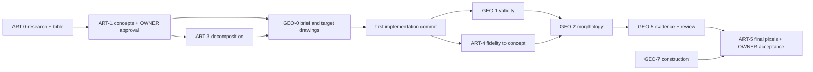

# Art quality gates (ART-0 … ART-5): adopted standard

- Status: **ADOPTED** by owner decision **ART-D1** on 2026-11-27. The owner adopted the **rules**; no concept, model or verdict is approved by that decision. Decision record: [`docs/review/art-1-raven-decision-packet.md`](../review/art-1-raven-decision-packet.md) §0 (the owner's explicit message relayed in the 2026-11-27 handoff, recorded by the agent; it is not a GitHub human review and not a cryptographically verified identity).
- In force: repository-wide once this file and the matching section in `AGENTS.md` are merged into `main`. Enforcement is by review against this document. **No automated enforcement exists** and none was added: no CI job reads this file and no repository ruleset changed.
- History: drafted as `docs/governance/art-quality-gates-proposal.md` on PR #13 against `main` @ `583d563`; renamed here on adoption. The text of §1–§6 is unchanged by adoption.
- Relationship: these gates **complement** the adopted [geometry quality gates](geometry-quality-gates.md) (GEO-0…GEO-7). They do not replace, weaken or reinterpret any GEO rule. Where the two could be read differently, GEO wins until the owner says otherwise.
- Prefix: `ART-` is not used by any other label set in the repository (GOV, CL, GEO, G, W, D, R, C and P3D are taken).
- Scope: any new or changed **visible object design** (creatures, vehicles, architecture, plants, props) intended for production or presented for visual acceptance.
- Out of scope: phase gates, ADRs, merges, Q1–Q6, ADR 0019, and every construction contract decision. Those stay with their own processes (GOV-1: merge, gate, ADR, visual, next-phase authorisation and release are separate decisions).
- Design reference: the adopted [Visual Bible](../art/visual-bible.md) (ART-D2).

## 1. Why

V1, V2 and V3 optimised technical validity before the design existed. V3 passed its own geometry certificate for 25 variants, yet failed GEO-2 on morphology.

GEO-0 already requires a brief and target drawings before code. It does not require that those drawings be **good**, that the owner **approved** them, or that the implementation **stays** faithful to them. ART fills those three gaps.

## 2. Rules for every ART gate

These mirror GEO §1 so that both standards read the same way.

1. **Three verdicts:** `PASS`, `FAIL` or `NOT VERIFIED`. Each one names its evidence: a commit SHA for implementation evidence, and a **file SHA-256** for concept artwork. Anything not evidenced is `NOT VERIFIED`.
2. **No averaging and no scores.** A failing hard criterion fails the gate. There is no beauty score, and diagnostics (silhouette at size, landmark ratios) are aids, not verdicts.
3. **No self-approval.** The author of a concept or implementation may self-assess. Human [H] verdicts need a reviewer who did not make the artwork or code. An independent verdict is a **recommendation**.
4. **The owner decides.** Concept approval (ART-1) and final visual acceptance (ART-5) belong to the owner alone, and each is recorded with:
   - the decision identity (who);
   - the source (the message, comment or document, with a link);
   - the date;
   - the exact artwork files and digests.

   Approval is never inferred from a request for work, from silence, from green tests, or from a reviewer's recommendation.
5. **Material changes invalidate approvals.** A change to an approved concept's silhouette, proportions, form hierarchy, pose or plane language returns its ART-1 approval to `NOT VERIFIED` until the owner re-approves. This rule extends GEO §1.10 to concepts. Re-rendering identical content does not count; the digest records it.
6. **Provenance.** Every reference cites its title, author, URL and use or licence status, and says whether it is verified or unverified. No external artwork, mesh or traced geometry enters the repository. AI-generated imagery, if ever used, is labelled as such and never counted as reference.
7. **Experimental work is labelled.** Concept maquettes, labs and studies say "concept" or "experimental" on every image and claim nothing beyond their evidence.
8. **Four decisions stay separate.** ART-1 approval is not ART-5 acceptance, and neither is a GEO verdict, a merge, an ADR decision or a phase authorisation (GOV-1).

## 3. The gates

### ART-0: Research and Visual Bible alignment

| # | Criterion | Kind | Hard |
|---|---|---|---|
| 0.1 | The subject is studied from real sources: anatomy or function, plus at least one craft (folding or construction) reference and one Eschaton reference. Each is cited with provenance (§2.6) | H | yes |
| 0.2 | The Visual Bible principles relevant to the subject are named: silhouette features, hierarchy, plane language, scale behaviour | H | yes |
| 0.3 | Variant identity is stated, for example "Common Raven, adult", and kept distinct from look-alikes (crow) | H | yes |
| 0.4 | Known anti-patterns for the subject are listed, including any from earlier failed attempts | H | no |

### ART-1: Concept selection and owner approval (before the first implementation commit)

| # | Criterion | Kind | Hard |
|---|---|---|---|
| 1.1 | At least two genuinely distinct concept directions, differing in plane language or construction idea, not in seed or shader | H | yes |
| 1.2 | Each concept has a sheet: hero, consistent turnaround, close-ups of the key parts, silhouettes on light and dark fields, a district-scale test, annotated landmarks, and pose intent | H | yes |
| 1.3 | Independent visual review of the actual sheet pixels against the ART-2 checklist, with findings by part and view | H | yes |
| 1.4 | **Owner decision recorded** (§2.4): approve, select, revise or reject, naming the exact sheet digests | H (owner) | yes |
| 1.5 | The approval commit, or the decision record, is a strict ancestor of the first implementing commit (the same rule as GEO §1.8) | A (git) | yes |

Small, isolated feasibility research is allowed before ART-1, for example folding one candidate module in an experiment. **Object implementation is not.**

### ART-2: Composition, silhouette, proportion and hierarchy assessment

Apply this to concepts, under ART-1.3, and again to implementations, under ART-4.

| # | Criterion | Kind | Hard |
|---|---|---|---|
| 2.1 | Reads as the stated subject and variant from three-quarter, side and front/top, in neutral material and in pure silhouette | H | yes |
| 2.2 | Signature features survive at 48 and 24 px on a light and a dark field, with context props hidden | H | yes |
| 2.3 | Clear primary, secondary and tertiary hierarchy; tertiary detail changes recognition or it is removed | H | yes |
| 2.4 | Proportions match the stated targets; anatomy or function is believable | H | yes |
| 2.5 | Free of the Visual Bible §5 anti-patterns (plank, rake, slab, voxel, heraldic spread, meaningless line, repeated noise, shader rescue) | H | yes |
| 2.6 | Turnaround views agree with the hero | H | yes |

### ART-3: Decomposition into construction (proposed vs proven)

| # | Criterion | Kind | Hard |
|---|---|---|---|
| 3.1 | The approved concept is decomposed into a semantic part graph and candidate modules, creases and ports, explaining why each module exists and what it is reused for | H | yes |
| 3.2 | Every construction claim is labelled **proposed** or **proven**, citing the proof for proven claims (GEO-1 certificates, folded-sheet tests). Foldability, collision, closure, bonds and thickness are `NOT VERIFIED` until evidenced | H | yes |
| 3.3 | Dependencies on open owner decisions (Q1–Q6, ADR 0019) are listed, not assumed | H | yes |
| 3.4 | Trade-offs where construction would force a deviation from the concept are documented **before** implementation. A forced deviation needs re-approval under ART-1 | H | yes |

ART-3 feeds GEO-0.5, GEO-0.6 and GEO-7. It does not satisfy them.

### ART-4: Implementation against the approved concept

| # | Criterion | Kind | Hard |
|---|---|---|---|
| 4.1 | The implementation is captured at the same views as the approved sheet, under GEO-5.1 neutral conditions and the stated scale | A + H | yes |
| 4.2 | Landmark ratios measured on the built geometry fall inside the **tolerances declared at ART-1** (GEO-2.2 measures them; ART-4 compares them with the approved concept) | A | yes |
| 4.3 | Side-by-side comparison with the approved sheet, per view; any drift is listed | H | yes |
| 4.4 | Drift beyond tolerance, or any change to silhouette or hierarchy, is either fixed or sent back for owner re-approval. It is never accepted silently | H | yes |

### ART-5: Final visual acceptance

| # | Criterion | Kind | Hard |
|---|---|---|---|
| 5.1 | An independent reviewer inspects the **final pixels**, captured after the last visual change (GEO §1.10), against ART-2 and the approved concept | H | yes |
| 5.2 | The ink and material look is reviewed separately from the neutral-geometry review. The look does not rescue the form | H | yes |
| 5.3 | Owner final visual acceptance is recorded (§2.4) | H (owner) | yes |

## 4. Order and dependencies

- The approved ART-1 sheets **are** the GEO-0.4 multi-view targets, plus the numeric targets and tolerances. ART-3 supplies GEO-0.5 and GEO-0.6 inputs.
- ART-4 and GEO-2 share evidence. GEO-2 asks whether the result is recognisable and balanced; ART-4 asks whether it is the approved design.
- ART-5 comes after GEO-5. Production still needs every applicable GEO gate (GEO §1.11). An ART pass never substitutes for a GEO pass.

## 5. Checklists

**ART-1 sheet checklist**
- [ ] Hero
- [ ] Front, side and top views, plus the underside for flight or the back for a perched pose
- [ ] Head, limb and tail close-ups
- [ ] Silhouettes on light and dark fields
- [ ] District strip at 96, 48, 24 and 12 px
- [ ] Hierarchy diagnostic
- [ ] Ink context study
- [ ] Landmark annotations
- [ ] Pose intent
- [ ] Target ratios
- [ ] Status banner ("concept, not approved")
- [ ] Provenance line
- [ ] SHA-256 of each file

**ART-2 reviewer checklist**
- [ ] Subject and variant are named without reading the labels
- [ ] Signature features are present at 24 px
- [ ] No anti-pattern from Visual Bible §5
- [ ] Hierarchy is legible
- [ ] The turnaround agrees with the hero
- [ ] Every finding names a part and a view

**ART-4 fidelity checklist**
- [ ] Same views as the approved sheet
- [ ] Neutral conditions
- [ ] Measured ratios against the declared tolerances
- [ ] Drift table
- [ ] Re-approval reference for any drift

## 6. Example failure outcomes

- **ART-1 FAIL (1.1).** Three concepts are seeds of one generator with different shaders.
- **ART-1 NOT VERIFIED (1.4).** A reviewer recommends a concept but no owner decision is recorded. The agent must not start object implementation.
- **ART-2 FAIL (2.5).** A raven's primaries are equal, coplanar, parallel blades, which is the V3 rake.
- **ART-2 FAIL (2.2).** Concept C round 1: at 24 px the top silhouette is a generic spread-eagle emblem.
- **ART-3 FAIL (3.2).** A construction note says the wing "folds from one sheet", with no folded test or GEO-1 certificate behind it.
- **ART-4 FAIL (4.4).** The implementation lengthens the tail by 20% to satisfy a port constraint, and the change is not sent back for re-approval.
- **ART-5 NOT VERIFIED (5.1).** The ink shader changed after the reviewer's pass, so the verdict returns to `NOT VERIFIED`.

## 7. Integration on adoption

Done on adoption (2026-11-27):

1. `AGENTS.md` (to which `CLAUDE.md` is a symlink) has an "Art direction" section that points to this file and to the Visual Bible, as was done for GEO.
2. This file was renamed from `art-quality-gates-proposal.md` and carries the decision identity above.

Not done: an `ART-1` field in the GEO reporting template (GEO §10) was optional and was not added. No CI enforcement exists; as with GEO, enforcement is by review.

## 8. Owner decisions

| ID | Question | State (2026-11-27) |
|---|---|---|
| ART-D1 | ART gates | **adopted** (this file) |
| ART-D2 | Visual Bible as the canonical art-direction reference for object form | **adopted** ([`visual-bible.md`](../art/visual-bible.md)) |
| ART-D3a | Raven concept (ART-1) | **Concept B (perched) selected as the artistic direction**, at the sheet digest recorded in the [decision packet](../review/art-1-raven-decision-packet.md) §0 |
| ART-D3b | B-2 flight wing and pose | **revise before approval**; v3 not approved as drawn. **v5 not approved** (second ruling, 2026-11-27): revise by a method generic for all objects, not bird-specific ([packet](../review/art-1-raven-decision-packet.md) §0.1). Any revised B-2 is pending a new owner ART-1 decision |
| ART-D3c | Numerical tolerances for ART-4 | **not authorized**; the proposed values stay proposals |

## 9. Current ART gate state for the Raven

| Gate | State | Why |
|---|---|---|
| ART-0 | research recorded, not graded | sources in [`art-direction-sources.md`](../research/art-direction-sources.md) |
| ART-1, B perched | **direction selected by the owner** (1.4 recorded for the artistic direction only) | selecting a direction does not approve final object quality or geometry; B's open defects are listed in the packet §3 |
| ART-1, B-2 flight | `NOT VERIFIED` | revision requested (ART-D3b). Revisions v4 and v5 were each independently reviewed **NEEDS REVISION** (packet §7). The owner did **not approve v5** and asked for a revision by a generic method (packet §0.1). v6 and v7 were each independently reviewed **NEEDS REVISION** (packet §9); the owner has not decided on v4, v6 or v7, and no version is approved |
| ART-1 tolerances | `NOT VERIFIED` | ART-D3c not authorized |
| ART-2 … ART-5 | `NOT VERIFIED` | no implementation exists; Geometry V4 is not authorized |

**ART-1 for implementation.** No Raven concept meets ART-1 as the precondition for object implementation (1.4, 1.5). The selection under ART-D3a fixes an artistic direction only. Implementation is not authorized in any case: Geometry V4 and Phase 4 are not authorized.

**Relationship to GEO-0.4 (clarification, under the header rule that GEO wins).** §4 says approved ART-1 sheets "are" the GEO-0.4 targets. Read with GEO, they **feed** GEO-0.4 and do not satisfy it. GEO-0.4 still needs its own numeric targets and tolerances in the design brief, and ART-D3c is not authorized.

A material change (§2.5) to the selected B sheet, or a new version of any sheet, does not inherit an earlier decision. It is a new file with a new digest, and it stays `NOT VERIFIED` until the owner decides on it.
