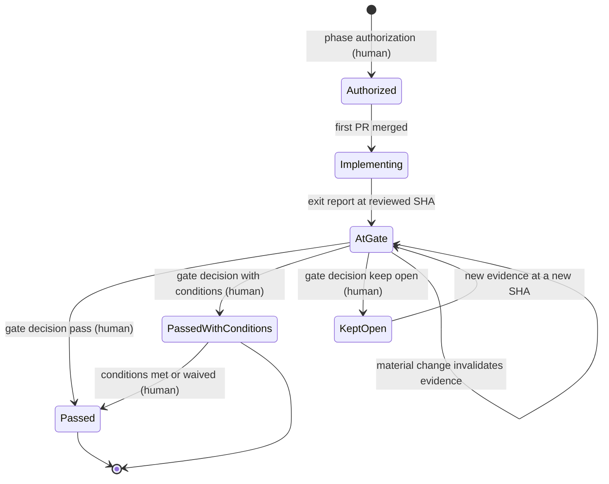

# Shared Phase Gate: governance proposal

- Status: **PROPOSAL (design only), except GOV-1.** The owner **adopted GOV-1 on 2026-11-27** as a policy: merge, gate, ADR, visual, next-phase authorization and release are separate decisions, and none implies another (record: [`../review/phase-3-owner-decision-packet.md`](../review/phase-3-owner-decision-packet.md) §0). Everything else here, including the ledger, the entry schema and the "Bound to" column of §2, stays a proposal (GOV-2…GOV-8). No ruleset, branch protection, workflow or credential has been changed. Nothing else is in force until the owner decides it, item by item (§9).
- Date: 2026-11-26. Repository `cuongtranba/eschaton`, `main` @ `870ef62`.
- Why now: four phases have passed through gates whose decisions are recorded only as prose written by the agent. One identity performed every PR, merge and approval-relevant action. A provenance audit found that this cannot be told apart from the owner acting alone, or from the agent acting without the owner.

## 1. What the provenance audit established

Read from GitHub with GET requests on 2026-11-26. Nothing was changed.

### 1.1 Repository and merge facts

| Fact | Value |
|---|---|
| Visibility / owner | **Private**, user-owned (not an organization). The viewer permission is `ADMIN` |
| Rulesets | `GET /repos/…/rulesets` → **HTTP 403** "Upgrade to GitHub Pro or make this repository public to enable this feature". Rulesets are not available on this plan for a private repository |
| Classic branch protection on `main` | `protected: false`. `GET …/branches/main/protection` also answers **HTTP 403** with the same "Upgrade to GitHub Pro or make this repository public" message |
| CODEOWNERS | None |
| Environments | 0 |
| Merge settings | merge, squash and rebase allowed; auto-merge off; delete-branch-on-merge off |
| CI | `.github/workflows/ci.yml`: jobs "lint · typecheck · unit · build · e2e" and "solver determinism and worker transport · chromium · firefox · webkit". They run on PRs and on pushes to `main`. Nothing makes them *required* |
| Local `gh` identity used by the agent | `cuongtranba`: the **owner's own account**, OAuth token with `repo` and `workflow` scopes |

| PR | Author | Merged by | Merge commit | Merged at (UTC) | Reviews | Comments |
|---|---|---|---|---|---|---|
| #1 Phase 0 | cuongtranba | cuongtranba | `b0ff485` | 2026-11-25 06:13 | 0 | 0 |
| #2 Phase 1 | cuongtranba | cuongtranba | `940a50b` | 2026-11-25 06:19 | 0 | 0 |
| #3 Phase 2 | cuongtranba | cuongtranba | `d673f84` | 2026-11-25 08:31 | 0 | 0 |
| #6 Docs drift | cuongtranba | cuongtranba | `982a4b4` | 2026-11-26 04:17 | 0 | 0 |
| #5 windFold | cuongtranba | cuongtranba | `85cee55` | 2026-11-26 04:17 | 0 | 0 |
| #4 Phase 3 | cuongtranba | cuongtranba | `870ef62` | 2026-11-26 04:44 | 0 | 0 |

- **No review or approval exists on any merged PR.** From GitHub's side, every PR was opened and merged by the same account the agent uses. GitHub cannot tell the owner's actions from the agent's.
- The explicit merge-only instruction for #4–#6 is known from the previous Mac agent session. It is not a GitHub artefact.

### 1.2 Label collisions in the decision record

- **`W1`–`W8`** are both the Phase 2 *milestones* (`plans/phase-2-wave.md`, for example "W1 | Solver core") and the Phase 2 *owner decisions* (`review/phase-2-owner-review.md`, for example "W1 | Verify the Local WFC target in the production browser worker"). Commit subjects use both senses ("W1: production-worker benchmark harness" is a decision task; "W1/W2: @eschaton/wave solver core" is a milestone).
- **`R1`–`R13`** are the research references in master plan §15, and **`R1`–`R8`** are the Phase 1 owner decisions (`review/phase-1-owner-review.md`).
- **`D1`–`D7`** are Phase 0 owner decisions, while plan decisions use `P1-D8`…`P1-D11`.
- **`C1`–`C6`** are the RTX 5070 manual checks; **`G0`–`G7`** are the Phase 3 milestones.

This proposal uses `GOV-n` for its own decisions, and the Phase 4 proposal uses `CL0`–`CL7` for milestones, to avoid adding new collisions.


Consequences:

- **Merge authorization, gate approval and next-phase authorization have been one blurred act.** PR #3 was merged "conditionally closed by owner W6; merge authorized by W6". PRs #4–#6 were merged on an explicit merge-only instruction, which the merge commit message records as "merge authorized by owner". Nothing machine-readable says that the Phase 3 gate is *not* passed.
- **Labels collide** (§1.2): the same token means different things in different documents.
- **Source authorship of D/R/W decisions is not independently provable.** The decisions are recorded in `docs/review/*.md` by the agent. No GitHub review, signed commit or comment from a separate human identity attests them. They remain valid as recorded history, but their provenance class is "agent-recorded, owner-attributed".

## 2. Decision kinds kept apart

| Kind | Question it answers | Subject | Who may decide | Bound to |
|---|---|---|---|---|
| `merge` | May this PR head be merged? | One PR | Policy (routine) or the owner (critical, §4) | PR head SHA |
| `gate` | Does phase *N* pass its exit gate? pass / pass-with-conditions / keep-open | A phase | Owner only | Reviewed SHA + evidence digest |
| `authorize` | May implementation of phase *N+1* start, and with what scope? | The next phase | Owner only | The plan document's SHA |
| `visual` | Does the scene meet the visual bar at this gate? (master plan §11) | A phase gate | Owner only, from looking at the scene | Screenshot set digest + SHA |
| `adr` | Accept, amend or reject one ADR choice | One ADR choice id | Owner | ADR file SHA |
| `check` | Result of a manual check (for example RTX 5070 C1–C6) | One check | Whoever ran it, stated as performed / failed / pending | Machine, browser, driver, SHA |
| `waiver` | Is a named requirement waived, for what scope, until when? | One requirement | Owner | Scope + expiry |

Rules:

- **A merge never implies a gate, a visual approval, an ADR decision or an authorization.** Each needs its own entry.
- **A gate pass needs a `visual` entry for the same gate** (master plan §11). It does not need every `check` to have passed: a pending check either blocks or is listed as a condition or a scoped waiver.
- **Waivers are explicit and scoped:**
  - `scope` names exactly what is waived (for example "RTX 5070 C1–C6 for the Phase 3 gate only");
  - `expires` is a phase gate or a date, after which the waiver is void;
  - a waiver is never inferred from silence.

## 3. Canonical gate ledger

One append-only, machine-readable file: `governance/ledger.jsonl`, one JSON object per line. Prose documents link to entries by id and never restate them. The ledger is the single source of truth for decisions; exit reports are evidence.

```jsonc
{
  "id": "gate-01JDXQ7Z3K8M",            // unique, never reused; kind prefix + a ULID-style suffix. No D/R/W numbering.
  "kind": "gate",                        // merge | gate | authorize | visual | adr | check | waiver | legacy
  "subject": "phase:3",                  // phase:N | pr:N | adr:0017#9 | check:rtx5070-C1
  "decision": "pass-with-conditions",
  "conditions": ["check:rtx5070-C1..C6 by phase:4 gate"],
  "reviewedSha": "870ef62b97b3d6d6fc66bc7f4aadeef4b3684ce5",
  "evidence": { "paths": ["docs/phase-3-exit.md", "docs/review/phase-3-closure-audit.md"], "digest": "sha256:…" },
  "decidedBy": { "login": "<human account>", "source": "github-review", "ref": "https://github.com/…/pull/N#pullrequestreview-…" },
  "recordedBy": { "login": "<agent identity>" },
  "prev": "sha256:<hash of the previous ledger line>",   // compare-and-swap anchor
  "at": "2026-11-26T09:00:00Z",
  "aliases": []                          // legacy labels such as "W7", for search only
}
```

- **Ids.** Kind prefix plus a time-ordered random suffix. Labels like W1 never collide again. Old labels survive only as `aliases`.
- **Hash chain.** `prev` is the SHA-256 of the previous line, so editing or deleting history breaks validation.
- **Evidence digest.** SHA-256 over the listed files at `reviewedSha`, in sorted path order. A validator recomputes it.
- **Provenance classes for `decidedBy.source`:**
  - `github-review`: an approving review by a human account on the PR that adds the entry, at its head SHA (verifiable);
  - `signed-commit`: an entry committed and signed by the human's key (verifiable);
  - `recorded-instruction`: an owner instruction in an agent session, quoted with its date. **Not verifiable**; it is accepted only for `merge` of routine PRs and for `legacy`.

## 4. Routine work versus critical boundaries

The owner's style is agentic: an agent opens, reviews and, under policy, merges routine PRs. This proposal keeps that and adds human approval **only** at named boundaries.

| Change | Gate |
|---|---|
| Routine PR inside an authorized phase (code, tests, docs) | Required CI checks green on the head. Merge by the agent identity under a standing `authorize` entry for that phase. Whether routine merges need any human review is owner decision GOV-5; the default is none |
| PR that adds a `gate`, `authorize`, `visual`, `adr` or `waiver` entry | Human approving review from the owner account, on the head SHA, after the last push |
| Changes to `governance/**`, `.github/workflows/**`, `.github/CODEOWNERS`, rulesets, `AGENTS.md` rules | Human approving review (CODEOWNERS) |
| Release tags (`release/*`, `phase-*-passed`) | Created only by a workflow that validates the ledger; the tag ruleset blocks the agent identity |



A phase's state is **derived** from the ledger by folding its entries. It is never stored separately.

## 5. Invalidation, concurrency and compare-and-swap

- **Material change.** A `gate`, `visual` or `adr` entry is bound to `reviewedSha` and its evidence digest. If a merge into `main` after the decision touches a *material path*, the derived state returns to `AtGate` and the validator reports "evidence stale". Material paths are `packages/**`, `apps/**`, the exit report and the evidence files of that gate. Docs-only changes elsewhere do not invalidate.
- **Stale approvals.** Rulesets dismiss approvals on new pushes and require approval of the most recent reviewable push (§6), so an approval always refers to the head that is merged.
- **Compare-and-swap on the ledger:**
  - An appending PR must declare `prev` = hash of the ledger tip on its base.
  - The ledger check fails when the base has moved: two concurrent gate PRs cannot both merge.
  - The second must rebase and re-declare `prev`. That makes it a new push, which needs a fresh approval.
  - "Require branches to be up to date" (or a merge queue, where available) serializes this on GitHub's side.
- **Race scenarios the validator must cover** (as tests when implemented):
  1. Two PRs append to the same tip: the second fails `prev`.
  2. Approval given, then a new push: approval dismissed, merge blocked.
  3. A gate passed at SHA X, then a material merge Y: derived state `AtGate`, "evidence stale".
  4. A waiver past `expires`: the requirement is reported unmet.
  5. An entry with a reused id or an edited earlier line: hash chain or uniqueness failure.
  6. A `gate` entry whose `decidedBy.login` equals the PR author or the agent identity: rejected (no self-approval).
  7. A `gate` entry with source `recorded-instruction`: rejected for gate, authorize, visual and adr kinds.
  8. A `merge` of a PR touching `governance/**` without a CODEOWNERS approval: blocked by the ruleset, not only by the validator.

## 6. What GitHub can and cannot enforce

Each claim has a source. "Verified" means that docs.github.com was read for this proposal on 2026-11-26, or that the behaviour was observed on this repository. "Uncertain" claims must be checked before anything is configured.

| Claim | Status | Source |
|---|---|---|
| Rulesets are unavailable for this private repository on the current plan | Verified by observation: the API answered 403 "Upgrade to GitHub Pro or make this repository public to enable this feature". The docs page read does not state the plan matrix itself | This repository; [About rulesets](https://docs.github.com/en/repositories/configuring-branches-and-merges-in-your-repository/managing-rulesets/about-rulesets) |
| With no ruleset or protection, any account with write access can push to `main` and merge any PR. A token with `repo` scope (today's agent token) can do both | Verified by observation: protection is off and the owner token merged #1–#6 | This repository |
| A PR author cannot approve their own PR | **Uncertain as a documented statement**: it is GitHub's long-standing behaviour, but the docs page read does not say it. Check it on a throw-away PR before relying on it. The design does not depend on it: "approval of the most recent push" (next row) already requires someone other than the last pusher | [About pull request reviews](https://docs.github.com/en/pull-requests/collaborating-with-pull-requests/reviewing-changes-in-pull-requests/about-pull-request-reviews) |
| "Require approval of the most recent reviewable push" requires "an approval from someone other than the last person to push"; "dismiss stale pull request approvals" dismisses an approval when a push or an updated merge base changes the diff | Verified (quoted from the rule descriptions) | [Available rules for rulesets](https://docs.github.com/en/repositories/configuring-branches-and-merges-in-your-repository/managing-rulesets/available-rules-for-rulesets) |
| Rulesets have a bypass list: "users with a certain role, such as repository administrator, or … specific teams or GitHub Apps" | Verified for roles, teams and Apps; deploy keys, PR-only bypass and the audit detail are uncertain | About rulesets; [Creating rulesets](https://docs.github.com/en/repositories/configuring-branches-and-merges-in-your-repository/managing-rulesets/creating-rulesets-for-a-repository) |
| A required status check can name a GitHub App as its expected source ("If the status is set by any other person or integration, merging won't be allowed"), and "Require branches to be up to date before merging" exists | Verified | Available rules for rulesets |
| Merge queue is available only in organization-owned repositories (public, or private on Enterprise Cloud). **Not available here** | Verified | [Managing a merge queue](https://docs.github.com/en/repositories/configuring-branches-and-merges-in-your-repository/configuring-pull-request-merges/managing-a-merge-queue) |
| Environments with required reviewers and "prevent self-review" exist, but on Free, Pro and Team they work only for public repositories | Verified | [Managing environments](https://docs.github.com/en/actions/how-tos/deploy/configure-and-manage-deployments/manage-environments) |
| A fine-grained token needs Pull requests: write to submit reviews and Contents: write to merge | Verified for reviews and for merge's Contents permission; whether merge also needs Pull requests: write is uncertain | [REST: reviews](https://docs.github.com/en/rest/pulls/reviews), [REST: pulls](https://docs.github.com/en/rest/pulls/pulls) |
| A GitHub App installation token is a separate bot identity that can open PRs and post reviews | Verified | [Authenticating as an installation](https://docs.github.com/en/apps/creating-github-apps/authenticating-with-a-github-app/authenticating-as-a-github-app-installation) |
| Whether a GitHub App's approving review counts toward a required-approvals rule | **Uncertain**: not found in the docs read. The design does not depend on it, because the agent must never be the approver | — |

**What this means for the design:**

1. **Today nothing can be enforced by GitHub on this repository.** The precondition is owner decision GOV-4a:
   - upgrade the owner account to GitHub Pro, so rulesets work on the private repository; or
   - make the repository public, which has its own consequences, including the reference-art rights noted in master plan §13; or
   - accept that the ledger validator in CI is advisory only: it can fail a check, but nothing requires the check.
2. **Ruleset for `main`, once available (the CI jobs report as GitHub Actions):**
   - require a PR; block force-push and deletion;
   - required status checks: both CI jobs plus the future ledger check, source GitHub Actions;
   - "require branches to be up to date" (this gives compare-and-swap on the ledger without a merge queue);
   - dismiss stale approvals; require approval of the most recent push.
   - **Required approvals: 0 for routine paths.** Code-owner review on the critical paths of §4 needs a CODEOWNERS file naming the owner.
   - **Bypass list: empty.** The owner keeps admin and can change the ruleset, but that change is visible and is itself a critical boundary.
3. **Tag ruleset:** `phase-*` and `release/*` tags can be created only by the bypass actor for the gate workflow. Nothing else may create, update or delete them.
4. **Not enforceable even then:**
   - that the human who approves actually looked at the scene;
   - that an instruction given in chat came from the owner;
   - that the owner's account was used by the owner.

   The design records the provenance class honestly instead of claiming more.
5. **No same-account approvals.** While the agent pushes as `cuongtranba`, the owner is the last pusher on every agent PR. A "most recent push" approval rule would block every merge, or push the owner to bypass. GOV-3 (a separate agent identity) is therefore a prerequisite of GOV-4.


## 7. Identity and credential model

| Identity | Holds | May | May not |
|---|---|---|---|
| **Owner** (human account) | Interactive login, 2FA; no long-lived token in agent environments | Approve PRs; author ledger decisions through reviews; administer rulesets | Share credentials with agents |
| **Agent** (a GitHub App installed on the repo, or a machine user with a fine-grained token) | Short-lived installation token scoped to this repository: contents write, pull requests write, checks read | Push task branches, open PRs, comment, merge routine PRs when the ruleset allows | Approve, bypass rulesets, edit rulesets, push to `main`, create release tags |
| **CI** (`GITHUB_TOKEN`) | Per-run token, `contents: read` | Run checks, including the ledger validator | Write the ledger |

- The essential change is that **the agent stops using the owner's `gh` identity**. While it does:
  - every act looks the same;
  - the owner is also the last pusher of every agent PR, so "approval of the most recent push" could never be met without bypassing;
  - by GitHub's usual behaviour, authors cannot approve their own PRs either (§6).
- Token claims inside commit messages or ledger text ("approved by owner") carry no weight. Only GitHub-verifiable sources do (§3).

## 8. Migration that keeps historical uncertainty honest

1. Create `governance/ledger.jsonl` with one `legacy` entry per historical decision: D1–D7, R1–R8, W1–W7 from `docs/review/*.md`.
   - `aliases`: the old label;
   - `decidedBy.source`: `recorded-instruction`;
   - a `provenance` note: "recorded by the agent in docs/review; source authorship not independently verified; no GitHub review exists".
2. Add `merge` entries for PRs #1–#6 with the merge SHA from GitHub.
   - #4–#6: source `recorded-instruction` ("explicit merge-only instruction, Kanna Mac session, 2026-11-26").
   - #1–#3: the D/R/W decision that the merge commit names.
3. Add **no** `gate` entry for Phase 3. Its derived state is `AtGate` until the owner decides through the new path.
4. Never upgrade a legacy entry's provenance class. If the owner wants to re-attest a historical decision, that is a new entry with a verifiable source, linking the legacy id.
5. Prose documents keep their text. Each exit report gains one line linking to its ledger entries.

## 9. Owner decisions

| Id | Decision | Alternatives | Recommended default |
|---|---|---|---|
| GOV-1 | Adopt the separate decision kinds (§2) | Adopt; adopt a subset; keep prose only | Adopt. **Adopted by the owner on 2026-11-27**, as policy only: the kinds merge, gate, ADR, visual, next-phase authorization and release are kept apart. Release is not a row of §2; GOV-1 names it as a separate kind, and no release exists |
| GOV-2 | Ledger format and location | `governance/ledger.jsonl` with hash chain; one YAML file per decision; GitHub Issues as the ledger | JSONL with hash chain (diffable, offline, CAS-friendly) |
| GOV-3 | Separate agent identity | GitHub App; machine user with a fine-grained token; keep the owner's identity (status quo) | GitHub App (short-lived tokens, no seat, clear audit trail) |
| GOV-4a | Make enforcement possible at all (§6) | GitHub Pro; make the repository public; advisory CI only | Owner's call (cost versus visibility); no default |
| GOV-4 | Rulesets on `main` and tags (§6) | Apply as proposed; apply only required checks; none | As proposed, after GOV-3 and GOV-4a (otherwise the owner could not approve) |
| GOV-5 | Human review for routine PRs | None (CI only); sampled; always | None. Human review only at the §4 boundaries |
| GOV-6 | Material-path list for invalidation | As in §5; stricter (any change); looser (code only) | As in §5 |
| GOV-7 | Migration (§8) | As proposed; skip legacy import | As proposed |
| GOV-8 | Implement the ledger validator (CI check) as a small tool under `tools/` | Now; with Phase 4; never | Before the Phase 4 gate. Implementation needs its own authorization |

## 10. Not in this proposal

No change to GitHub settings, no new workflow, no credential creation or rotation, no ledger file, and no re-classification of any past decision. Each needs the owner's decision above and then a separate, reviewed PR.
