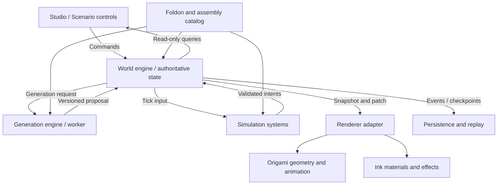

# ESCHATON
## A Self-Constructing Universe

**Master research, architecture and implementation plan**  
Version 1.1 · 2026-11-24 (roadmap revision; v1.0 baseline 24 November 2026)

*Creation. Collapse. Rebirth.*

> We do not build worlds. We build the laws from which worlds emerge.

## 1. Vision and product definition

Eschaton is a web-based procedural world engine and creative laboratory for a self-constructing, continuously evolving universe. Its visual language combines modular Japanese origami-inspired geometry with monochrome woodcut-like illustration. A small vocabulary of reusable geometric pieces, connection rules and composable behaviors should produce landscapes, cities, organisms, atmospheric effects and the collapse and rebirth of civilizations.

The LEGO analogy is fundamental: a limited library of 1×1, 1×2, 2×2, 2×4 and 4×4 pieces can create an enormous variety of structures. Unlike LEGO, Eschaton's pieces also fold, deform, detach, move and respond to their surroundings. Complex assemblies may become reusable modules at higher scales. Wave Function Collapse (WFC) resolves compatible placements; grammar provides meaningful structure; simulation evolves it; rendering expresses it as a living artwork.

The narrative is the end of a world, not merely a destruction simulator. The universe has three capabilities: **Genesis** (self-construction), **Collapse** (local and cascading transformation), and **Rebirth** (constrained reconstruction). A world may remain in ruins; rebirth is a scenario policy, not an inevitable automatic repair.

### 1.1 Goals

- Build coherent 3D worlds from a small authored primitive catalog, not a library of finished models.
- Generate distinct worlds from seeds, preserve stable identities, and expose reproducible generation and replay.
- Allow assemblies to transform continuously and topology to change at explicit simulation boundaries.
- Support recursive composition across scales, with reusable validated modules.
- Make environmental effects visually consistent with the geometry and style of the world.
- Provide a laboratory for debugging shape, sockets, constraints, animations, fields and performance.
- Make adding a primitive, behavior or rule primarily a data/composition change.

### 1.2 Non-goals for the first release

No unrestricted infinite universe, fully general origami solver, physical paper simulation for every face, arbitrary topology-changing mesh morphing, complete game, AI-generated asset pipeline, multiplayer, or distributed backend. No claim that locally valid WFC results guarantee beautiful or globally functional worlds. A bounded interactive district is the first meaningful release. Expand only with evidence.

## 2. Art direction — The Last World


*Reference supplied by the project owner. Use as an art-direction anchor, not as a texture or a claim about the original artist or medium. Confirm usage rights before public redistribution.*

The reference depicts a ruined landscape: tall dark towers and traditional pitched-roof buildings at left, abandoned vehicles and debris on a winding pale corridor, a barren tree at right, layered mountains and a large radiant sun. Its warm paper ground, near-black masses, fine engraved-looking linework, horizontal cloud bands, and negative space create a quiet, monumental apocalypse. These are visible properties of the image; its production method and provenance are not established.

**Artistic target:** a living three-dimensional print. Geometry reads as folded paper; lighting and marks read as ink on aged paper. Avoid a generic colorful low-poly game, glossy sci-fi surfaces, heavy realistic particle textures, or a grid of obvious toy cubes. The supplied reference supersedes the earlier red-accent-first direction. Red is optional and rare, not part of the baseline scene.

### 2.1 Proposed visual tokens

| Token | Initial value | Role |
|---|---|---|
| Paper | #E8D8B5 | Sky, paper tone, highlights |
| Pale paper | #F2E5C9 | Sun, strong light, negative space |
| Ink | #222321 | Main silhouettes and deep shade |
| Charcoal | #454440 | Fold shadows and massing |
| Ash | #858078 | Middle distance and weathering |
| Optional vermilion | #A84335 | Exceptional narrative events only |

These are proposed tokens inspired by the reference, not exact sampled colors. Use a limited value ramp, directional hatching, restrained outlines, paper grain, layered depth and carefully selected silhouettes. Grain and hatching should be world/object anchored or otherwise temporally stable; avoid screen-space shimmer during camera movement.

### 2.2 Composition rules

- Foreground: broken beams, vehicles, layered debris, high contrast and larger marks.
- Midground: winding road or riverbed, traditional roof shapes, damaged city blocks and coherent pathways.
- Background: successive mountain ridges and distant architecture with progressively reduced contrast.
- Sky: large sun disk, radial strokes, sparse star-like marks and horizontal clouds; use a dedicated sky composition system rather than WFC for celestial placement.
- Camera: orthographic or long-lens perspective art-directed presets; slow deliberate movement; preserve a recognizable silhouette. Support an orbit mode for inspection.
- Animation: long quiet holds, drifting dust, fluttering edges, subtle cloud movement, occasional structural failure. Destruction must contrast with stillness, not turn every scene into constant noise.

### 2.3 Rendering research and proof

Test flat/quantized lighting, crease-edge rendering, stylized shadows, procedural directional cross-hatching, depth-based ink fading, paper grain, and geometric particles independently. Compare at fixed camera and lighting. Maintain a golden reference scene with near/mid/far layers and an animation clip. Aesthetic acceptance requires human approval; pixel comparisons are regression checks, not taste scores. Do not use the input illustration as a flat background substitute for a generated world.

## 3. Research foundations and technical decisions

| Reference | What to learn | Decision for Eschaton |
|---|---|---|
| [R1] Original WFC | Simple tiled model, weighted choices, propagation | Implement a bounded adjacency solver behind a small public API. |
| [R2] Hierarchical Semantic WFC | Hierarchies of constituent tiles | Coarse semantic generation followed by fine assembly under boundary contracts. |
| [R3] Tessera | Multi-cell modules and extended constraints | Compile multi-cell placements with consistent anchors and complete footprints. |
| [R4] Shape grammar / CGA | Massing, facade rules, semantic decomposition | Generate structure intent, proportions and component roles before WFC detail. |
| [R5] FOLD | Interchange for crease patterns and folded states | Adopt an adapter; do not make FOLD the entire world-state format. |
| [R6] Origami Simulator | Crease constraints and GPU folding | Compare rigid hinges, compliant surfaces and advanced crease solving in experiments. |
| [R7] MarkovJunior | Rewrite rules and constraint propagation | Explore local event-driven transformation and grammar-based regeneration. |
| [R8–R10] Three.js | WebGPU, TSL, instancing | Use a renderer adapter; benchmark and capability-test GPU paths. |
| [R11–R12] Block generation and infinite WFC | Boundary stability and incremental generation | Research streaming only after bounded local repair passes invariants, as the separate Phase 8 research track (§11). |
| [R13] A Philosophy of Software Design | Deep modules and complexity control | Hide algorithms and internal representations behind behavior-level interfaces. |

These references demonstrate individual techniques, not proof that their combination achieves Eschaton's goals. Phase 0 tests those assumptions. Check licenses, dependencies and supported APIs before adopting code. Prefer a small own-domain implementation over copying a full Unity-specific system.

## 4. Geometric alphabet — Foldon

A **Foldon** is Eschaton's internal name for a reusable smallest *logical* geometric building block. It is not a claim that every piece is an authentic single-sheet origami construction. A module is an assembly of Foldons; an assembly can expose a higher-level placement contract.

| ID | Primitive | Base footprint | Initial use |
|---|---|---|---|
| P01 | Planar panel | 1×1×1 | Floor, wall, water facet |
| P02 | Triangular facet | 1×1×1 | Slope, foliage, debris |
| P03 | Hinged two-panel crease | 1×2×1 | Roof, animated surface |
| P04 | Mountain fold | 2×2×1 | Roof ridge, terrain ridge |
| P05 | Valley fold | 2×2×1 | Channel, valley, wave trough |
| P06 | Triangular prism | 1×2×1 | Beam, ridge, edge transition |
| P07 | Pyramid / raised facet assembly | 1×1×1 | Peak, ornament |
| P08 | Box shell | 1×1×1 | Volumetric mass, tower segment |
| P09 | Irregular fragment | 1×1×1 at rest | Rubble, dust, detached paper |

Footprints represent logical occupancy, not visible geometry or physical collision volume. A moving fragment uses dynamic collision bounds and is not forced to stay on the placement grid. Start with a cubic integer grid and discrete rotations around the vertical axis. Add other orientations and irregular lattices only when needed. Retain continuous geometry, articulated poses and non-cubic silhouettes. A module footprint may be sparse or nonrectangular.

### 4.1 Hierarchy

L0 Foldon → L1 module (2×2, 4×4) → L2 structure (roof, tree, tower) → L3 district → L4 region → L5 world. These are composition relationships, not subclasses. A district can consist of many structures; a structure can consist of nested modules. Every reusable assembly carries a canonical hash, versioned recipe, external socket boundary, occupancy mask, semantic summary, bounds and validation status. Use an acyclic assembly DAG; instances have stable IDs and transforms. Deduplicate equivalent recipes, bound recursion and cache only useful validated modules. Prevent circular definitions and uncontrolled catalog growth.

### 4.2 Sockets, creases and materials

Socket = local frame (position, normal, tangent), profile, role, allowed mates, tolerance and optional joint properties. Match both directions, alignment, scale, geometry and occupancy. Large boundaries expose a set of unit face segments or equivalent canonical signatures; each segment matches compatible neighboring boundaries. An explicit empty/exterior socket allows free faces. Hinge and bond are runtime constraints, not interchangeable names for adjacency.

A crease connects adjacent faces along an edge with a rest angle, target range, stiffness and mountain/valley designation. A geometry recipe stores vertices, faces, creases and local bounds. Paper is an artistic material with mechanical parameters defined separately from appearance. A building may look like paper yet follow a structural support model.

### 4.3 Data contracts (illustrative TypeScript)

```ts
type Vec3 = readonly [number, number, number];
type Cell = readonly [number, number, number];
type Id = string;

type FoldonDefinition = Readonly<{
  id: Id;
  version: number;
  footprint: readonly Cell[];
  geometry: GeometryRecipe;
  sockets: readonly SocketDefinition[];
  creases: readonly CreaseDefinition[];
  rotations: readonly Rotation[];
  components: readonly ComponentSpec[];
  tags: readonly string[];
  weight: number;
}>;

type Placement = Readonly<{
  id: Id;
  definitionId: Id;
  definitionVersion: number;
  anchor: Cell;
  rotation: Rotation;
}>;

type ComponentSpec =
  | { kind: 'foldable'; creases: readonly Id[] }
  | { kind: 'structural'; strength: number }
  | { kind: 'wind-responsive'; drag: number }
  | { kind: 'decayable'; resistance: number }
  | { kind: 'thermal'; capacity: number }
  | { kind: 'renderable'; material: Id };
```

The named geometry and socket types are contracts to implement, not an existing SDK. Definition data is immutable and versioned. Runtime state stores pose, health, bonds, velocity and other mutable values independently. Validate input at catalog boundaries; use typed IDs and canonical serialization internally where they reduce errors. Avoid saving GPU objects in world state.

## 5. Generation engine — hierarchical multi-cell WFC

The solver addresses discrete compatibility. It is not a physics engine and does not reason about visual quality by itself.

### 5.1 Base algorithm

For each cell, maintain a domain of possible states. Use weights normalized over the surviving states, p(t)=w(t)/sum(w), and weighted Shannon entropy H=-sum(p log p). Choose a minimum-entropy cell with deterministic seeded tie-breaking; pick a weighted candidate; propagate incompatibilities; backtrack on an empty domain. Return either a validated solution or an explicit failure with diagnostic information. Bound time, nodes, retries and memory. Never silently emit a partial invalid solution as success.

Compile adjacency compatibility for all allowed orientations. Use stable ordering and a local seeded PRNG; never depend on iteration order from asynchronous tasks or global randomness. Use a reference solver first; profile before adopting bitsets, support counters or specialized queues.

### 5.2 Multi-cell tiles

Enumerate candidate placements (definition, anchor, rotation) and occupied cells. Each covered cell references the same placement, with its local offset. Selecting a placement commits the whole footprint atomically and rules out overlapping alternatives; removing a placement invalidates all its corresponding cell states. Validate external socket segments, not internal faces of the same tile. Permit explicit empty space where the scenario permits it.

An alternative implementation compiles each multi-cell tile into offset-specific cell states and forces matching internal neighbors; compare correctness and cost in Phase 2. The public contract remains placement-based. Tests must cover rotations, boundary straddling, sparse masks, pinned placements and contradictory footprints. Geometry intersection is a separate test for shapes that extend outside nominal occupancy.

### 5.3 Hierarchical generation

1. Generate coarse height, land/water and regional intent with a bounded field/noise or authored scenario seed.
2. Plan globally meaningful networks (roads and waterways) using graph and terrain algorithms; enforce boundary terminals and relevant reachability.
3. Use shape grammar to split districts, lots and structural massing into semantic roles.
4. Compile role-specific candidate catalogs and boundary contracts; solve WFC within each domain.
5. Assemble precise geometry, validate, and publish an atomic world patch.

Do not run WFC over every triangle in an entire continent. Hierarchical backtracking may revise coarse choices when finer detail is impossible. Keep budgets, deterministic ordering, constraints and diagnostics explicit. Hard constraints: compatibility, occupancy, support where required, pinned landmarks and seam matches. Soft preferences: silhouettes, repetition, proportion, orientation and stylistic variety. Soft preference must never override validity.

### 5.4 Local re-collapse and streaming (research)

The local region solve under a frozen exterior contract, with pinned placements and cancellation, is production scope of Phase 2 (Wave) and is consumed by Phase 4 (Collapse). Streaming is a separate research track (Phase 8, §11) and is not on the release path.

On topology-changing events, mark a region dirty. Expand it to include complete intersecting placements, affected bond boundaries and required dependency halo. Freeze the exterior contract; solve a local replacement under explicit scenario constraints (for example preserve ruins rather than repair them). Validate occupancy, seam and required networks. Commit a versioned patch only if base revision still matches; otherwise discard/retry. Preserve IDs for unchanged placements; preserve damage and state unless a rule explicitly changes them. Failure leaves prior valid state intact, emits diagnostics and may request bounded escalation. Detached rubble is a separate dynamic entity, not an invalid WFC placement.

Chunk generation in Phase 8 (research) uses canonical boundary ownership and stable seed derivation; test generation-order independence rather than assume it. A persistent change overlay must survive unloading/reloading. No chunk may independently change a shared seam. Stream based on budget and camera; authoritative simulation state must not depend on visual LOD.

## 6. Dynamic simulation — creation, collapse, rebirth

Separate two meanings of dynamic: continuous motion (fold angles, wind, water) and discrete topology change (attach, detach, replace). WFC is invoked for discrete constrained reconstruction, not each frame. World simulation uses a fixed logical tick with explicit phase order; rendering interpolates between snapshots. Decorative GPU effects may be non-authoritative and need not replay bit-exactly.

### 6.1 State and tick pipeline

Commands → validated event/intent → sample fields → update mechanical/behavior state → resolve bond failure and topology changes → schedule bounded generation jobs → validate and commit patches at deterministic boundaries → publish snapshot/events → render.

Workers return proposals, never mutate the world. Async completion ordering must not decide authoritative outcomes; queue results in a stable order or record the chosen commit tick/results in the replay log. Integrate with a seeded scheduler. Use a fixed tick (start with 30 Hz) and interpolated render loop; cap catch-up work. A simulation can pause, step, replay or reset. Physics reproducibility across browsers is not assumed; document deterministic scope and record authoritative outcomes as needed.

### 6.2 Environment fields and effects

| Field / system | Authoritative effect | Visual expression |
|---|---|---|
| Wind vector field | Force on opted-in loose/flexible pieces | Paper flutter, drifting shards, dust strokes |
| Gravity/support | Falling and disconnection | Folded debris and collapsing silhouettes |
| Stress | Bond weakening and propagation | Crease darkening, buckling, cracks |
| Heat | Optional damage and material transformation | Angular ink flames and ash |
| Water | Terrain/water interaction in later phases | Folded wave ribbons and pale channels |
| Decay | Scenario-driven loss of strength | Ink erosion, exposed structure |
| Growth/reassembly | Explicit construction policy | Fragments gather, unfold and connect |
| Atmosphere | Mostly decorative | Horizontal clouds, haze, paper grain |

Use a lightweight support graph first: supports anchored to the ground, bonds with strengths, deterministic propagation and an explicit failure budget per tick. This is a stylized structural heuristic, not engineering-grade finite element analysis. Later compare a rigid-body engine for moving fragments if needed. Use field sampling functions and CPU-authoritative values; shader-only effects may use approximations. Water and fire can initially be visual-only; label this honestly.

### 6.3 Rebirth as a rule system

An event or scenario selects a target semantic role (ruin, habitat, bridge, monument, new settlement). Select reusable fragments if a conservation mode is enabled; otherwise generation may create elements under an explicit source policy. A solver plans target placements; an animation planner schedules motion and hinge transitions; commit attachments when constraints hold. Use bounded retries and cancellation. Do not imply matter conservation unless material accounting is implemented. Start with a finite inventory demo, with no duplicate ownership between debris and placements.

Lifecycle is per capability, not a universal inheritance tree. A structural module may have stable → damaged → disconnected states; a folding component has current and target angle; an assembly job has planned → moving → committed/failed states. A Foldon may be both damaged and folding. Keep these independent rather than inventing a single combinatorial enum.

## 7. Software design — Composition over Inheritance (mandatory)

The software architecture must mirror the world: small compatible capabilities compose into meaningful entities. No domain inheritance hierarchy such as `WorldObject → Building → JapaneseBuilding → RuinedJapaneseBuilding`, and no effect class tree. Domain polymorphism uses structural interfaces, discriminated unions, data recipes and function composition. Classes may be used for encapsulating state with a small public API; inheritance is not the default extension mechanism. Third-party subclassing required by an adapter is an exception documented in an ADR, isolated outside domain packages.

### 7.1 Example

```ts
const roof = defineFoldon({
  geometry: mountainFold({ width: 2, depth: 2 }),
  footprint: rectangularFootprint(2, 1, 2),
  sockets: roofBoundary(),
  components: [
    foldable({ stiffness: 0.8 }),
    structural({ strength: 0.9 }),
    windResponsive({ drag: 0.2 }),
    decayable({ resistance: 0.6 }),
    renderable({ material: 'charcoal-paper' }),
  ],
});

const leaf = defineFoldon({
  geometry: triangularFacet(),
  footprint: rectangularFootprint(1, 1, 1),
  sockets: leafBoundary(),
  components: [
    foldable({ stiffness: 0.2 }),
    windResponsive({ drag: 0.9 }),
    renderable({ material: 'ash-paper' }),
  ],
});
```

Illustrative authoring API; concrete parameter shapes should be settled during Phase 0. Both entities reuse folding and wind behavior; neither inherits from the other. Normalize factory output into validated serializable definitions. Runtime systems operate on entities that possess the relevant components. Do not place callbacks or renderer objects inside persisted component data.

### 7.2 Compose systems, not hidden behavior chains

```ts
const engine = createWorldEngine({
  catalog,
  generator: createConstraintGenerator({ rules, seedPolicy }),
  systems: [
    sampleEnvironment,
    integrateFolds,
    resolveStructuralDamage,
    resolveTopology,
  ],
  clock: createFixedClock({ ticksPerSecond: 30 }),
});
```

The engine owns system order and validates read/write contracts. Systems produce typed intents/patches or write only authorized draft state within the transaction; no arbitrary writes across subsystems. Avoid a generic plugin framework or full ECS upfront. Start with component data and explicit systems; migrate storage to sparse sets/SoA if profiles justify it. A component is a data capability, not a wrapper object per entity per frame. Prefer cohesive deep modules over a maze of tiny abstractions.

### 7.3 Coding rules and review gate

- Strict TypeScript, explicit module exports, no `any` at domain boundaries, no unsafe type assertion to bypass validation. Prefer discriminated unions and exhaustive switches where useful.
- Favor composition, pure functions for deterministic calculations, immutable definition data, explicit side-effect boundaries and injected dependencies for replaceable external capabilities. Avoid service locators, singleton global world state, mixin hierarchies and premature generic factories.
- One authoritative world state; derived render and query caches are not independent truth. UI sends commands, never mutates domain state directly. Keep dependencies acyclic and use one-way data flow.
- Deep modules hide solver, storage, geometry and buffer-management complexity behind meaningful behavior APIs. Do not create shallow pass-through layers or abstract two superficially similar features prematurely. Keep related logic together; design difficult interfaces twice and document the trade-off.
- Follow SOLID where it reduces complexity; do not equate single responsibility with one tiny function per file. Prefer self-explanatory names and code; avoid inline explanatory comments; capture important rationale, invariants and exceptions in docs/ADRs.
- Read project knowledge (AGENTS.md, CLAUDE.md, README, ADRs and docs) before changes. Inspect branch, worktree and remote; use an appropriate existing or dedicated git worktree, fast-forward only, no destructive Git actions. Consult current library docs (Context7 where available) before dependencies change. Update related docs and Mermaid diagrams with implementation.
- TDD at public behavior seams; tests import package entry points only. No mocks/spies, arbitrary sleeps, testing private methods or asserting incidental ordering. Use real lightweight inputs and explicit clocks/seeds; one cause → one decisive behavior; helpers small and fixtures built via public APIs. Name regression tests for the original defect. Use `toBe` for identity. If an existing repository policy conflicts, report the conflict rather than silently override it.
- Review new code for domain `extends`, duplicated behavior, cyclic dependencies, invalid state combinations, hidden global state, unnecessary abstractions, unbounded loops and unmeasured optimization. The lint gate may restrict class inheritance within domain folders with documented exceptions; TypeScript interface extension is not class inheritance and need not be prohibited.

## 8. Architecture and ownership



Arrows describe runtime data flow, not imports. The core orchestrator imports stable contracts; generation and simulation do not import the orchestrator or renderer. Keep dependency direction explicit; proposal → commit is intentional feedback at the runtime boundary, not a cyclic module dependency.

| Module | Owns | Does not own |
|---|---|---|
| contracts | Shared domain IDs, DTOs, command/result contracts | Execution or mutable state |
| foldon | Catalog, geometry recipes, assembly validation | World placement scheduling |
| generation | WFC, grammar, compiled compatibility, diagnostics | Authoritative world state or graphics |
| simulation | Field and behavior systems, topology intents | Renderer or independent world state |
| world | Commands, transactions, state, revisions, clock, orchestration | Shader or UI details |
| renderer | Geometry conversion, caches, animation interpolation, shaders, GPU resources | Domain mutations |
| presets | Data-driven rules, scenarios, artistic tokens | Engine implementation |
| studio | UI, camera, editing and debugging views | Direct domain mutations |

Suggested workspace (start with fewer packages if justified; these are boundaries, not mandatory separate deployables):

```text
eschaton/
  AGENTS.md
  README.md
  apps/studio/
  packages/contracts/
  packages/foldon/
  packages/generation/
  packages/simulation/
  packages/world/
  packages/renderer/
  packages/presets/
  assets/reference/
  assets/crease-patterns/
  experiments/
  docs/research/
  docs/architecture/
  docs/decisions/
  benchmarks/
```

Use TypeScript, Vite, React for Studio, Three.js, TSL/WebGPU with a capability-tested baseline, Web Workers for solve jobs, Vitest, Playwright and typed-array data stores as required. Prefer a local-first single browser app with downloadable snapshots and recipes; no database or network backend initially. Use the existing repository's package manager if present. Pin versions after verification, not by guessing. Rust/WASM is a later measured option, not a prerequisite.

### 8.1 Public world API (proposed)

```ts
const world = createWorld({ seed: 42, scenario: lastWorld, catalog });
const result = await world.generate({ bounds: districtBounds });
if (result.ok) {
  world.dispatch({ type: 'applyField', field: decayField });
  world.step(1);
  renderer.apply(world.snapshot());
}
```

The command result identifies revision, events and failures; generation may return typed unsatisfiable/budget/cancelled/stale outcomes. `step(1)` advances one fixed tick. Read-only snapshots are versioned and serializable. Render updates consume deltas where available and recover with full snapshot on revision mismatch. Save header includes schema, seed, rules/catalog/engine versions and tick. Replay stores commands and authoritative outcomes necessary for reproducibility; migrations must be explicit.

## 9. Rendering and performance

Three.js renderer should map recipe hashes/materials to instanced batches; stable assemblies can merge or batch per chunk; articulated pieces use hinge transforms; moving debris use pooled instance buffers; large fields may use GPU particles and shader animation. Avoid creating a React component or Object3D for each Foldon. Separate logical cells, render instances, visible triangles and simulation-active entities in metrics. Camera culling and LOD reduce rendering cost without changing authoritative state. GPU resources have explicit disposal on reset, chunk eviction and renderer recreation.

Origami MVP: rotate rigid panels around hinges, maintain shared edges, check angle limits, and disallow impossible transitions. Complex closed crease networks require simultaneous constraint solving and collision/self-intersection tests; research FOLD import and solver methods separately. Do not advertise arbitrary physically foldable origami before validating it. Geometry style may be procedural folded-paper inspired from day one.

WebGPU is preferred for advanced effects; WebGL 2 fallback must feature-detect compute-dependent paths. Keep a baseline renderer with static ink materials and CPU hinge/particle updates or disable unsupported features clearly. Test target browsers. Do not assume shader equivalence or GPU-deterministic simulation.

### 9.1 Proposed benchmark gates (not measured)

Record exact OS, browser, device, driver, resolution, catalog, seed and commit. Run fixed scenes after warm-up; report p50/p95 frame CPU/GPU time, solve latency and node/backtrack counts, worker transfer cost, memory, active entities, draws, triangles and patch latency. Use a laptop/iGPU baseline and a discrete GPU target; on the latter use 1920×1080 desktop quality initially. The following are provisional targets, revised after Phase 0 measurements:

| Scene | Target | Gate |
|---|---|---|
| Lab | 100–1,000 pieces | Smooth interaction; no persistent resource growth after reset |
| District | 10k visible logical instances | Aim for 60 FPS / p95 frame ≤16.7 ms on discrete GPU; report actual |
| Stress | 100k static logical instances | Benchmark instancing/chunking; keep active dynamic subset bounded |
| Research | 1M logical pieces across streamed chunks | Phase 8 research track only; no promise of simultaneous display or simulation; only after measured evidence |
| Local WFC | 16×16×8 region, bounded catalog | Initial p95 target ≤250 ms worker solve on benchmark hardware; budgeted failure is acceptable and reported |
| Interaction | During worker solving | No solver-caused main-thread long tasks; cancellation observable |

Measure before optimizing. No silent degradation of correctness; reduce decorative detail, render distance or active effect count first. Add benchmark regression thresholds only after stable baselines exist.

## 10. Eschaton Studio / Laboratory

The laboratory is the first product, not a disposable test screen. It has a viewport, primitive catalog, inspector, scenario controls and event/solver timeline. The viewport supports orbit, orthographic composition camera, selection and toggles for grid, footprint, sockets, crease axes, support graph, constraint domains and chunk borders.

Inspector: definition and version, stable ID, footprint, sockets, selected neighbors, current/target crease angle, components, state, bond stress and diagnostic failures. Solver: seed, step/run/pause, candidate count/entropy, propagation, pinned cells, backtracking and contradiction trace. Simulation: play/pause/single tick, wind/decay sliders, apply local event, clear/reset, and replay. Scene controls: palette, hatching strength, lighting, sun, haze, density and camera presets. Export/import snapshot and catalog JSON, screenshot and benchmark report. Controls send commands; debug overlays read state. Keyboard, reduced-motion option and accessible control labels are required.

UI direction: graphite panels, warm paper viewport, compact technical typography, subtle separators. The application chrome should not compete with the artwork. Keep initial UI small and useful; no full visual editor or node graph before the engine is proven.

## 11. Implementation roadmap and phase gates

Durations are planning estimates for a small developer/agent team, not delivery promises. Scope, not calendar, controls progression. Every phase ends with a demo, passing tests, updated docs and an explicit go/no-go decision. No parallel implementation of later phases until dependencies stabilize.

**Roadmap v1.1 is the only roadmap.** Other documents link here and must not restate the phase list. Version 1.1 was approved by the project owner on 2026-11-24; the v1.0 → v1.1 mapping is in §11.2.

**Visual review at every phase gate.** Each gate includes an owner visual review of the current scene against the reference in §2. Visual approval is never inferred from passing tests, pixel comparisons or benchmark results; a gate without a recorded owner visual review is not passed.

| Phase | Estimated effort | Deliverable | Exit criteria |
|---|---|---|---|
| 0 — Laboratory closure | v1.0 estimate 1–2 weeks; closure tasks to be re-estimated | v1.0 Phase 0 (primitive viewer, hinge experiment, ink look-dev, research ADRs) plus closure tasks T0–T6: **T0** owner review package; **T1** benchmarks on a clean committed SHA; **T2** JS heap growth investigation; **T3** documentation corrections plus fold and footprint tests; **T4** CI; **T5** WebGPU test on a physical GPU; **T6** Phase 1 design ADRs 0010–0013 | Nine draft primitives or justified reduced set; three distinct assemblies from shared pieces; socket/footprint overlays; continuous fold demo; one visual reference scene approved; baseline metrics recorded; T0–T6 each done or explicitly waived by the owner; the Phase 1 design ADRs decided by the owner |
| 1 — Foundation | v1.0 estimate 1–2 weeks; re-estimate at the Phase 0 gate | Versioned catalog, placement, bonds, composition systems, **runtime identity and ownership, fragment lineage, atomic transactions and revisions (rollback and replay contract), directional sockets, logical-versus-rendered placement model** | Valid/invalid connections, transform, occupancy and identity invariants; attach/detach and round-trip serialization; roof/leaf share behavior without inheritance; **identity/ownership invariants (no duplicate ownership, stable ids, acyclic lineage); transaction atomicity and rollback; directional socket compatibility tests** |
| 2 — Wave | v1.0 estimate 2–3 weeks; re-estimate at the Phase 1 gate | Production 3D multi-cell WFC in a worker, with **pinned placements, frozen boundaries (local region solve under an exterior contract) and cancellation**, backtracking and diagnostics | Same seed/version/input same logical result; multi-cell atomicity; zero overlap; explicit unsat/budget/cancel results; fixed regression corpus; no main-thread solver block; **solve inside a frozen boundary; cancellation observable; cross-browser determinism scope documented** |
| 3 — Genesis | 2–3 weeks | Hierarchical district and semantic scene generation | Roads/river contracts and boundaries valid; recognizable architecture and terrain; ≥10 distinct valid seeds for one preset; no finished building meshes in core catalog; **the scene look is reached through validated logical placements, bounded decorative offsets and a separate backdrop (ADR 0013)** |
| 4 — Collapse | 2–4 weeks | Fixed tick, fields, support graph, topology change and local re-solve | Reproducible event sequence; local repair protects exterior; damaged pieces detach; failed solve rolls back; no duplicate ownership |
| 5 — Atmosphere | 2–3 weeks | Origami particles, water, atmosphere, lighting (v1.0 "Ink & effects") | Consistent style with reference; stable hatching across motion; one cinematic collapse scene; accessible motion toggle and capability fallback |
| 6 — Rebirth and finite inventory | v1.0 estimate 2–4 weeks including streaming; re-estimate at the Phase 5 gate | Assembly inventory and reconstruction | Ruins can reconstruct into a different valid structure; finite inventory conserved in demo |
| 7 — The Last District | 1–3 weeks | Bounded integrated release: usable controls, save/replay/export, docs, the §11.1 vertical slice | End-to-end Genesis→Collapse→Rebirth demo; no known critical invariant violations; visual approval and documented performance/capability limits; the §11.1 vertical slice runs end to end |
| 8 — Infinite Universe (research track) | Not scheduled | Streaming, chunks, seams and load order, LOD, persisted modifications across reload | Seam/load-order tests; persisted modifications survive reload; Stress and Research benchmark targets (§9.1) assessed. Separate research track, **not on the release path**; starts only on measured evidence from the earlier phases |

### 11.1 First vertical slice — The Last District

A single bounded terrain region contains a winding pale corridor, towers, pitched roofs, debris, barren tree silhouettes, distant mountains and a radiant sun. Seed produces scene variation; scenario constraints preserve the visual composition. User triggers a local decay or wind event. A roof or tower loses bonds, breaks into visible fragments, and settles. Protected neighboring structures remain unchanged. A subsequent rebirth command reuses fragments in a new low structure. Environment responds through the shared field system. User can replay, change seed and inspect the pieces. The prototype can use simple supported camera composition rules, not a complete open-world generator.

**Success is not maximum world size. Success is one convincing scene in which the same fragments can create, collapse and reconstruct coherently.**

### 11.2 Roadmap change log

| Version | Date | Change | Approval |
|---|---|---|---|
| 1.0 | 2026-11-24 | Baseline: phases 0–7 as first proposed ("Proposed engineering baseline") | Engineering proposal |
| 1.1 | 2026-11-24 | Phases 0–7 restructured and a research phase 8 added; mapping below | Approved by the project owner on 2026-11-24 |

| v1.0 phase | v1.1 phase | What moved and why |
|---|---|---|
| 0 — Research & geometry lab | 0 — Laboratory closure | Same exit criteria, plus closure tasks T0–T6 (owner review package, clean-SHA benchmarks, heap investigation, documentation corrections with fold and footprint tests, CI, WebGPU test on a physical GPU, Phase 1 design ADRs). The v1.0 evidence had open items that the gate cannot honestly pass without. |
| 1 — Foldon core | 1 — Foundation | Runtime identity and ownership, fragment lineage, atomic transactions and revisions, directional sockets and the logical-versus-rendered placement model are pulled into Foundation, because attach/detach and the ownership invariants cannot be defined or tested without them. |
| 2 — WFC | 2 — Wave | Frozen boundaries (local region solve under an exterior contract), pinned placements and observable cancellation are pulled out of Collapse into Wave, so the local re-solve that Phase 4 depends on is de-risked while the solver is being built, not discovered during Collapse. |
| 3 — Genesis | 3 — Genesis | Criteria unchanged except one addition: the scene look must be reached through validated logical placements, bounded decorative offsets and a separate backdrop (ADR 0013), because the Phase 0 reference composition bypasses Foldon validation. |
| 4 — Collapse | 4 — Collapse | Unchanged. |
| 5 — Ink & effects | 5 — Atmosphere | Renamed only; same criteria. |
| 6 — Rebirth & streaming | 6 — Rebirth and finite inventory | Rebirth and inventory criteria stay. Streaming, chunk proof, LOD, seam/load-order tests and persisted-modification reload move to Phase 8, because §11.1 states that success is not world size and §1.2 excludes an unrestricted infinite universe. The v1.0 criterion "benchmark targets assessed" splits: bounded-scene targets are assessed in Phase 7 (documented performance limits), Stress and Research targets in Phase 8. |
| 7 — Studio release | 7 — The Last District | Renamed and framed as the bounded integrated release; criteria and the §11.1 vertical slice unchanged. |
| (new) | 8 — Infinite Universe | Separate research track that receives the streaming scope of v1.0 Phase 6. Not on the release path; starts only on measured evidence. |

The visual-review-at-every-gate rule (§11) is new in v1.1 and applies to every phase, including Phase 0.

## 12. Verification and invariants

| Invariant | Decisive behavior test |
|---|---|
| Determinism | Same seed, inputs, rules, version and logical command schedule → same canonical logical hash in declared runtime scope |
| Atomic multi-cell placement | A 4×4 tile appears wholly or not at all; competing placement cannot overlap |
| Compatibility | Every committed external socket matches its mate or allowed boundary |
| Geometry | Valid indices, finite values, hinge edges remain coincident; documented collision rules |
| Semantic connectivity | Required road/river terminals connected according to scenario |
| Stable identity/locality | Outside protected dirty region, placements and state remain identical |
| Transactionality | Contradictory, cancelled or stale proposal cannot change committed world |
| Seam consistency (Phase 8 research track; not a release-path invariant) | Neighbor chunks agree on canonical boundary regardless of tested load order |
| Lifecycle ownership | A detached piece cannot simultaneously occupy a static placement; no duplicate fragment IDs |
| Material conservation | In conservation-mode reconstruction, total fragment inventory preserved |
| Replay | Snapshot plus recorded authoritative events reproduces canonical state |
| Resource lifetime | Repeated create/reset/unload does not leak owned GPU resources |

Use deterministic real fixtures and generated seed corpora; report number of successful/unsatisfiable/budget-limited cases separately. Property-based tests can generate footprints and rotation/adjacency cases using a seeded generator. Golden render scenes use tolerant comparisons on a pinned environment, plus human visual review. Playwright exercises actual Studio controls, pause/step/reset and import/export. Keep failure diagnostics with seed, rules version, region and contradiction trace. Optional formal specification of atomic placement/local patch ownership may be considered if concurrency complexity warrants it.

## 13. Risks and decisions to resolve

| Risk | Mitigation / decision experiment |
|---|---|
| Cubic grid creates a toy-like world | Compare silhouette quality with off-grid continuous geometry and sparse multi-cell footprints |
| WFC catalog too permissive or contradictory | Small curated catalogs, explicit semantic roles, debug domains, bounded backtracking and seed corpus |
| Beautiful but disconnected districts | Plan global network first; validate reachability after local solves |
| Closed crease system cannot fold | Start with open hinges; isolate advanced rigid/compliant solver research |
| Composition turns into generic framework | Explicit capabilities and systems; extract abstractions only for observed reuse |
| Simulation becomes chaotic/unreadable | Scenario constraints, visual pacing, failure rate budget and protected landmarks |
| Async solves break determinism | Revision checking, stable scheduler, recorded commit outcomes |
| GPU fallback inconsistent | Capability matrix and explicit quality tier; baseline no compute reliance |
| Hatching flickers or obscures silhouettes | Object/world anchored sampling, filtered patterns, animation review |
| Recursive catalog explosion | Canonical recipe hashes, validation, quotas, bounded levels and deliberate promotion |
| Reference artwork usage rights unknown | Keep internal reference; obtain clearance before external distribution |

Initial ADRs: grid vs irregular topology; multi-cell encoding; component data and system order; world transaction/replay semantics; renderer capability/fallback; ink visual strategy; crease representation/FOLD adapter; catalog promotion; local solve (Phase 2) and seam ownership (Phase 8). The Phase 1 design ADRs 0010–0013 (identity and ownership, transaction and revision contract, directional sockets, logical versus rendered geometry) are drafted and await owner approval. Record actual experiments and alternatives, not just preferences.

## 14. Coding-agent handoff — Phase 0 — Laboratory closure only

Scope of this handoff is **Phase 0 — Laboratory closure** (§11): steps 1–7 below are the v1.0 Phase 0 work, and closure tasks T0–T6 in the §11 table complete the phase. No later phase starts before the owner approves the Phase 0 gate.

**Mission:** prove the smallest meaningful version of a self-constructing origami-inspired universe while honoring the supplied monochrome apocalypse reference and composition-over-inheritance rule.

1. Inspect repository, existing standards and worktree. If greenfield, establish minimal TypeScript/Vite app and written architecture contracts; do not scaffold every future package.
2. Read R1–R10 and inspect current dependency docs; produce short research notes with testable implications and license checks.
3. Implement immutable primitive definitions and geometry preview, with explicit footprint/socket/crease contracts. Start tests at public seams before implementation. Use the simplest hinge demo and validate shared edge positions.
4. Build three visually different assemblies from the same small pieces, using data composition. Do not hardcode full imported models. Include a 2×2 and 4×4 assembly contract; full WFC belongs to Phase 2.
5. Prototype ink/cream lighting, hatching and paper grain in a small reference-inspired composition. Build a usable viewport/inspector with fold slider, orbit, seed display and overlay toggles.
6. Create a small throwaway WFC/constraint experiment or reference implementation to validate feasibility of placement encoding; do not prematurely build the production solver. Compare basic adjacency and multi-cell representations.
7. Record benchmarks, screenshots/video captures, known limitations, ADRs, and a go/no-go recommendation for Phase 1. Update AGENTS.md with the coding rules in §7, adapted to actual repo conventions.

**Required outputs:** runnable lab, public behavior tests, primitive catalog, three shared-piece assemblies, folding demo, visual comparison, research notes, benchmark results, architecture diagram, and phase gate report. Suggested files: `docs/research/phase-0.md`, `docs/decisions/`, `docs/architecture/overview.md`, `docs/phase-0-exit.md`. Use actual measured results; never invent passing tests or benchmarks. Do not progress to Phase 1 without approval. If an assumption fails, record the failure and propose a smaller alternative.

## 15. Reference register

Primary and technical references (consulted or identified for implementation research; independently verify versions and licenses):

- R1. Maxim Gumin, [WaveFunctionCollapse](https://github.com/mxgmn/WaveFunctionCollapse).
- R2. [Hierarchical Semantic Wave Function Collapse](https://doi.org/10.1145/3582437.3587209), FDG 2023.
- R3. Boris the Brave, [Tessera: A Practical System for Extended WaveFunctionCollapse](https://www.boristhebrave.com/permanent/21/08/Tessera_A_Practical_System_for_WFC.pdf); [generator API](https://www.boristhebrave.com/docs/tessera/6/api/Tessera.TesseraGenerator.html).
- R4. Müller et al., [Procedural Modeling of Buildings](https://doi.org/10.1145/1179352.1141931), 2006.
- R5. [FOLD specification and repository](https://github.com/edemaine/fold).
- R6. Amanda Ghassaei, [Origami Simulator](https://origamisimulator.org/) and [source](https://github.com/amandaghassaei/OrigamiSimulator).
- R7. Maxim Gumin, [MarkovJunior](https://github.com/mxgmn/MarkovJunior).
- R8. Three.js, [WebGPURenderer manual](https://threejs.org/manual/pages/webgpurenderer).
- R9. Three.js, [TSL reference](https://threejs.org/docs/pages/TSL.html).
- R10. Three.js, [InstancedMesh reference](https://threejs.org/docs/pages/InstancedMesh.html).
- R11. Boris the Brave, [Infinite Modifying in Blocks](https://www.boristhebrave.com/2021/11/08/infinite-modifying-in-blocks/) — follow-up research.
- R12. Marian Kleineberg, [Infinite WFC](https://marian42.de/article/infinite-wfc/) — follow-up research.
- R13. John Ousterhout, *A Philosophy of Software Design* — architecture principles; not a claim that the book mandates all project-specific rules above.

## 16. Long-term research — A Self-Constructing Universe

Once bounded creation, collapse and rebirth work, investigate semantic assembly discovery, automatic promotion of validated structures, multi-level generation, biome/ecology rules, evolution of rule catalogs, and agent-authored scenario constraints. Agents propose definitions and rules, not direct mutations or unvalidated executable code. Engine validates geometry, compatibility, budgets, semantic constraints and version provenance before accepting a proposal. Promote only tested recipes; maintain rollback and curated catalogs. No LLM is required in the runtime loop.

The ultimate milestone is a universe that can produce forms its creators did not explicitly model, change them in response to its own state, and preserve the visual identity and laws of its world throughout that process.

**The universe is composed. The code is composed. Complexity emerges from their shared rules.**
