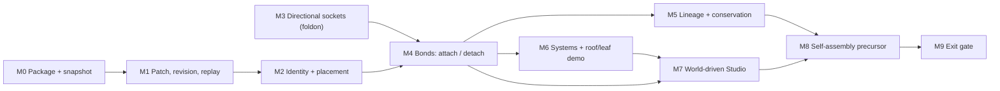

# Phase 1 — Foundation: implementation plan (PROPOSED, not started)

- Status: **Proposed plan. No Phase 1 code exists or may be written until the owner approves the Phase 0 gate and the Phase 1 go decision (D6, D7 in [`../review/phase-0-owner-review.md`](../review/phase-0-owner-review.md)).**
- Date: 2026-11-24
- Scope and exit criteria: [`../master-plan.md`](../master-plan.md) §11, Phase 1 "Foundation" (roadmap v1.1). That section is canonical. This document only slices that scope into ordered milestones; if the two disagree, the master plan wins and this plan is corrected.
- Designs it builds on: ADRs [0010](../decisions/0010-runtime-identity-ownership-lineage.md) identity/ownership/lineage, [0011](../decisions/0011-atomic-transactions-and-revisions.md) transactions/revisions, [0012](../decisions/0012-directional-sockets.md) directional sockets, [0013](../decisions/0013-logical-vs-rendered-geometry.md) logical vs rendered geometry. All four are **Proposed**. The independent review [`../review/adr-review.md`](../review/adr-review.md) recommends "amend, then approve" for each.

## 1. What exists after Phase 0 (code) vs what this plan proposes (design)

| | Exists in Phase 0 code (`phase-0` branch) | Proposed for Phase 1 (this plan; no code) |
|---|---|---|
| Definitions | Immutable, versioned `FoldonDefinition`s P01–P09; assemblies with canonical hash; typed 2×2/4×4 module contracts (`satisfiesContract`); `createCatalog` all-or-nothing validation (`packages/foldon`) | Unchanged in kind; socket table becomes versioned data (ADR 0012) |
| Runtime state | None. The Studio's `LabState` is UI state only (`apps/studio/src/lab/state.ts`) | `WorldState` with an entity table, one owner per entity, revisions (ADR 0010/0011) |
| Identity | Recipe paths `assembly/part` from `catalog.flatten` (**not identity**) | `EntityId` minted on commit; lineage records |
| Change | None (the catalog is built once) | `Patch` against a base revision; `applyPatch` all-or-nothing; replay log |
| Sockets | Position, opposed normals, symmetric profile table; orientation check inert (ADR 0009) | Turn and hand aware matching from one versioned table (ADR 0012, amended to lcm) |
| Behaviour | Component data only (`foldable`, `wind-responsive`, …) | Small explicit systems that read components and propose patches |
| Rendering | Studio renders catalog items and a look-dev composition that bypasses validation | Studio renders a world snapshot; decorative offsets derived, backdrop labelled (ADR 0013) |
| Architecture gate | ESLint dependency direction, entry points, no inheritance (`tools/architecture`) | Same rules extended to the new package |

## 2. Decisions that block Phase 1 code

Code for a milestone cannot start until the decisions it lists are answered. All of them are owner decisions. Each has an agent recommendation, which is not a decision.

| # | Decision | Blocks | Recommendation |
|---|---|---|---|
| P1-D1 | Phase 0 gate (D6) and Phase 1 go (D7) | everything | Decide after D1–D5 |
| P1-D2 | New package `@eschaton/world` (ADR 0011 Q7; amends ADR 0001) | M1+ | Yes: one package for runtime state, transactions and systems; foldon stays definitions-only |
| P1-D3 | Id scheme: mint on commit from `(revision, ordinal)`, ordinal = committed op order (ADR 0010 Q1, review amendment) | M2+ | Yes. Reword "independent of arrival order" to "deterministic given the commit log" |
| P1-D4 | **Detach keeps the entity id; only splits, merges and newly created pieces mint ids** (ADR 0010 invariant 5) | M4, M5 | Yes; it keeps lineage and conservation simple |
| P1-D5 | Conservation unit: integer `quantity` per material, default 1 (ADR 0010 Q3/Q9) | M5 | Yes; split/merge must be quantity-preserving |
| P1-D6 | Strict base-revision equality in Phase 1; read-region rebase is a Phase 2 requirement (ADR 0011 Q8, review) | M2 | Yes; record the Phase 2 requirement now |
| P1-D7 | ADR 0012 amended: symmetry rule uses **lcm**, not gcd | M3 | Yes; verified by reasoning in the review; M3 adds the test that catches it |
| P1-D8 | Where fold state lives: per-entity runtime `foldAngles` on placed entities; **logical occupancy stays the definition footprint whatever the pose** (ADR 0003 Q1, ADR 0013, review) | M6, M7 | Yes; the footprint is the logical contract, and posed geometry is rendering plus a geometry check |
| P1-D9 | Fragment start transform on detach = **logical** pose, not pose plus decorative offset; transform includes uniform scale (ADR 0013 Q10, review) | M4, M7 | Yes; keeps look presets out of authoritative state |
| P1-D10 | Systems in Phase 1 without a tick: systems run on explicit invocation and return patches; the tick and system order belong to Phase 4 (ADR 0007/0011 conflict, review) | M6 | Yes; amend ADR 0007 accordingly |
| P1-D11 | Bond model: an explicit bond record per mated socket pair, created by `attach`, removed by `detach`; strength is data only until Phase 4 | M4 | Yes; needs a short ADR (0014) before M4 |
| P1-D12 | Decorative offset envelope bounds and group-level offsets (ADR 0013 Q4/Q9) | M7 | Default to zero offsets in Phase 1; set bounds after the ADR 0013 rebuild experiment |

## 3. Milestones (dependency-ordered vertical slices)

Every milestone ends green on `pnpm lint`, `pnpm typecheck`, `pnpm test`, `pnpm build` and `pnpm e2e`, in CI, with its tests written first at the public seam. Tests import only `@eschaton/world` or `@eschaton/foldon`, or drive the Studio UI. They use no mocks, spies or sleeps, and each has one decisive outcome.

M3 depends only on Phase 0 foldon code and can run in parallel with M0–M2.

### M0 — `@eschaton/world` package, immutable state and snapshot (P1-D1, P1-D2)
- **Scope:**
  - New workspace package `packages/world`, entry point only. It depends on `@eschaton/foldon` and never the reverse; add this to the architecture lint and its rejection tests.
  - `createWorld({ catalog, seed })` returns a deeply frozen `WorldState` with header `{ schema, seed, versions: { catalog, rules, engine }, tick: 0, revision: 0 }` and an empty entity table.
  - `serializeSnapshot` and `parseSnapshot`.
- **Interfaces:** `WorldState`, `SnapshotHeader`, `createWorld`, `serializeSnapshot`, `parseSnapshot` → `Result`.
- **Invariants:** definitions are never mutated by the world (ADR 0010 #9); states are immutable (ADR 0011 #9).
- **Acceptance tests:**
  - "an empty world round-trips through a snapshot to an equal state and hash".
  - "a snapshot from a newer schema is rejected".
  - "a snapshot whose catalog version differs is rejected".
  - Architecture: "foldon importing world is rejected".

### M1 — Atomic patch, revision, commit log and replay (P1-D6)
- **Scope:**
  - `Patch = { baseRevision, ops }` and `applyPatch(state, patch)`, which returns `Committed { state, record }` or `Rejected { reason }`.
  - Strict stale check, revision +1 per commit, and a `CommitRecord` holding the patch and a state hash.
  - `replay(initial, log)` reports the first divergence.
  - A single no-op op kind (`annotate`) is enough to build and test the machinery before entities exist.
- **Invariants:** ADR 0011 #1–#6 and #8.
- **Acceptance tests:**
  - "a patch with an invalid op leaves the previous state object unchanged (`toBe`)".
  - "a stale patch is rejected and consumes no revision".
  - "replaying the commit log reproduces the live state hash".
  - "a corrupted commit record is reported as a divergence at its revision".

### M2 — Identity, placement and derived occupancy (P1-D3)
- **Scope:**
  - Op `instantiate { ref: foldon | assembly, anchor, rotation }`. An assembly expands through the existing `catalog.flatten` composition.
  - Entities with `owner: placed`, a `group` id for assembly instances, and ids minted at commit from `(revision, ordinal)`.
  - Occupancy is derived from placed entities and never stored.
  - Assembly-internal socket checks reuse the compiled assembly. External contacts are checked against neighbours with the current (orientation-free) `socketsCompatible` until M3 lands.
- **Invariants:** ADR 0010 #1–#4 and #9; no double occupancy.
- **Acceptance tests:**
  - "instantiating the same assembly twice at overlapping anchors rejects the second patch".
  - "entity ids do not depend on recipe part ids" (two recipes differing only in part ids mint equal ids).
  - "ids are never reused after an entity is consumed" (lands with M5's consume op; listed here as the invariant).

### M3 — Directional sockets in `@eschaton/foldon` (P1-D7; parallel with M0–M2)
- **Scope:** ADR 0012 as amended.
  - A versioned `SocketTable` holds profiles with symmetry, hand and wildcard, plus mates with turn relations.
  - `socketMismatches(table, a, b)` returns reasons; `socketsCompatible` becomes `mismatches.length === 0`.
  - All current profiles migrate as C4 with no hand, so existing validity is unchanged.
  - The typed module contract boundary (A1) is untouched: it stays orientation-free until a contract needs orientation.
- **Invariants:** existing catalog and assembly hashes unchanged; a C4 piece is never orientation-sensitive.
- **Acceptance tests:**
  - "migrating the profile table changes no primitive, assembly or hash".
  - "a C1 door profile mates with a road only at its relation turn".
  - "a quarter-turned C4 piece mates exactly where the unturned one does" (catches gcd vs lcm).
  - "handed side faces mate only left-to-right".
  - "a table with an illegal self-pair relation is rejected".

### M4 — Bonds: attach and detach with stable identity (P1-D4, P1-D9, P1-D11; needs ADR 0014)
- **Scope:**
  - Op `attach { entity, anchor, rotation }` takes a detached or inventory entity to `placed`, creating one bond per mated socket pair.
  - Op `detach { entity, transform }` takes a placed entity to `detached` and removes its bonds; the start transform is the logical pose.
  - Bonds are records owned by the world state. Each references two entity ids and a socket pair, and holds strength data that is not interpreted until Phase 4.
- **Invariants:**
  - A detached entity occupies no cell.
  - A bond exists only between two placed, touching, compatible sockets.
  - Detach then attach keeps the id.
  - No entity is both placed and detached.
- **Acceptance tests:**
  - "detaching a placed roof frees its cells and keeps its entity id".
  - "re-attaching a fragment where its sockets do not mate is rejected and the fragment stays detached".
  - "a detached entity never appears in occupancy".
  - "attach creates a bond for each mated socket pair and detach removes exactly those".

### M5 — Lineage, inventory and conservation (P1-D5)
- **Scope:**
  - Owners `inventory { store }` and `consumed { by, reason }`.
  - Ops `store`, `retrieve`, `split` (one entity into n children, quantity-preserving), `merge`, and `consume` for an explicit destruction cause.
  - Append-only lineage records.
  - World conservation mode `off | closed { baseline }`.
- **Invariants:** ADR 0010 #3, #6, #7 and #8.
- **Acceptance tests:**
  - "in closed mode a patch that creates material without a split is rejected".
  - "split children carry new ids and lineage to their parent; the parent becomes consumed".
  - "a consumed entity cannot be attached".
  - "lineage edges always point forward in (revision, ordinal)".
  - "moving a fragment through inventory keeps its id and the material totals".

### M6 — Composable systems and the roof/leaf demonstration (P1-D8, P1-D10)
- **Scope:**
  - A system is a plain object `{ id, reads: ComponentKind[], plan(view, input) → Patch | Rejected }`, where `view` is a read-only query over entities that have the listed components.
  - `runSystem(world, system, input)` applies the plan through `applyPatch`. It is the only write path, and there is no engine-wide order or tick (Phase 4).
  - Runtime fold state (`foldAngles`) lives on placed entities. It is validated against crease ranges with the existing `poseGeometry` and never changes occupancy.
  - One system, `windFold`: given a uniform wind vector input, every entity with `foldable` and `wind-responsive` components gets target fold angles scaled by its `drag` and `stiffness`.
  - The **roof** is the existing `roof-module` (P03 creases). The **leaf** is a small leaf definition built from shared geometry helpers with the same two components, authored as preset data rather than a new primitive.
- **Invariants:**
  - A system touches only entities with its declared components.
  - Systems never mutate state; they only propose patches.
  - No class inheritance (architecture lint).
- **Acceptance tests:**
  - "wind folds both a roof and a leaf through the same system" (decisive: both entities' fold angles change by component data, and neither definition references the other).
  - "an entity without wind-responsive is not folded".
  - "a fold target outside a crease range is rejected and nothing changes".
  - "folding never changes occupancy".

### M7 — Authoritative logical geometry and derived rendering in the Studio (P1-D9, P1-D12)
- **Scope:**
  - The Studio gets a "World" mode that holds a `WorldState` and dispatches commands through `plan`/`applyPatch`. It renders the snapshot:
    - placed entities at pose plus fold angles;
    - detached entities at their transform;
    - decorative offsets derived from `(seed, entityId)` with a zero default envelope;
    - backdrop layers labelled "not part of the world".
  - The Phase 0 catalog view and the look-dev composition stay, labelled as look-dev. They are not migrated or polished.
- **Invariants:**
  - The renderer holds no domain state.
  - Removing decorative offsets changes no logical query or state hash (ADR 0013).
- **Acceptance tests (e2e):**
  - "attaching and detaching in the Studio updates the inspector's owner and keeps the id".
  - "toggling decorative offsets changes the image but not the reported state hash".
  - "undoing is replaying to an earlier revision" (if replay-to-revision is exposed; otherwise drop this test).

### M8 — Smallest self-assembly precursor (no production WFC)
- **Scope:** `planAssembly(world, { target: assemblyId, anchor, rotation, from: inventory store })` returns an ordered list of patches that build a target assembly from **existing inventory entities** of matching definitions.
  - The order is bottom-up by support, so each step attaches one entity to a validated placement.
  - Each patch is committed through `applyPatch`. The first failure stops and leaves the last committed state valid.
  - The target's module contract (A1) is checked before planning, and conservation must hold in closed mode.
  - This is a deterministic greedy planner over a known recipe. It is not WFC and it does not search alternatives.
- **Invariants:**
  - Every intermediate state is valid.
  - No entity is duplicated.
  - Ids are preserved: reassembly moves entities and mints none.
- **Acceptance tests:**
  - "a roof-module is reassembled from inventory fragments with the same entity ids".
  - "an inventory missing one piece fails before committing anything and leaves the world unchanged".
  - "self-assembly in closed conservation mode leaves material totals unchanged".
  - "reassembly into a different valid structure succeeds" (a second recipe from the same inventory). This is a small precursor of the Phase 6 criterion.

### M9 — Exit gate
- **Evidence:**
  - The master plan Phase 1 exit criteria, mapped to tests.
  - The full invariant suite and the replay demo.
  - Roof/leaf in the Studio.
  - The ADR 0013 rebuild experiment screenshots for the **owner's visual review** (visual review at every gate).
  - Commit, replay and planning micro-benchmarks recorded on a clean SHA.
  - ADR statuses as decided by the owner, and a Phase 1 exit report.

## 4. Integration contract with Phase 2 (Wave)

- **Output:** the solver's output is a `Patch` of `instantiate` ops against a base revision. It commits through the same `applyPatch`, so atomic placement, zero overlap and socket validity are enforced once.
- **Pinned placements** are existing placed entities inside the region. They are passed to the solver as fixed cells.
- **Frozen boundary:** the exposed sockets of placed entities around the region, read with the M3 table. This uses the same boundary-signature idea as the A1 module contract, which may gain orientation then.
- **Cancellation** is dropping a proposal, because proposals are inert (M1).
- **Staleness:** Phase 2 must add rebase by read region (P1-D6), because strict equality will starve solves once ticks commit revisions (Phase 4).
- **Determinism:** solver seed is `(world seed, revision, region)`. Replay applies the recorded patches, so it does not depend on cross-browser `Math.log`. Generation-equality across engines is a separate, documented Phase 2 scope item.

## 5. Out of scope for Phase 1

- **Simulation and time:** tick, fixed clock, fields, support graph, stress and damage (Phase 4).
- **Generation:** production or worker WFC (Phase 2); grammar and terrain (Phase 3).
- **Effects:** particles, water, atmosphere (Phase 5).
- **Streaming:** chunks, LOD (Phase 8).
- **Physics:** a rigid-body engine.
- **Folding research:** closed-loop crease networks; the FOLD adapter.
- **Frameworks:** an ECS framework, a plugin system or a generic scheduler.
- **Tooling and persistence:** a visual editor; a database or network backend.
- **Art:** polishing the look-dev composition, or any second authoritative placement path. Visual fidelity work is judged at the Genesis, Atmosphere and Last District gates.

## 6. Risks

| Risk | Mitigation in this plan |
|---|---|
| Frozen deep-copy state is slow for large worlds | Measure commit and replay at M1 and M9 on a clean SHA; structural sharing only if measured |
| Bond and socket rules diverge between attach (M4) and solver output (Phase 2) | One validation path: `applyPatch` |
| Fold poses that exceed the footprint (for example P08's flat net) collide visually | P1-D8 keeps occupancy logical; posed-geometry intersection is a later, separate check |
| Id minting order changes when ops are reordered | Canonical op order is part of the patch, and replay tests cover it |
| The world package grows into a framework | Systems are plain objects; no registry or plugin layer; deep-module review at each milestone |
| Visual divergence between look-dev and the world mode | Expected; the owner reviews at the gate; the look-dev scene stays labelled |

## 7. Exit gate (proposed)

Phase 1 passes only with the owner's decision on all of the following:

1. Every master plan Phase 1 exit criterion is mapped to passing tests, with CI green on the evaluated SHA.
2. Invariants are checked after every commit in tests.
3. The replay demo is reproduced.
4. The roof/leaf demonstration runs.
5. The self-assembly precursor runs.
6. The owner's visual review of the world mode and the ADR 0013 rebuild experiment is recorded.
7. ADRs 0010–0014 have been decided by the owner.
8. Known limitations are listed.
