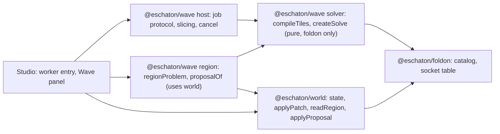

# Phase 2 — Wave: implementation plan

- Status: **Authorized by owner decision R7 (2026-11-25)** ([`../review/phase-1-owner-review.md`](../review/phase-1-owner-review.md)): plan and execute production 3D multi-cell WFC within this scope, stopping at the Phase 2 exit gate. No Phase 2 PR merge and no Phase 3 work without separate approval.
- Scope and exit criteria: [`../master-plan.md`](../master-plan.md) §11, Phase 2 row (roadmap v1.1, amendment 1), and §5.1, §5.2, §5.4. That text is canonical; this plan only slices it.
- Builds on: ADR [0004](../decisions/0004-multi-cell-encoding.md) (placement encoding), [0011](../decisions/0011-atomic-transactions-and-revisions.md) (atomic commit; read-set rebase required in Phase 2), [0012](../decisions/0012-directional-sockets.md) (one socket table), [0013](../decisions/0013-logical-vs-rendered-geometry.md) (regular lattice), [0014](../decisions/0014-bond-model.md). New: [0015](../decisions/0015-wave-solver.md) (solver), [0016](../decisions/0016-region-proposals.md) (region-aware commit).
- Base: `main` @ `940a50b`, which contains Phase 0 (PR #1, merge `b0ff485`) and Phase 1 (PR #2, merge `940a50b`). Branch `phase-2`.

## 1. Merge record (owner R8)

| Step | Evidence |
|---|---|
| PR #1 (`phase-0` → `main`) | Exact head `5b2a995`; both checks green; merged with a **merge commit** `b0ff485`, pinned to that head. `main`'s tree equalled the `phase-0` tree |
| PR #2 retargeted `phase-0` → `main` | Same 25 commits and 99 changed files against either base; no conflicts; the merge result tree equalled the `phase-1` tree |
| PR #2 checks on the new base | Exact head `07b89c0`: CI run 45559048901 green (188 tests = 162 unit + 26 e2e; Phase 1 numbers, see `phase-1-exit.md` §8), plus run 45558353537 on the former base |
| PR #2 merged | **Merge commit** `940a50b`, pinned to `07b89c0`. `main`'s tree equals the `phase-1` tree; `5b2a995` and `07b89c0` are ancestors of `main` |
| Branches | `phase-0` and `phase-1` are kept. Nothing was squashed, rebased or force-pushed |

## 2. Architecture

- **One authoritative state.** The solver never holds world state. It receives a `WaveProblem` (plain data) and returns placements. Only `applyProposal` changes the world, once, atomically.
- **Pure solver, deep module.** `compileTiles(catalog, tiles)` and `createSolve(compiled, problem)`; the solver imports `@eschaton/foldon` only. Lint forbids the solver folder from importing the world, the renderer, the DOM or Node.
- **Worker adapter is a thin shell.** The job host is pure code driven by messages; the Studio owns the actual `Worker`.

## 3. Milestones

Every milestone ends green on lint, typecheck, unit, build and e2e, in CI. Tests are written first at public seams (`@eschaton/wave`, `@eschaton/world`, `@eschaton/foldon`, or the Studio in a real browser), with no mocks, spies or sleeps.

| | Scope | Decisive tests |
|---|---|---|
| W0 | Rules and catalog support: `ProfileSpec.needsMate` (socket table v3), `catalog.source()`, multi-cell and irregular preset pieces | A table round trip; an irregular (L-shaped) piece compiles; the source rebuilds a catalog with the same fingerprint |
| W1 | Solver core: variants, candidate placements, explicit air, propagation with support counts, weighted seeded choice, chronological backtracking, budgets, outcomes `solved`, `unsatisfiable`, `budget-exceeded` | Same inputs give the same placements; no overlaps; every external face legal; multi-cell atomicity; a genuine contradiction is `unsatisfiable`; a tight budget is `budget-exceeded`; nothing partial is returned |
| W2 | Constraints from the world: fixed cells, frozen boundary sockets, pins, ground plane, exterior air | Solve inside a frozen boundary; a pin survives; an impossible border is `unsatisfiable`; disconnected sub-regions |
| W3 | Region-aware commit in `@eschaton/world`: `readRegion`, `Proposal`, `applyProposal` | An unrelated intervening commit does not invalidate a proposal; a commit inside the region or its shell does; writes outside the region are refused; catalog or rules mismatch refused; ABA case documented by a test |
| W4 | Region glue in `@eschaton/wave`: `regionProblem`, `proposalOf`; identity and conservation | Unchanged exterior and pins keep ids and hash-equal entities; closed conservation refuses generation before solving; replay reproduces the hash |
| W5 | Job host: slicing, progress, cancellation, explicit `cancelled` outcome; Studio worker | A cancelled job returns `cancelled` and no proposal; progress is never authoritative |
| W6 | Studio: Wave panel in World mode, live progress from the real worker, preview labelled non-authoritative, one atomic commit | e2e: solve commits one revision; the UI stays responsive during a solve; cancel leaves the world hash unchanged; two seeds give different valid structures |
| W7 | Corpus, benchmarks, transaction-cost profile at 100, 1,000 and district scale | Recorded on a clean SHA |
| W8 | Exit report; stop at the gate | Owner visual review and decision |

### Milestone status (2026-11-25)

W0–W8 are done and Phase 2 is **conditionally closed by owner decision W6**, subject to the closure evidence in the exit report §9: see [`../phase-2-exit.md`](../phase-2-exit.md) for the criteria mapping, commits, benchmarks, visual evidence, flagged choices and limitations. Deviations from this plan:
- W0's "table round trip" is covered by the catalog-source fingerprint test.
- W7's transaction profile used 100, 1,000 and 10,000 entities; no optimisation followed (by instruction).

## 4. Out of scope

- Phase 3: hierarchical districts, semantic roles, roads, terrain, shape grammar.
- Phase 4: tick, forces, damage, support graph, local re-solve triggered by events, breaking bonds.
- Phase 5 art; Phase 8 streaming and chunk seams.
- Reconstruction under **closed conservation** (building from finite inventory with a search). Phase 2 generation mints new entities and is refused in closed mode; inventory-bounded solving is Phase 6. The Phase 1 greedy `assemble` is unchanged.
- An ECS framework, persistent data structures, or other rewrites not driven by a measurement.

## 5. Risks

| Risk | Handling |
|---|---|
| Solver too slow for 16×16×8 | Measure first (W7); support counters are already the design; bitsets only on evidence |
| Catalog too permissive (everything is air) | Air has a weight and `needsMate` forbids floating supports; corpus checks fill ratio |
| Read-set too coarse or too fine | The read set is the region plus a one-cell shell, compared by content; tests for both false rejection and false acceptance |
| Determinism claims beyond evidence | Integer-only solver; claims are limited to what is tested (ADR 0015) |
