# Phase 3 — Genesis: implementation plan

- Status: **Implemented; waiting at the Phase 3 exit gate** ([`../phase-3-exit.md`](../phase-3-exit.md)). Authorized by owner decision W7 (2026-11-25) ([`../review/phase-2-owner-review.md`](../review/phase-2-owner-review.md)): design and execute Phase 3 within this scope, stopping at the Phase 3 exit gate. No Phase 3 PR merge and no Phase 4 work without separate authorization.
- Scope and exit criteria: [`../master-plan.md`](../master-plan.md) §11, Phase 3 row (roadmap v1.1, amendments 1–2), and §5.3. That text is canonical.
- Builds on: ADR 0013 (regular lattice, logical placements), 0015 (wave solver), 0016 (region proposals; Phase 3 must extend the read set). New: [0017](../decisions/0017-hierarchical-generation.md).
- Base: `main` @ `d673f84`, which contains Phases 0–2 (PR #3 merged as `d673f84`, pinned to `a5746f2`, CI run 45575897725 green; `main`'s tree equals the `phase-2` tree). Branch `phase-3`.

## 1. Pipeline

```mermaid
flowchart LR
  REQ["Request: preset, seed, district box, boundary contract"] --> PLAN["1 Plan (2D, semantic): river, roads, plaza, lots, roles"]
  PLAN --> CHK["2 Global validators: connectivity, boundaries, frontage"]
  CHK --> NET["3 Network pieces: paving, water, bridges"]
  NET --> LOTS["4 Per lot: role tile set, local Foldon WFC around frozen neighbours"]
  LOTS --> PROP["5 One inert proposal + nonlocal dependencies"]
  PROP --> AUD["6 Independent audit of the candidate state"]
  AUD --> WORLD["7 applyProposal, once (world)"]
  WORLD --> VIEW["Derived renderer"]
```

- **WFC stays local.** It decides which Foldons fill a lot so that faces are compatible. It knows nothing about roads or roles.
- **Global constraints are separate code.** River continuity, road connectivity to every terminal, lot frontage and boundaries are enforced by the planner and re-checked by independent validators. A plan that cannot satisfy them fails explicitly; it is never patched up by hand.
- **No competing world state.** Lots are solved in order against a private scratch state (immutable values of the same world type, never published). The world changes once, through one proposal, or not at all.

## 2. Milestones

Every milestone ends green on lint, typecheck, unit, build, e2e and the engines job, in CI. Tests are written first at package entry points (`@eschaton/genesis`, `@eschaton/world`, `@eschaton/foldon`) or drive the Studio in a real browser. No mocks, spies or sleeps.

| | Scope | Decisive tests |
|---|---|---|
| G0 | Proposal dependencies in `@eschaton/world` (nonlocal read set); ground pieces (`paving`, `water`, `bridge`) as preset Foldons | A change inside a declared dependency is a conflict, an unrelated one is not; the new pieces validate |
| G1 | Scoped seeds; semantic plan: river, road network, plaza, lots, roles | Same request, same plan; scope seeds independent of order; global validators pass; impossible contracts fail explicitly |
| G2 | District generation: network pieces, per-lot WFC against a scratch state, one proposal | World invariants hold; exterior and pins unchanged; roads connected in the committed world; no building on a road or the river |
| G3 | Independent audit and single settlement; continuation from a neighbouring district with nonlocal dependencies | A tampered result is refused; a neighbour's network change conflicts, an unrelated change does not |
| G4 | Steppable job, worker host, cancellation and progress | Cancel returns `cancelled` and commits nothing |
| G5 | Studio: Genesis panel, semantic layers, routes, diagnostics, progress | e2e: generate commits one revision; cancel leaves the hash unchanged; layers toggle; same seed same hash |
| G6 | Corpus of at least 10 seeds with reproducible metrics; screenshots; district workload profile | Recorded on a clean SHA |
| G7 | Exit report; stop at the gate | Owner visual review and decision |

## 3. Out of scope

- Phase 4: tick, forces, damage, support, breaking bonds, event-driven re-solves.
- Phase 5: final ink, atmosphere, lighting, effects. Phase 6: closed-inventory search. Phase 8: streaming, chunks, seams, LOD.
- Multi-district worlds beyond one neighbour continuation; terrain elevation beyond land and water; vehicles; hand-authored scenes.
- An irregular lattice or any change to the lattice contract (ADR 0013 owner direction).

## 4. Risks

| Risk | Handling |
|---|---|
| Plans look arbitrary rather than like a district | Roles by distance to the plaza and road frontage; metrics reported; the owner judges the look |
| A lot cannot be filled next to its neighbours | Air is always allowed; an empty lot is retried with a new scoped seed and then reported, not hidden |
| District commits get slow | Measured in G6. The profile led to the small scratch world and `draftProposal` (ADR 0017, Implementation) |
| Semantic plan drifts from the committed world | The audit re-derives road, river and lot occupancy from the candidate state and compares |
