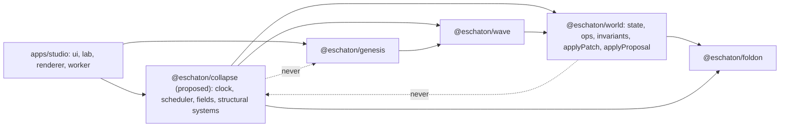
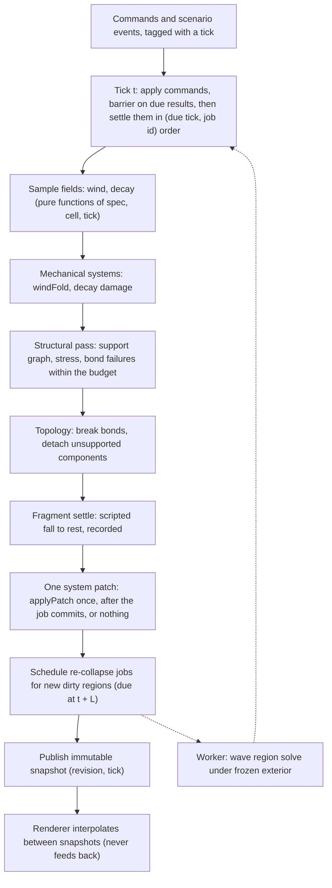

# Phase 4 — Collapse: architecture plan (proposal)

- Status: **PROPOSAL for the owner's review. Phase 4 is NOT authorized.** Nothing here is implemented or approved, and no code accompanies it. It becomes a plan only through an explicit owner decision at or after the Phase 3 gate. If anything here differs from the master plan, the master plan wins.
- Date: 2026-11-26. Written against `main` @ `870ef62`, with Phases 0–3 merged. The Phase 3 gate is still open ([`../phase-3-exit.md`](../phase-3-exit.md)).
- Revised 2026-11-27, against `main` @ `03760d2`, to match the design review of draft ADRs 0018 and 0019. That review covered tick atomicity, the session cursor, the late-worker stop, integer stress, anchors, non-structural pieces, the read set and exterior protection. Where this sketch and a draft ADR differ in detail, the draft ADR states the detail; the owner decisions stay in §7. Still a proposal: nothing is accepted or authorized.
- Canonical scope: [`../master-plan.md`](../master-plan.md) §11, Phase 4 row: "Fixed tick, fields, support graph, topology change and local re-solve". Exit criteria: "Reproducible event sequence; local repair protects exterior; damaged pieces detach; failed solve rolls back; no duplicate ownership". Also §5.4, §6.1–6.2, §11.1 and §12.
- Builds on: ADR 0007 (systems and the tick belong to Phase 4), 0010 (identity, ownership, lineage), 0011 (transactions, versions, determinism scope; tick and idle-tick questions), 0013 (logical versus rendered; fragments are layer C), 0014 (bonds; "how a broken bond will differ from contact"), 0015–0016 (local region solve, read sets), 0017 (district generation, scoped seeds, scratch world).

## 1. What Phase 4 must prove, and what it must not attempt

**The slice:** a committed Last District, a user-triggered local decay or wind event, a roof or tower that loses bonds and detaches as fragments that settle, and a local re-collapse of the damaged lots under a frozen exterior. Neighbouring structures stay identical, and the whole sequence reproduces from its inputs. This is the Collapse half of the §11.1 vertical slice. Rebuilding from the fragments is Phase 6.

| Required in Phase 4 | Deferred, and where it goes |
|---|---|
| Fixed logical tick at 30 Hz, with pause, step, reset and replay | Real-time physics engine, rigid-body contacts between fragments (master plan §6.2 "later compare a rigid-body engine"). Not planned before measured need |
| Wind and decay as authoritative field inputs, sampled per entity | Heat, water and growth fields (§6.2). Visual-only effects such as dust, ink erosion and flutter go to **Phase 5** (Atmosphere) |
| Structural support graph on stored bonds, with ground anchoring, a stylised stress heuristic and a per-tick failure budget | Engineering-grade analysis (§6.2 excludes it); stress visualised as crease darkening (**Phase 5**) |
| Explicit bond breaking and detaching of unsupported components, identity kept, lineage recorded | Reassembly, finite-inventory search and conservation-mode reconstruction: **Phase 6** |
| Fragment settle as a recorded, deterministic outcome | Fragment-to-fragment collision and stacking |
| Local WFC re-collapse of the damaged region under a frozen exterior, with conflict, retry and rollback | Chunk streaming, seams, LOD and persisted overlays across reload: **Phase 8** (research) |
| Studio controls: trigger an event, play, pause, step, replay; overlays for support and damage | Cinematic camera and final art: **Phase 5** and **Phase 7** |

Not in scope at any point: an ECS framework, a generic plugin system, or a separate simulation world state (master plan §7.2).

## 2. Architecture

### 2.1 Packages and dependency direction



- **`@eschaton/world` stays the only owner of state.** Phase 4 adds a small set of new ops and invariant changes there (§2.4). It does not gain a clock, a scheduler or field code.
- **`@eschaton/collapse` (proposed new package; owner decision P4-1)** holds:
  - the fixed-step clock and the system schedule;
  - field samplers;
  - the structural pass;
  - fragment settling;
  - dirty-region planning for re-collapse.

  Like `wave` and `genesis`, it is pure (no renderer, UI or Node built-ins) and holds no world state of its own. It does not import `genesis`: a scenario passes the ruin tile set to it as data.
- The alternative is to put the systems in `@eschaton/world`, which is where `windFold` lives today. That is rejected as the default because it would make `world` both the validator of patches and their main author.

### 2.2 Tick pipeline (one tick)



This is master plan §6.1 made concrete. The order is fixed and part of the session's `schedule` version, which the input log carries (draft ADR 0018 §3). It is not part of `versions.rules`, in line with P3D-4 (a). Each tick first applies its commands; then a barrier waits for every result still due at the tick, before anything commits (ADR 0018 §4, §6).

### 2.3 Fixed step

- **30 Hz** (master plan §6.1, "start with 30 Hz"). Why:
  - a 33.3 ms step leaves two 60 Hz render frames per tick to interpolate;
  - structural change is meant to read as paced and "occasional" (§2.2), not continuous;
  - the measured Phase 3 settle costs (25–111 ms per commit at 1.6k–9k entities, §5 of the Phase 3 exit report) already show that a commit per tick at 60 Hz is out of reach without new work.
- **Time is an integer tick.** Simulated time is `tick / 30`; nothing accumulates a float `dt`. Rates in field and system specs are per tick.
- **Catch-up is capped** at 4 ticks per animation frame. Beyond that the clock drops wall time, not ticks. The logical sequence never depends on frame rate; only the wall-clock pace does.
- **Pause, single step, reset and replay** act on the clock owned by the simulation session, not on the world.

### 2.4 World additions (contract sketches; illustrative, not code)

```ts
// New ops, validated and recorded like every other op (ADR 0011). All values integer.
type WorldOp =
  | /* existing ops */
  | { op: "damage"; entity: EntityId; amount: number }   // integer milli-units, 0 < amount
  | { op: "break"; bond: BondKey }                       // removes a stored bond, records it as broken
  | { op: "settle"; entity: EntityId; transform: ContinuousTransform }; // fragment rest pose (detached only)

// Entity runtime state gains integer damage; definitions keep strength as data.
type Entity = { /* existing */ damage: number };          // 0..1000, part of the state hash

// Bonds: stored ⊆ eligible (ADR 0014, "how a broken bond will differ from contact").
type WorldState = { /* existing */ broken: readonly BondKey[] }; // canonical order; settling never re-creates these
```

- **Invariant 2 of ADR 0014 is relaxed** from "every eligible pair has a stored bond" to "every eligible pair has a stored bond or is listed in `broken`". `attach` (or a future `mend`) is the only way back. This raises `invariants@` in `versions.rules`. Older snapshots are then refused as `rules-mismatch` (owner decision P4-6 covers migration).
- **The header `tick`** becomes the tick of the latest commit. An idle tick commits nothing and writes no record (owner decision P4-3).
- **The `detach` op already exists.** It keeps the entity id, sets owner `detached` and the `ContinuousTransform` to the logical pose (ADR 0010/0013), and removes the entity's bonds. Splitting a piece into P09 fragments uses the existing `split` op with lineage, and is an optional milestone (CL4b).

### 2.5 Fields and systems

- **Field specs are data:**
  - wind: a uniform vector plus optional gust boxes `{ region, vector, fromTick, toTick }`;
  - decay: zones `{ region, ratePerTick }`.

  They enter through recorded commands. Sampling is a pure function of `(spec, cell, tick)` at the entity's anchor cell, using only integer arithmetic or correctly rounded IEEE operations. `Math.hypot`, `sin`, `cos`, `atan2` and `pow` (other than exact power-of-two scaling such as the existing `2 ** 500`, ADR 0018 §4) are banned from authoritative paths. ADR 0017 shows what they cost in cross-engine determinism.
- **A system has the existing shape** `{ id, reads, plan(view, input) }` (ADR 0007). The scheduler runs the systems of one tick in a fixed order against a drafted state (the `draftProposal`/`advance` pattern: validated, not hashed). It concatenates their ops and commits **one system patch per tick**, after the tick's due job settlements, each of which is its own atomic commit. If any system op is invalid, the system patch commits nothing, the job commits already made at that tick stand, and the session fails terminally with the system id and the issue (fail-stop; owner decision P4-4; draft ADR 0018 §5 compares this with a single transaction per tick).
- **Scoped seeds**, as in ADR 0017: `seed(world seed, tick, system id, scope)`, from integer streams only. Equally overloaded bonds are ordered by canonical key, not by a seed (ADR 0019 §4).

### 2.6 Structural model (stylised, explicitly not engineering)

- **Support graph:**
  - Nodes are placed entities with a `structural` component.
  - Edges are **stored bonds**. Geometric contact without a bond carries no load. This keeps support separate from adjacency (ADR 0014's four facts).
  - **Anchors** are structural entities with a footprint cell at the scenario's ground level, or pinned by the scenario. Ground pieces (`paving`, `water`, `bridge`) are not structural and nothing bonds on top of them, so they are never anchors (ADR 0019 §3).
- **Stress heuristic (integer):**
  - Each node carries load 1 plus the load of nodes that depend on it through the breadth-first layering from the anchors.
  - A bond fails when its carried load × 1000 exceeds an integer capacity built from `strength` (a float in the catalog, converted once to milli-units), the scale `S` and the larger damage of its ends.
  - The exact rule, its numeric bounds and the ranking of zero-capacity bonds belong to ADR 0019 §4; the point is that it is integer and order-independent.
- **Failure budget:** at most `K` bond breaks per tick (proposed K = 8). They are chosen by descending overload, then by canonical bond key. A collapse therefore cascades over several ticks: it is readable (§2.2 pacing), and every tick's cost is bounded.
- **Disconnection:** after the breaks, compute connected components over the support graph. A component with no anchor detaches as a whole that tick. Components are ordered by the lowest entity creation stamp, and entities inside one by stamp. Non-structural pieces follow what they are bonded to (owner decision P4-11).
- **Fragment settle:** a detached fragment falls along a scripted, closed-form path to a rest pose on the ground plane. The pose is chosen from `(fragment id, scope seed)` with basic arithmetic. It is committed by a `settle` op when reached, and in-between poses are render interpolation only. There is no rigid-body solver (§1). Detached fragments never occupy logical cells (ADR 0013 layer C), so they cannot block placements.

### 2.7 Local re-collapse (no full world reset)

1. **Dirty region.** Take the bounding box of the cells vacated by detaches since the cascade began (P4-12). Expand it to the complete footprints of every placement it intersects (§5.4) and clip it to the district. The read set is the region plus its one-cell shell (ADR 0016).
2. **Protected content.** Network ground pieces (`paving`, `water`, `bridge`) and any entity marked pinned by the scenario are never in a write set; they are pins for the solver. The semantic plan is not persisted (ADR 0017, choice 4), so protection is derived from world content. Persisting the plan is the alternative (owner decision P4-7).
3. **Nonlocal dependencies.** The job declares the road cells adjacent to the region as `depends` (the ADR 0017 mechanism). The scenario policy says what may fill the region: "preserve ruins" (ruin and air tiles only) is the default for the slice.
4. **The solve** runs in the existing wave worker host with cancellation, against a snapshot. Its result is an inert proposal.
5. **Settling at a deterministic boundary.** A job is dispatched once the cascade that caused it has stopped breaking and detaching (owner decision P4-12, ADR 0019 §6). A job scheduled at tick `t` is due at `t + L` (proposed L = 15 ticks, 0.5 s, comfortably above the §9.1 p95 target of 250 ms). At the start of tick `t + L` its result is settled through `applyProposal`. If the worker is late, the clock **waits** instead of advancing, so a slow machine changes the pace but not the sequence (owner decision P4-2). A wait past a wall-clock bound stops the session; only an `abandon` or `retry` that resolves it is recorded, never the stop itself (ADR 0018 §6).
6. **Conflict and rollback.**
   - A digest change in the read set or the dependencies is a `conflict`. The job is re-dispatched against the new state, at most twice, then abandoned with a diagnostic, and the ruin stays as it is.
   - A new dirty region that overlaps an outstanding job cancels and merges it.
   - An invalid or failed result commits nothing; that is the existing guarantee of `applyProposal`.

**A read-set gap Phase 4 must close.** `readRegion`'s digest covers placed entities' ids, definitions, anchors and rotations. It does not cover fold angles, bonds, broken bonds or damage. For a re-collapse that relies on "these neighbours are intact", the bond state of the shell has to be in the digest. Otherwise a proposal can commit on top of a neighbour that broke after the job read it. Proposed: an ADR 0016 amendment that adds the stored bonds and broken keys of read entities to the digest (owner decision P4-5). Damage is left out, because decay changes it every tick and would make every job near a decay zone conflict. The digest is transient, so this needs no version of its own; the rules bump comes from the new state fields (ADR 0019 §6).

### 2.8 Identity, ownership, conservation

- Detach keeps ids, and ownership moves `placed → detached` (ADR 0010). Split children get new ids and lineage records. Nothing is ever duplicated: a detached entity owns no cells, and a region proposal can only `consume` placed entities wholly inside its region.
- **Conservation in the slice is `off`.** Re-collapse mints new pieces, and generation is refused in closed mode (ADR 0016). Conservation-mode collapse with reconstruction from inventory is Phase 6. `split` and `detach` already conserve quantity, so closed mode remains valid for collapse without re-collapse.
- The open questions Q9 (conservation key) and Q10 (group on detach) become concrete here. Phase 4 keeps the provisional rules and lists them again (P4-8).

### 2.9 Replay, render snapshots, determinism scope

- **Replay** stays as it is: initial snapshot + log, each record's state hash verified (ADR 0011). Each record carries its tick. Re-collapse commits are recorded as outcomes, so replay never re-runs the solver or the systems.
- **Re-simulation** is the stronger Phase 4 promise: re-running the clock from the initial snapshot and the command log reproduces the same records. It holds on Node and is pinned on Chromium, Firefox and WebKit through the engines job, for the declared scope only. That scope is integer field and structural maths, correctly rounded float operations in `windFold`, and recorded settle outcomes. A finite corpus supports the claim; it does not prove it for every input (owner decision P4-9 on promising it).
- **Rendering** consumes immutable snapshots tagged `(revision, tick)` and interpolates fragment transforms and fold angles between the last two. Nothing the renderer computes (decorative offsets, interpolated poses, effects) is read back by a system or hashed (ADR 0013).

### 2.10 Performance and cancellation budget

| Item | Budget (proposed; measured before it becomes a gate) |
|---|---|
| Systems of one tick (main thread, district of about 1.5k–9k entities) | p95 ≤ 8 ms |
| Tick commit | p95 ≤ 16 ms at 2k entities; **at 9k entities today's O(world) state hash alone has a p95 of 40.6–48.1 ms** (re-measured 2026-11-26, decision packet §5.1; the 28 ms of [`../phase-3-exit.md`](../phase-3-exit.md) §5 was a single sample), so it does not fit a 33 ms tick |
| Re-collapse solve (worker) | p95 ≤ 250 ms (§9.1); cancellation observable within one slice |
| Main thread during a solve | No solver long task (existing Phase 2 guarantee) |

The commit-cost row is the main technical risk. Milestone CL1 measures it first. The options are:

- an incremental state hash, which is a hash-format change ADR 0011 reserved for the owner;
- hashing only at checkpoints every N ticks, which changes the meaning of `CommitRecord.stateHash`;
- fewer committing ticks: only ticks with changes commit, and the failure budget keeps them small.

This is owner decision P4-10. No option is taken silently.

## 3. Invariants (checked at every commit unless noted)

1. No entity is owned twice. A detached or consumed entity owns no cells (existing, ADR 0010).
2. Stored bonds ⊆ eligible contacts. No stored bond is also listed as broken, and settling never re-creates a broken bond.
3. Every placed structural entity is either connected to an anchor through stored bonds or detached in the same tick (checked after the structural pass, by the audit).
4. After a committed re-collapse of region R, every entity the proposal does not consume keeps its id, definition, owner and pose, fold angles and damage. That includes detached fragments and entities only partly inside R. Every bond and broken record with neither end consumed is unchanged; the only bond changes are the removal of those with a consumed end and the addition of those with an instantiated end ("local repair protects exterior"; made precise in draft [ADR 0019](../decisions/0019-structural-support-and-bond-failure.md) §7, because consuming or placing a piece inside R necessarily changes its bonds to exterior neighbours).
5. A failed, cancelled, conflicting or late re-collapse changes nothing.
6. Same initial snapshot + same command log → same records (ids, ticks, state hashes) on Node and the three engines in scope.
7. `damage` is an integer in [0, 1000] and never decreases without an explicit repair op (none in Phase 4).

## 4. Test-first cases (public seams only; no mocks, spies or sleeps)

Each test is written failing first at `@eschaton/world` or `@eschaton/collapse`, or drives the Studio in a real browser.

- "an idle tick commits nothing and leaves the state hash unchanged"
- "the same command log re-simulates to the same records" (Node), and the same on three engines (engines job)
- "a decay zone damages only entities whose anchor cell lies inside it"
- "a bond whose carried load exceeds its damaged strength breaks, and an unloaded one does not"
- "no more than K bonds break in one tick; the rest break in later ticks, in canonical order"
- "a component that loses its last anchor detaches whole in the same tick and keeps every entity id"
- "settling bonds after an unrelated commit does not re-create a broken bond" (the ADR 0014 hazard)
- "a fragment's settle pose is the same on every run and is recorded, not recomputed on replay"
- "a re-collapse commits inside its dirty region, leaves every entity it does not consume identical, and changes no bond whose ends it neither consumed nor instantiated" (invariant 4)
- "a re-collapse whose shell changed after it was read conflicts and commits nothing" (structural-state digest)
- "a re-collapse result that would place a piece on a road is refused"
- "a late worker result makes the clock wait instead of committing at a different tick"
- "a cancelled re-collapse posts one cancelled result and changes nothing"
- **Failure tests:**
  - "an invalid op from any system commits no system patch, keeps that tick's job commits, and fails the session with the system id";
  - "a dirty region that cannot be solved within budget leaves the ruin and reports it";
  - "a snapshot from before the broken-bond rules is refused as rules-mismatch".
- **e2e:**
  - "triggering decay on a tower collapses it over several ticks, detaches fragments, re-collapses the lot, leaves the neighbouring houses' entities identical, and changes their bonds only to pieces the re-collapse instantiated";
  - "pause, step and replay reproduce the same revision sequence".

## 5. Milestones and dependency order

Milestones are labelled CL0–CL7 so that they cannot be confused with the RTX 5070 checks C1–C6 or with owner decision labels.


| | Scope | Depends on | Owner decisions needed first | Decisive evidence |
|---|---|---|---|---|
| CL0 | Owner decisions P4-1…P4-12; ADR 0018 (clock, tick commit, system order) and ADR 0019 (structural support and bond failure) accepted; ADR 0014 and 0016 amendments | Phase 3 gate decided; Phase 4 authorized | P3D-1; Phase 4 authorization; drafts [0018](../decisions/0018-clock-tick-and-system-order.md) and [0019](../decisions/0019-structural-support-and-bond-failure.md) reviewed | Recorded decisions |
| CL1 | Clock, scheduler, one system patch per tick, idle ticks, pause, step, replay, re-simulation to an exact cursor; **tick commit cost measured at 2k and 9k entities** | CL0 | P4-1, P4-3, P4-4, P4-10 (c) for the slice | Unit tests above; benchmark on a clean SHA with load stated |
| CL2 | Field specs and sampling; `windFold` under the clock; decay damage op | CL1 | none beyond CL1 | Field and damage tests |
| CL3 | Broken-bond state, support graph, stress heuristic, failure budget, disconnection detach | CL2 | P4-6, P4-11; ADR 0019 §1–§5 (rules bump, shared with CL1's if they ship together) | Structural tests; invariants 2, 3 and 7 |
| CL4 | Fragment settle (recorded); CL4b optional: P09 split fragments with lineage | CL3 | P4-8 stays provisional | Settle and replay tests |
| CL5 | Dirty region, protected content, re-collapse job, structural-state digest, settle at `t + L`, conflict, retry, rollback | CL3, and CL1's commit-cost decision | P4-2, P4-5, P4-7, P4-12; ADR 0018 §6 late-result bound | Re-collapse, conflict and late-worker tests; three-engine re-simulation |
| CL6 | Studio: event triggers, play, pause, step, support and damage overlays, replay | CL1–CL5 | none new | e2e above |
| CL7 | Corpus (at least 10 seeds × 3 events), cross-engine run, performance profile, screenshots on a physical GPU, exit report | CL6 | P4-9 (or deferred); ADR 0003 closed-loop gate done; owner visual review | Exit report; CI green on the exact head |

**External dependency.** The closed-loop crease research gate (ADR 0003 amendment) must run "before the Phase 4 gate". It is independent of CL1–CL6, so it can run in parallel but must finish before CL7.

## 6. Acceptance and evidence gates

- Master plan exit criteria, each mapped to a named test. "Reproducible event sequence" is mapped to re-simulation, not only replay.
- CI green on the exact head (lint, typecheck, unit, build, e2e; engines job extended with the re-simulation pin).
- Benchmarks recorded on a clean SHA, with machine, load and engine stated. CI and local figures are kept separate.
- **Owner visual review** of the collapse sequence against the reference (§11): a still series and a short capture. Visual approval is never inferred from tests.
- The RTX 5070 manual test C1–C6 stays pending and is not waived. Owner decision P3D-5 (2026-11-27) makes it due before any Phase 5 work. Phase 4 does not change that.

## 7. Owner decisions (with recommended defaults)

| Id | Question | Alternatives | Recommended default |
|---|---|---|---|
| P4-1 | Where the clock and systems live | (a) new `@eschaton/collapse`; (b) inside `@eschaton/world` | (a): keeps the world a validator, not an author |
| P4-2 | When worker results commit | (a) at `t + L`, the clock waits if late; (b) at the tick they arrive, with the tick recorded (replay-only reproducibility) | (a): live runs reproduce from inputs, at the cost of a visible wait on slow machines. A wait past a wall-clock bound stops the session; only the `abandon` or `retry` that resolves it is recorded (ADR 0018 §6) |
| P4-3 | Idle ticks | (a) no record, header tick = tick of last commit; (b) a record per tick | (a): logs stay small and hashes unchanged when nothing happens. The cursor is session state and is never recovered from a world snapshot: a run continues in memory or by exact re-simulation (ADR 0018 §2) |
| P4-4 | A system emits an invalid op | (a) fail-stop; (b) drop that system's ops and continue. Under (a): (a1) separately atomic job commits, then one system patch, with a terminal failure; (a2) one validated transaction per tick | (a1): an invalid op is a defect and should be loud, and (a1) needs no new world transaction API (ADR 0018 §5) |
| P4-5 | Read-set digest and structural state | (a) add stored bonds and broken keys to the digest; (a+) also damage; (b) keep it placement-only and accept stale-support commits | (a). Damage is left out because decay changes it every tick (ADR 0019 §6). The digest is transient, so no version bump of its own |
| P4-6 | Snapshots from before the rules bump | (a) refuse (current policy); (b) a written migration that sets `broken = []` and `damage = 0` | (b) only if real saved data exists; otherwise (a). The repository holds no snapshot or log that would need it. ADR 0019 §1 proposes an encoding that keeps Phase 3 entity and bond content byte-identical, so (b) would be only a header rewrite and a new hash |
| P4-7 | What re-collapse may not touch | (a) derive protection from world content (network ground pieces, pins); (b) persist the semantic plan in the world | (a) for Phase 4; (b) revisited at Phase 6 or 7 |
| P4-8 | Q9 conservation key, Q10 group on detach, Q5 tombstones | Keep the provisional rules, or decide now | Keep provisional; decide before Phase 6 |
| P4-9 | Re-simulation across engines as a product promise | Promise for the named engines, or keep as a tested property | Tested property; promise decided at Phase 7. The owner's P3D-6 (2026-11-27) keeps Phase 3 cross-engine determinism a tested property; it does not decide this item |
| P4-10 | Tick commit cost at 9k entities | (a) incremental hash (format change); (b) checkpoint hashes; (c) accept fewer committing ticks | (c) for a one-district slice, on the figures of 2026-11-26 (decision packet §5.1: one loaded machine, evidence and not proof). CL1 measures again on a clean SHA before any of it becomes a gate |
| P4-11 | Non-structural placed pieces (`P09`, `leaf`) after a collapse | (a) they follow what they are bonded to and detach in the same tick; (b) they stay placed, recorded as a known limitation | (a) (ADR 0019 §5); CL3 counts them either way |
| P4-12 | When a re-collapse job is dispatched | (a) at the first tick after the detach in which the structural pass breaks and detaches nothing; (b) at the detach tick | (a): a job read during a cascade conflicts until it is abandoned (ADR 0019 §6) |

## 8. Risks

| Risk | Handling |
|---|---|
| The O(world) state hash makes 30 Hz commits too slow at district scale | Measured first (CL1); P4-10 |
| The stress heuristic looks arbitrary | The budget makes it legible; the owner judges the collapse visually; the rule is versioned so it can change |
| Re-collapse fills ruins with something that reads as new building | The default policy is ruin and air tiles only; the owner judges |
| Fragments rest where re-collapse places pieces (visual overlap; logically legal) | Visible in the slice; a scenario rule may keep rest poses outside dirty regions; recorded as a known limitation if unresolved |
| Scope creep into effects or physics | §1 table; any addition needs an owner decision |
