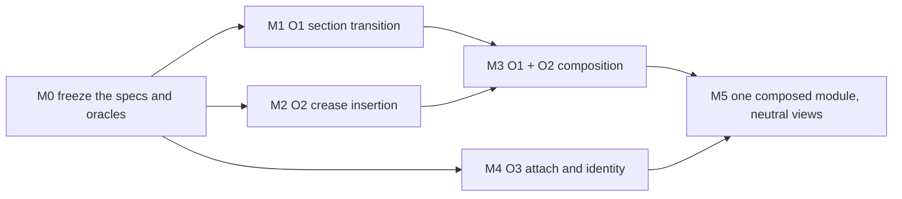
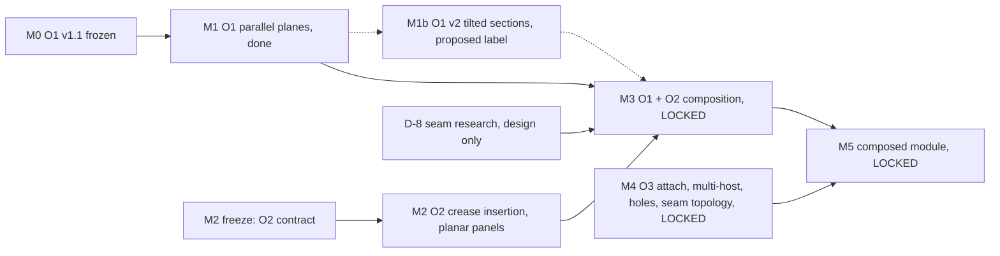

# Geometry Operator Laboratory (PROPOSAL ONLY)

- **Status: PROPOSAL.** Nothing here is implemented or authorized. No package, app, solver, runtime prototype, runnable lab or dev server exists for it, and this document creates none. Running any milestone below needs a **separate owner authorization**, which this proposal does not ask to be inferred from anything (GOV-1).
- **Subject:** the operators O1, O2 and O3 of [`geometry-operators.md`](geometry-operators.md).
- **What kind of work this is:** small, isolated mathematical feasibility research. ART-1 permits that kind of work before concept approval: "for example folding one candidate module in an experiment". It is **not** object implementation, it is **not** ART-1 concept approval, and it is not Geometry V4.
  - No object (raven, vehicle, building, tree or holdout) would be built by this laboratory.
  - Its outputs would be operator properties, not artwork.

## 1. Two kinds of acceptance, kept apart

| Kind | Asks | Decided by | Lab's role |
|---|---|---|---|
| **Mathematical validation** | Does the operator meet its stated pre- and postconditions, invariants and error bounds on the fixtures? | an oracle independent of the implementation, plus the tests at the public seam | produces it |
| **Aesthetic acceptance** | Does a form built with it read well? | ART-1 and ART-5 (owner), ART-2 and GEO-2 (independent reviewer) | **none.** The neutral multi-view images in M5 are evidence for a reviewer, never a verdict |

A green lab never implies an ART or GEO-2 pass (GEO §1.4).

## 2. Milestones, in dependency order

**Why the order starts with section transition and explicit fold and attach.**
- O1 is the operator behind the F1 failure, which every round has repeated.
- O2 is the only route by which a line becomes a declared crease (F4).
- O3 sits on the open contract questions (Q1, Q2), so it is fenced off and done in parallel, without touching Foldon.

| # | Milestone | Smallest decisive question | Fixtures (manual numbers; [`geometry-operators.md`](geometry-operators.md) §3) | Stop if |
|---|---|---|---|---|
| M0 | Freeze | Are the operator contracts, error codes and oracles written down before any code? | this document and `geometry-operators.md` at one commit | any contract still says "to be decided" |
| M1 | O1 | Does the band have planar faces only, Minkowski slices, the prismoidal volume and a non-overlapping layout on the fixtures, and does it reject what it must? | square→diamond: 8 triangles; sides 2, √2, √2 and √2 ×3; V = 10/3; the layout as listed. Similar squares: 4 trapezoids (frustum). v5 `PENT` pair 0.322→0.268: hull triangles, where the matched loft warps 0.0039 L. Cap (B a point). Wedge (B a segment) | a fixture's planarity or volume oracle disagrees beyond the stated tolerance; or a non-convex or crossing input is accepted |
| M2 | O2 | Does a straight crease keep convexity and edge lengths, keep the tree, and reject a crossing or splitting crease? | unit square split by x = 0.5 at θ = ±90°; camber c = 1, s = 0.1 with k = 1, 2, 3, 5: deviations 0.0252, 0.0112, 0.0063, 0.0028 L and fold angles 22.6°, 15.1°, 11.3°, 7.5° | a posed edge length changes beyond 1e-9; or a crossing crease is accepted |
| M3 | O1 + O2 | Do the declared folds of a three-keyframe mass coincide with the band's fold rings, with no tessellation edge left as a visible line? | three keyframes: two off the Minkowski path, one on it. The on-path ring must be reported as a tessellation ring with dihedral 0 | the on-path ring is reported as a fold, or a fold ring is lost |
| M4 | O3 | Does mating port frames place the child exactly, preserve identity under detach and attach, and reject each documented incompatibility? | the frame product worked by hand for an edge port at 30° about a hinge; detach and re-attach keeps both ids; one negative control per failure code | an id changes; a rejection lacks a reason; Foldon would need a change (that is Q1 or Q2, so stop and ask the owner) |
| M5 | One composed module | Are all invariants met at once, and is the module deterministic? Plus neutral views for a reviewer | one mass (O1, three keyframes) + one camber (O2) + one attached leaf (O3) | any GEO-1 negative control passes when it should fail |

## 3. Oracles and the test plan

**Oracles** (each independent of the code under test):
- **Planarity:** largest vertex distance to the Newell plane, at most 1e-6 (Foldon's tolerance).
- **Volume:** the prismoidal formula h/6 · (|A| + 4|M| + |B|), with |M| from a support-function computation, compared with a tetrahedral decomposition.
- **Slices:** the polygon at height t compared with (1 − t)A ⊕ tB built from support functions (Hausdorff at most 1e-9 L).
- **Layout overlap:** an exact 2D triangle-pair test.
- **Rigidity:** edge lengths before and after posing.
- **Identity:** a hash of the quantised parameters.

**Property-based tests,** seeded, with no global randomness:
- random convex pairs in parallel planes always give only triangles and trapezoids, the face count equals the number of distinct edge normals, and the volume matches the formula;
- random non-crossing crease lines always give convex pieces and a tree;
- random frames: attach followed by detach is the identity on ids.

Generators use an explicit seed, so every failing case is reproducible from (seed, index).

**Regression and negative controls,** one test per cause:

| Operator | Negative controls |
|---|---|
| O1 | `non-convex-section`, `sections-cross`, `thin-panel` (two edge directions 0.1° apart), `degenerate-band`, `partition-twist` |
| O2 | `line-misses-panel`, `splits-crease`, `closed-network` (a crossing pair) |
| O3 | `kind-mismatch`, `side-mismatch`, `length-mismatch`, `angle-not-allowed`, `port-in-use`, `not-a-tree`, `overlap-short`, `clearance`, `collision` |

Each control must fail for exactly its stated reason.

**Seam.** Tests import one entry point only and use no mocks, spies or sleeps (`AGENTS.md` test rules). The entry point would be named in the M0 authorization; none exists now.

**Reproducibility.** Every fixture is a committed list of input numbers with its expected outputs, which are the manual values above. The operator version and the commit SHA are printed with every result (GEO §1.3).

## 4. Visual plan, for M5 only

- Neutral clay, one key light, fixed cameras, flat shading (GEO-5.1).
- Views: three-quarter, front, side, top and the end view along the spine, plus the flat layout of each sheet with its crease assignment.
- The images come from a committed capture script at a clean commit (GEO-5.3), and an independent reviewer inspects the pixels (GEO-5.4).
- This is evidence for a reviewer, not acceptance (§1).

## 5. Budgets, justified by scale

| Item | Budget | Why |
|---|---|---|
| Panels per mass | at most 2kK (k vertices per keyframe, K keyframes) | O1's exact face count. For B-2 v7's body this is at most 192 |
| Time | linear in panels per band. O1 is O(m + n). Collision checks are measured, not promised | the per-object cost is reported in milliseconds (GEO-6.5) |
| Stop condition | stop and report if any operator measures super-linear | the world profile is 10 000 entities (`profile:commit`); the cost per object must stay linear before any district use is discussed |

No absolute millisecond budget is set before a measurement exists.

## 6. Integration gates and stop conditions

1. **No milestone runs without the owner's authorization.** This proposal is not one.
2. **The lab never edits `packages/*` or `apps/*`** (GEO-6.1). If a milestone needs Foldon to change, the lab stops and the need goes to the owner as Q1, Q2, Q3 or Q4.
3. **After M5, any proposal to promote an operator to a production API** is a separate owner decision. It needs:
   - the Q1–Q6 answers it depends on;
   - a catalog-versioning answer (Q6);
   - GEO-6.
4. **Bounded effort.** If M1 cannot pass its fixtures after one revision, the work stops with a NO-GO report and the precise remaining items (GEO §1.12). Fixtures are never weakened.
5. **No added gate.** The lab adds no new gate and no new checklist. It reports against existing GEO criteria and the operator contracts.

## 7. Acceptance matrix (mathematical only)

| Property | O1 | O2 | O3 | Oracle |
|---|---|---|---|---|
| Planar faces | required | required | inherited | Newell distance |
| Convex panels | required | required | inherited | turn sign |
| Edge lengths under pose | n/a (static) | required | required (rigid placement) | length comparison |
| Tree creases | half-bands, or Q4 | required | assembly tree | `analyzeTree`-style traversal |
| Slices and volume | Minkowski, prismoidal | n/a | n/a | support functions |
| Layout without overlap | per case, reported | per case | n/a | exact 2D test |
| Identity under detach and attach | n/a | n/a | required | id equality |
| Determinism | required | required | required | same inputs give the same hash, on two engines (P3D-6) |
| Rejection with a reason | all of its codes | all of its codes | all of its codes | one negative control each |

## 8. Errata after the independent review (2026-11-27)

- **M3 milestone.** The off-path ring is a **seam** between band sheets, not a fold ([operators §9](geometry-operators.md#9-errata-after-the-independent-review-2026-11-27) item 1). The decisive question becomes: are the seams at off-path rings reported as seams with their dihedral and angle defect, and is the on-path ring reported as a tessellation ring?
- **M1 fixture.** The warp metric must be named; proposed: the distance between the diagonals. The v5 warp figure is replaced by the reviewer's actual-frame values.
- **Determinism.** It needs exact predicates, not quantisation alone (operators §9 item 4).

## 9. Status after M0–M1 (2026-11-28)

- **Authorization.** Owner decision D-3 (decision packet §0.3) authorized M0 and M1 only, in isolation.
- **M0.** The O1 contract was frozen in [`geometry-operator-lab/m0-o1-contract.md`](geometry-operator-lab/m0-o1-contract.md): v1 at `58b424f`, then v1.1 at `33e7f67` after an independent mathematical review returned GO WITH AMENDMENTS. The freeze came before any script.
- **M1.** It was implemented test-first under [`geometry-operator-lab/`](geometry-operator-lab/README.md) as standalone Python scripts (D-5).
- **Differences from this proposal.** They are listed in contract §9 (C10–C16), with their reasons:
  - the `thin-panel` control is reversed by the mathematics (C13);
  - the "exact 2D triangle-pair" overlap test becomes a float separating-axis test with a stated band (C14);
  - planarity and slices are checked exactly (C15);
  - two-engine determinism is claimed only for what was compared (C16).
- **Not started.** M2–M5, O2 and O3 need a new owner decision.

## 10. Roadmap after D-6 to D-10 (2026-11-28)

- **Authorization.** Owner decisions D-6 to D-10 and the laboratory CI job (decision packet §0.4) permit research execution only. Results and their evidence are in the laboratory [README](geometry-operator-lab/README.md) and in packet §12. The §2 milestone table above stays as proposed; this section records what changed in the order.
- **M1b, tilted sections (proposed label).** An O1 v2 contract for two convex sections on distinct, non-parallel planes, under D-7. It has its own freeze, review and version, and it never edits contract v1.1 or its evidence. It is a research track beside M1, not a prerequisite of M2.
- **M2 does not depend on M1b.** O2 acts on one planar sheet in its rest plane. Its inputs are planar convex panels, so it needs no O1 result of any version. M2 proceeds after its own contract freeze (D-6).
- **M3 stays locked.** M3 (O1 + O2 composition) needs a separate owner permission and seam evidence: every off-path O1 ring is a seam between sheets (operators §9 item 1), so M3 cannot be specified before the seam research of D-8 says how sheets meet. If M3 uses tilted rings, it also needs a frozen and tested M1b.
- **M4 and M5 stay locked.** Under D-9, multi-host attachments, holes in panels and advanced seam topology belong to M4 and are not worked around anywhere earlier.

Dashed arrows are conditional: M1b feeds M3 only if M3 needs tilted rings.

### 10.1 Deferred to M4 under D-9 (not worked around)

| Topic | Why it is deferred | Dependency | Open questions |
|---|---|---|---|
| **Multi-host attachments** (one element held by two or more hosts, for example the holdout's strings) | O3 as proposed mates one child port to one host port. Two hosts close a loop in the assembly graph, so the assembly is no longer a tree | O3 single-host contract (M4); Q1/Q2 (how a bond is represented) | Is a second host a constraint (closure residual) or a second bond? Which host owns identity on detach? What tolerance closes the loop? |
| **Holes in panels** (the holdout's peg holes) | A Foldon panel is one convex polygon. A hole makes the panel non-simply-connected, and O2 splits only simply connected convex panels | Q3 or a panel representation decision; O2 (M2) for the convex pieces around a hole | Is a hole a set of convex panels around a void (a seam ring), a separate boundary loop, or an attached element? |
| **Advanced seam topology** (seams that meet at a vertex shared by three or more sheets, seams that cross creases, seam networks with cycles) | D-8 studies only one seam between two sheets along matching boundary chains | D-8 results; Q1, Q2, Q4; ADR 0019 | Vertex closure at a three-sheet corner; whether a seam cycle needs a global closure constraint; how seams and creases share a vertex |

### 10.2 Status after D-6 to D-10 (2026-11-28)

- **M2:** done in isolation under D-6. Contract v1.1 frozen after review; tests first; implementation by a separate agent; final review PASS WITH FINDINGS; one bounded test revision.
- **M1b:** done as a bounded experiment under D-7. Contract v2.2; same discipline; final review PASS WITH FINDINGS.
- **D-8:** seam research, design only.
- **CI:** an independent "Math lab" job.

Details and verdicts are in the laboratory [README](geometry-operator-lab/README.md) and in packet §12. **M3, M4 and M5 stay locked.**
