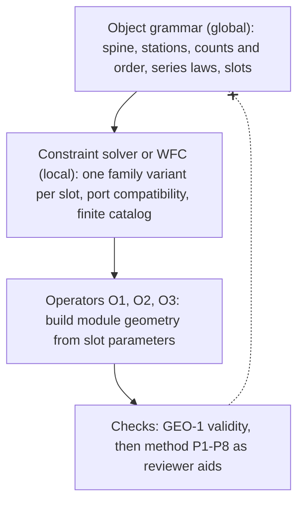

# Geometry operators for composable folded form (research proposal)

- Status: **RESEARCH PROPOSAL. Not adopted, not implemented, not authorized for implementation.** It was written under the owner's third ART-D3b ruling ([decision packet](../review/art-1-raven-decision-packet.md) §0.2). This document changes no package, no app, no Foldon contract, no gate and no open question.
  - Q1–Q6 stay open. They are defined on draft PR #11, in `docs/research/geometry-expressiveness.md` §6 @ `616b0cf`.
  - ADR 0018 and ADR 0019 stay Proposed.
  - Geometry V4 and Phase 4 are not authorized.
- Purpose: to find the **smallest set of composable operators** that explains the failure patterns F1–F8 of the proposed [form method](../art/form-construction-method.md) §2. For each operator it states:
  - what is exact and what is heuristic;
  - what the operator would need from Foldon;
  - how it fails.
- Companion: the laboratory that would test it is a **proposal only**: [`geometry-operator-lab.md`](geometry-operator-lab.md).
- Numbers: every worked example below was computed by hand formulas. It was cross-checked in a scratch script outside the repository; nothing runnable was added. Units are stated for each example.

## 1. Answer in brief

Three constructible operators, plus a grammar and a solver above them, explain F1–F8:

| Operator | What it does | Failure patterns it explains |
|---|---|---|
| **O1 Section transition** | joins two convex keyframe sections by the planar faces of their convex hull | F1 sections, F2 taper and outline, and continuous (C) junctions of F3 |
| **O2 Crease insertion** | splits one planar convex panel along a straight line into two panels joined by a crease | F4 designed lines, plus camber, pleat and hem |
| **O3 Attach** | places a module by mating typed port frames, with a stated overlap or clearance | F8 attachment, hard-break (B) junctions of F3, F5 layering together with a series law, F6 designed gaps, and branching together with a grammar |

- **Taper, camber, pleat, layering and branching are not separate operators.** They are special cases or compositions of these three (§4).
- **Curved creases, closed crease networks, single-sheet branching and smooth developable lofts are deferred,** each with a reason (§4).
- **Production APIs.** None of the three is proposed as a production API here. Whether any should become one is a later owner decision after the laboratory (lab proposal §6).

## 2. Two levels that must not be confused

| Level | What it is | Examples | Preserves |
|---|---|---|---|
| **Design-target transformation** (conceptual) | a map that says what shape is wanted | sweep of a section along a spine (generalized cylinders: Binford 1971; Agin and Binford 1976); taper, twist and bend (Barr 1984); lofting or morphing between sections | nothing physical. Barr's deformations are not isometries: taper stretches paper |
| **Constructible folded-module operation** | a map on panels and creases that a sheet can realise | crease insertion, posing by rotation about a crease, mating ports, the planar faces of a hull | edge lengths, panel planarity, convexity, the crease and hinge structure, the tree property (Foldon), identity |

A design target is **approximated** by constructible operations, and the approximation error is part of the operator's contract. A conceptual operator is never shipped as if it were constructible.

| Change | Examples | Topology | Edge lengths |
|---|---|---|---|
| **Pose** | fold angles and articulation angles (`poseGeometry`) | unchanged | unchanged |
| **Topological** | O1 adds a strip of panels; O2 splits a panel and adds a crease; O3 adds or removes an edge of the assembly graph; a grammar rule adds slots | changed | new panels only; existing panels keep theirs |

## 3. The operators

### 3.0 Common definitions

- A **section** is a convex polygon given in a declared plane frame. Its unit is the object's reference length L, and it is quantised before use (§3.4).
- A **panel** is a planar, strictly convex polygon, as in Foldon (`validateFoldon`: planarity 1e-6, convexity, area ≥ 1e-9 in cell units).
- The **fold-angle sign** follows `AGENTS.md`: θ > 0 is valley, θ < 0 is mountain. FOLD v1.2's `edges_foldAngle` uses the same sign, in degrees (Demaine, Ku and Lang, github.com/edemaine/fold).
- **Failure semantics, common to all three operators.** An operator returns a value or an `Err` with a reason code. It never repairs its input silently. Expected failures are values, as `AGENTS.md` requires.

### 3.1 O1 Section transition (the "prismatoid band")

**Definition.** Let the sections A ⊂ Π_A and B ⊂ Π_B be convex polygons with m and n vertices. Then:

`O1(A, B) = ∂ conv(A ∪ B) \ (int A ∪ int B)`

This is the lateral surface of the convex hull: a strip of planar faces whose two boundary loops are ∂A and ∂B.

- **Domain:**
  - A and B are convex and non-degenerate. B may degenerate to a segment, which gives a wedge, or to a point, which gives a cap. Not both may degenerate.
  - Plane condition: B lies strictly on one side of Π_A, and A strictly on one side of Π_B. Equivalently, both sections are faces of the hull, so neighbouring sections never cross.
- **Codomain:** a polyhedral annulus with planar faces, together with its crease ring at ∂A and at ∂B.
- **Parameters:** the two keyframes, given as vertex coordinates in L, each with its frame (origin, across `s`, up `u`), plus the station tolerance.
- **Preconditions:**
  - convexity is checked, and a non-convex section is rejected with `non-convex-section`;
  - the plane condition is checked, and a violation is rejected with `sections-cross`;
  - the minimum panel altitude meets the per-object threshold of GEO §1.9. A violation is rejected with `thin-panel` unless the brief marks the face `thin` (GEO-1.2).

**Exact results** (T = theorem, derived here or cited):

1. **(T) Face shapes.** Every lateral face is a triangle or a quadrilateral.
   - A lateral face meets each of the two section planes in at most one edge or one vertex, because the sections are convex faces of the hull.
   - When the planes are parallel, a quadrilateral face is a trapezoid: its two section edges lie in parallel planes and in one face plane, so they are parallel.
   - Each face is planar because it is a hull face.
   - The prismatoid definition is in Kern and Bland (*Solid Mensuration*, 1948, §30) and MathWorld "Prismatoid". No published source was found for building lofts this way; the derivation above is this document's own.
2. **(T) Face count.** For parallel planes, there is one lateral face per distinct outward edge-normal direction of A and B, with directions shared by both counted once. So there are at most m + n faces, and they come out in angular order: this is the edge merge of rotating calipers. A direction shared by A and B gives a trapezoid. A direction owned by one section gives a triangle on the other section's extreme vertex.
3. **(T) Slices are Minkowski interpolations.** For parallel planes at heights 0 and 1, the slice at height t is `(1 − t)A ⊕ tB`.
   - Proof. A point of the hull is `Σλ_i a_i + Σμ_j b_j` with total weight 1. Its height is `Σμ_j = t`. So it equals `(1 − t)a + t b`, where `a = Σλ_i a_i / (1 − t) ∈ A` and `b = Σμ_j b_j / t ∈ B`. The converse is immediate.
   - Consequence: the morph that O1 builds is the Minkowski morph. This is a principled interpolation of convex shapes (Schneider, *Convex Bodies: The Brunn–Minkowski Theory*, 2nd ed., Cambridge 2014, doi:10.1017/CBO9781139003858).
4. **(T) Volume.** The slice area is quadratic in t: `(1 − t)²|A| + 2t(1 − t)V(A, B) + t²|B|`, where V(A, B) is the mixed area (Schneider, as above). Simpson's rule is exact for polynomials up to degree three, so for height h the volume is `V = h/6 · (|A| + 4|M| + |B|)`, with M = ½A ⊕ ½B. This gives the laboratory an oracle that is independent of any mesh code.
5. **(T) Intrinsically flat, so it unfolds.**
   - All vertices of the band lie on its two boundary loops, and a band has no interior vertex.
   - Discrete Gaussian curvature is the angle defect at interior vertices (Meyer, Desbrun, Schröder and Barr 2003, doi:10.1007/978-3-662-05105-4_2; Descartes and Gauss–Bonnet), so the band is intrinsically flat everywhere.
   - Cut it along one lateral edge and it becomes a strip of faces whose dual graph is a path. It lays out in the plane uniquely, up to a rigid motion.
   - The layout may **overlap itself**. Whether it does is a separate exact 2D test (GEO-1.4), and it is not guaranteed.
6. **(T) Refinement invariance.** Insert a keyframe on the Minkowski path, K = (1 − s)A ⊕ sB, at height s. Then O1(A, K) ∪ O1(K, B) = O1(A, B), because λA ⊕ μA = (λ + μ)A for convex A.
   - The ring at K then has dihedral angle 0 everywhere. Its edges are **tessellation edges** (method §4.1) and must be dissolved.
   - A keyframe **off** the path makes real folds. That is how a profile change, a waist or a neck is designed.

**Special cases**, which merge three of the named transformations:
- **Prism:** B is A translated.
- **Frustum (taper):** B = λA. Every face is a trapezoid. This is V3's homothetic `band` (PR #11 `module.ts` lines 193–243).
- **Cap:** B is a point.
- **Wedge or ridge end:** B is a segment.

So **taper is not a separate operator**. Note that an aspect-only family, B = diag(a, b)·A with a ≠ b, is **not** a frustum: every edge that is not on an axis changes direction, and the hull gains triangles.

**Counterexample (why an arbitrary loft is not constructible).** The common "loft" matches vertex i of A to vertex i of B and spans quads.

Take the square A = {(±1, ±1)} at z = 0 and the diamond B = {(0, ±1), (±1, 0)} at z = 1, matched index to index:
- The quad (1, 1, 0), (−1, 1, 0), (−1, 0, 1), (0, 1, 1) has its first, second and fourth corners in the plane y = 1. The third corner lies **1.0 L** from that plane, at a loft height of 1 L. The same holds for all four quads.
- Each quad is therefore non-planar. A smooth bilinear patch over it is a hyperbolic paraboloid, with negative Gaussian curvature, so it is not developable.
- Folding exactly such a pleat with only its own creases is impossible (Demaine, Demaine, Hart, Price and Tachi 2011, doi:10.1007/s00373-011-1025-2). A mesher must triangulate it, and each diagonal it adds is an **undeclared fold**: the F4 mechanism.

The same mechanism is present, but small, in **B-2 v5**:
- Its `PENT` keyframes are `diag(w_i, h_i) · PENT` (an aspect-only family), lofted index to index by `kit.loft`.
- The quad warp between consecutive keyframes is up to **0.0039 L** (keyframes 0.322 → 0.268). That is 0.78 px with the bird drawn at the hero lower bound: a 400 px span, so L = 200 px.
- So v5's F1 (one profile) and F4 (lines at sampling stations) share a single cause: a vertex-matched loft of one profile. This is evidence about the tool, not about the bird.

**Constructive replacement, worked.** O1 applied to the same square and diamond:
- **Faces:** eight hull faces, alternating between:
  - right isosceles triangles with sides 2, √2, √2: a square edge plus a diamond vertex, lying in the planes y = ±1 and x = ±1;
  - equilateral triangles with side √2: a diamond edge plus a square vertex.
  Each was checked to be a supporting plane of all eight points.
- **Layout:** cut at one lateral edge, the band lays out with no overlap. Its plane coordinates start (0, 0), (2, 0), (1, 1), then (2.366, 1.366), (3.732, 1.0), and so on, ending at (3.366, 5.098).
- **Angles:** the face angles sum to 150° at each square vertex and 210° at each diamond vertex.
- **Volume:** M = ½A ⊕ ½B is the octagon with vertices (±1, ±0.5) and (±0.5, ±1), of area 3.5. So V = 1/6 · (4 + 4 · 3.5 + 2) = **10/3 L³**. A tetrahedral decomposition of the hull, computed independently, gives 3.3333.

**Approximation error against a design target.** Let the target be a family of convex sections S*(t), continuous in the Hausdorff metric with modulus ω. Sample keyframes at spacing Δt and join them by O1.

- Every slice satisfies `d_H(slice(t), S*(t)) ≤ ω(Δt)`.
- Reason: for convex sets, `d_H = sup |h_X − h_Y|` over the support functions, and support functions are linear under Minkowski combination.
- So the number of keyframes needed for a tolerance τ is about the total Hausdorff variation of S* divided by τ. Each added keyframe ring is a real fold ring only where it leaves the Minkowski path (result 6).

This is a measurable error bound for a declared target. It is not a beauty criterion.

**Non-convex sections.** O1 either rejects them or partitions them.
- A non-convex section is rejected with `non-convex-section`.
- A **matched convex partition** is allowed only when two conditions hold:
  1. A and B split into the same number of convex pieces with the same adjacency;
  2. each internal chord of A is parallel to its partner chord in B.
- Under those conditions each internal wall conv(c_A ∪ c_B) is a planar trapezoid, and the walls are dropped from the outer surface.
- Without the parallel chords the wall would twist, as in the counterexample above. That case is rejected with `partition-twist`.
- The convex hull of a non-convex section is **never** substituted silently, because that would fill a designed concavity.

**Adversarial cases and failure codes:**

| Case | What happens | Reported as |
|---|---|---|
| Near-parallel edge directions (angle α between them) | the hull makes a sliver triangle with an angle of about α | `thin-panel`, or a declared snap that merges the two directions when α < τ_θ. The snap moves the shorter edge by at most ℓ·τ_θ, which is reported as an error term |
| Coincident planes | — | `sections-cross` |
| Sections in non-parallel planes (a bent spine) | still valid under the plane condition, but result 3 no longer holds and the faces are general planar quadrilaterals | — |
| Both sections degenerate | — | `degenerate-band` |

**Composition and order.**
- A chain O1(K₀, K₁) ∪ O1(K₁, K₂) ∪ … is determined by the keyframe sequence alone; no other order dependence exists.
- The union is not convex, which is the point: it allows waists and necks. V3 recorded that "tuning cannot produce a neck from one homothetic section" (V3 record line 196). O1 with a non-similar keyframe can.
- Shared rings are fold rings. A **closed** ring of creases around a mass is a closed crease network. Foldon creases form a tree (`AGENTS.md`; `analyzeTree` reports `crease-cycle`), so a full band is either:
  1. split into two mirrored half-bands meeting at a seam, as V3 did with the `midline` port, which uses ports (Q1, Q2); or
  2. made possible by a decision on **Q4** (closed networks).
- Closing the seam is the GEO-1.6 closure test. Rigidity of the closed convex shell is Cauchy's theorem, a classical result in Demaine and O'Rourke 2007 (doi:10.1017/CBO9780511735172, ch. 23). It applies only once the shell is closed and convex. A band alone is not claimed rigid.

**Complexity.** For parallel planes, faces come from a linear merge of sorted edge directions: O(m + n) per band, with at most m + n panels. A mass of K keyframes with at most k vertices each has at most 2kK lateral panels. B-2 v7's body (12 keyframes with 8 vertices each) would need at most 192.

### 3.2 O2 Crease insertion

**Definition.** Given:
- a planar, strictly convex panel P in plane Π;
- a line ℓ ⊂ Π that meets the interior of P;
- a rest angle θ ∈ [−π, π], whose sign fixes the assignment (valley > 0);

O2 returns P⁻ = P ∩ H⁻ and P⁺ = P ∩ H⁺, joined by the crease e = P ∩ ℓ, where one side is the tree child of the other. Posing rotates the child subtree rigidly about e (`poseGeometry`).

**Exact results:**
- **(T)** Both pieces are convex: the intersection of convex sets.
- **(T)** Posing preserves every edge length and keeps the hinge edge shared: it is a rotation.
- **(T)** Two insertions along lines that do not cross inside one panel commute in the flat state. Their posed states agree up to one rigid motion, whichever tree root is chosen.

**Preconditions and failure codes:**

| Condition | Failure code |
|---|---|
| ℓ meets int P | `line-misses-panel` |
| ℓ passes within δ of a vertex but not through it, so one piece's altitude falls below the per-object threshold (GEO §1.9) | `thin-panel` |
| ℓ would **cross an existing crease edge** of P | `splits-crease`. The two halves of the old crease would both hinge to the same neighbour, which closes a loop |
| Two creases would cross inside a panel, creating an interior vertex of degree 4 | `closed-network`. Panels around a vertex form a cycle, which is not a tree. Folding such a vertex rigidly needs the rotation-product condition of belcastro and Hull 2002 (doi:10.1016/S0024-3795(01)00608-5), and flat folding needs Kawasaki–Justin. That is Q4 |

**Merged into O2:**
- **Camber:** a few parallel spanwise creases.
- **Pleat:** parallel creases with alternating sign. Each hinge is independent in a chain, so it stays a tree and folds rigidly as an open chain. Collision is still GEO-1.8's job.
- **Hem:** one crease near a free edge with |θ| close to π. The coplanar-contact negative control of GEO-1.11 applies.
- **Concentric pleats (the hypar) are rejected.** They do not fold with their own creases (Demaine et al. 2011), and their rings are closed networks.

**Approximation error: camber.** A conceptual circular camber over a chord c with sagitta s is approximated by k equal creases, that is, n = k + 1 equal segments inscribed in the arc. Each fold angle is Φ/n, where Φ is the arc's central angle, and the largest deviation is R(1 − cos(Φ/2n)).

Worked example, with c = 1 L and s = 0.1 L, so R = 1.3 L and Φ = 45.24°:

| Creases k | Deviation | Each fold angle |
|---|---|---|
| 1 | 0.0252 L | 22.6° |
| 2 | 0.0112 L | 15.1° |
| 3 | 0.0063 L | 11.3° |
| 5 | 0.0028 L | 7.5° |

**Trade-off.** More creases fit the arc better, but at five creases each fold falls below the method's 8° line-visibility bound (P4), so the lines would mark almost no form change. The operator reports both numbers. The brief chooses k. No universal k exists.

**Deferred: curved creases.** Kilian et al. 2008 (doi:10.1145/1360612.1360674) show curved-crease developables. Foldon panels are planar, so a curved crease has no representation. That is outside Q1–Q6, and is the same open item as the method's bent panels.

### 3.3 O3 Attach

**Definition.** A **port** is a frame F = (o, R) ∈ SE(3) on a module, together with a type τ = (kind, side, length class or profile, role). Attaching a child port F_c to a host port F_h with a mate M places the child by:

`g = F_h · M · F_c⁻¹`

M comes from a **finite** set allowed for the type pair: identity, a flip about the edge, or an opening angle on a ladder. V3 used 0.5° steps (PR #11 `module.ts` lines 36–45).

**Preconditions and failure codes.** The first four follow V3's `checkContract` (PR #11 `assembly.ts` lines 65–80).

| Condition | Failure code |
|---|---|
| Kinds compatible | `kind-mismatch` |
| Sides compatible | `side-mismatch` |
| Lengths equal within the weld tolerance | `length-mismatch` |
| Mate allowed for the type pair | `angle-not-allowed` |
| Port free | `port-in-use` |
| Assembly stays a tree | `not-a-tree` |
| Overlap at least the brief's minimum (layering) | `overlap-short` |
| Clearance at least the brief's minimum through the articulation range (rotating or articulated parts) | `clearance` |
| No contact outside the shared boundary (GEO-1.7, GEO-1.8) | `collision` |

**Invariants:**
- definitions are unchanged, because placement is rigid;
- the definition id and the instance id survive detach and re-attach (GEO-7.8; V3 `detach` and `attach`);
- provenance is a DAG of slot → instance → definition → decision (GEO-7.6).

**Composition.**
- Frames compose by multiplication, so placement is associative. The final pose is a pure function of the assembly tree, not of the order in which the attachments were made.
- The checks are global, because collision involves other instances. Failure semantics: evaluate every attachment, then report **all** rejections, sorted by slot id. This is deterministic.

**Layering needs a gap or an angle.** A layer laid exactly coplanar on its host is the GEO-1.11 "coplanar overlap" negative control. Layering therefore needs one of:
- a declared normal offset ε > 0, which is stylised thickness and is not modelled as paper;
- a hinge angle that separates the planes.

**Merged into O3:**
- **B junctions (F3).** O3, optionally with an O1 collar from the port's section to the child's base section.
- **Layering and tracts (F5).** O3 repeated under a series law, which comes from the grammar. The series law is not geometry.
- **Branching.** A grammar rule that creates child slots, each a chain of O1 masses attached to the parent by O3 with a collar.
  - Single-sheet branching (Lang's tree method, SoCG 1996, doi:10.1145/237218.237249) is **deferred**: it changes the whole crease pattern, and GEO-7 does not require one sheet.
  - Leonardo's area rule (Eloy 2011, doi:10.1103/PhysRevLett.107.258101) is an empirical rule with a model, not a theorem. It may inform a tree grammar's parameter bounds only as a cited heuristic.
- **Designed gaps (F6).** These are O3 clearances and envelope declarations. They are measured, never assumed.

**Foldon today.**
- Placement is quarter turns about +Y plus integer anchors.
- Ports are cell-face sockets (`transform.ts`, `sockets.ts`). There are no edge ports.
- Arbitrary frames are **Q1**, and a non-folding join edge is **Q2**. Both are undecided.

### 3.4 Determinism, identity and units (all three)

- **Inputs.**
  - Parameters are quantised before use: positions to 1e-6 L, angles to the ladder step. The convention follows V3's `q6` and `q3`, and Foldon's `foldedNet`, which stores numbers on a 1e-9 grid.
  - An operator is a pure function of its quantised inputs.
- **Ties.** Hull ties are broken by exact comparison on the quantised inputs, so the result never depends on the order of floating-point summation. This makes it compatible with P3D-6: cross-engine determinism is a tested property.
- **Identity.** id = hash(family, version, canonical quantised parameters). This is V3's `module.ts` precedent, using Foldon's `fnv1a64` and `canonicalJson`.
- **Versioning.** A change to an operator's algorithm is a new version, and it moves the catalog fingerprint. Whether such catalog changes are acceptable is **Q6**.

## 4. Merges, deferrals and rejections

| Candidate | Decision | Reason |
|---|---|---|
| Section transformation and morphing | **O1** | the Minkowski morph is exact and constructible; an arbitrary morph is not |
| Taper | merged into O1 (frustum) | a special case |
| Transition and junction | C: O1 between masses; B: O3 plus an optional O1 collar | the existing junction classes, P3 |
| Camber | merged into O2 | a few parallel creases; the error and line-visibility trade-off is reported |
| Pleating | merged into O2 (parallel only) | concentric or crossing pleats need closed networks (Q4) and may not exist (Demaine et al. 2011) |
| Layering | O3 plus a grammar series law | ordering is a law; the geometry is attachment |
| Branching | grammar plus O1 and O3 | a topology change belongs at grammar level; single-sheet branching is deferred |
| Attachment | **O3** | — |
| Twist and bend (Barr) | design targets only; realised by O1 with rotated or tilted keyframes | not isometries |
| Smooth developable lofts (Aumann 1991; Liu et al. 2006; Rabinovich et al. 2018; Stein et al. 2018) | deferred | they need curved or planar-quad panel kinds that Foldon lacks; PQ meshing is a possible later route, not needed for F1–F8 |
| Closed crease networks | deferred to Q4 | Foldon is tree-only |

## 5. Where grammar, solver and operators sit

The dashed edge with a cross means that checks never feed shape back into the grammar automatically. A failed check is reported, and a person changes the design (§4.0 of the method).

- **The grammar owns global shape.** That includes the function program, the keyframe stations, the four fingers, the tier order and the branch generations. Shape grammars come from Stiny and Gips (IFIP 1971, published 1972); CGA shape from Müller et al. 2006 (doi:10.1145/1141911.1141931); L-systems from Prusinkiewicz and Lindenmayer 1990. Today the grammar lives in the brief. In code it would be **Q5**; Genesis has no object grammar (`planDistrict` chooses district tiles only).
- **The solver owns local discrete choice.** Constraint propagation and WFC: Merrell 2007 (doi:10.1145/1230100.1230119); Gumin 2016; Karth and Smith 2017 (doi:10.1145/3102071.3110566). Global constraints (P6 silhouette, P7) are separate checks with separate owners (GEO-7.4). The `wave` package solves cell lattices with sockets and has no edge or section ports.
- **Bottom-up.** Keyframes come from module families at slots. O1 builds bands from them, O2 adds declared creases, and O3 mates modules. No target mesh is segmented (GEO-7.9). A drawing guides the brief, never the geometry.

## 6. Relation to what exists (no migration decision)

| Need | Today on `main` (Foldon) | Lab only (PR #11 V3) | Would need |
|---|---|---|---|
| Planar convex panels, tree creases, rigid posing | `defineFoldon`, `validateFoldon`, `poseGeometry` | same | — |
| O1 band | none | `band` (homothetic frustum only), `stitch` (a triangle strip without a hull guarantee), `cap` | Q3 (families as recipe generators); Q4 or half-bands with seams (Q1, Q2) |
| O2 crease insertion | crease authoring only; no operator | `foldNet` | Q3 |
| O3 typed frames | cell-face sockets, quarter turns | edge and section ports, `checkContract`, `detach` and `attach`, `reuseTable`, `provenance` | Q1, Q2 |
| Grammar | none (Genesis is district-level) | backtracking search (`solve.ts`) | Q5 |
| Versioned ids | `fnv1a64`, `canonicalJson`, catalog fingerprint | parameter-hash ids | Q6 |

Foldon has no minimum-altitude check; only `MIN_AREA` exists. The lab's limit is 0.004 cells. O1 and O2 therefore depend on a per-object altitude threshold under GEO §1.9, which the laboratory would have to justify.

## 7. Unproved assumptions and limits

1. **Sufficiency is a hypothesis.** That O1 + O2 + O3 suffice for F1–F8 is shown by mapping (§1, §4), not by building every case. The holdout check ([`docs/art/form-studies/holdout/README.md`](../art/form-studies/holdout/README.md)) tests one new category at design level only.
2. **Convex keyframes.** Organic profiles are often non-convex (for example, a keel concavity). The matched-partition rule may reject designs an artist wants.
3. **No result guarantees good form.** O1's morph is mathematically principled, but that does not make it beautiful. The keyframes carry the design.
4. **Flat-pattern overlap, collision and closure stay per case.** These are the GEO-1.4, GEO-1.6 and GEO-1.8 checks; no operator removes them.
5. **Decision problems are hard in general.** Flat-foldability of a general crease pattern is NP-hard (Bern and Hayes 1996; re-proved by Akitaya et al., "Box Pleating is Hard", 2016, doi:10.1007/978-3-319-48532-4_15). Rigid foldability is NP-hard when creases are optional, and weakly NP-complete when all must fold (Akitaya et al. 2020, doi:10.20382/jocg.v11i1a4). The operators stay inside the tractable subset: tree creases and open chains.
6. **The algebra is unpublished.** The convex-hull lofting construction and its matched-partition rule are this document's own derivation, not a published method.

## 8. Sources

All of the following were checked on 2026-11-27 against publisher or author pages. "Partly" means the record was found but the cited content was read only through secondary sources.

| Source | Identifier | Status |
|---|---|---|
| Huffman 1976, *IEEE Trans. Computers* C-25(10) | doi:10.1109/TC.1976.1674542 | verified |
| belcastro and Hull 2002, *Linear Algebra Appl.* 348 | doi:10.1016/S0024-3795(01)00608-5 | verified; the condition is necessary only, and the order of the product matters |
| Hull, *Origametry*, 2020 | doi:10.1017/9781108778633 | verified (Kawasaki–Justin, Maekawa) |
| Demaine and O'Rourke 2007 | doi:10.1017/CBO9780511735172 | verified |
| Bern and Hayes, SODA 1996 | osti.gov/biblio/416799 | verified; the gap in their proof was fixed by Akitaya et al. 2016 |
| Akitaya et al. 2020, *JoCG* 11(1) | doi:10.20382/jocg.v11i1a4 | verified |
| Demaine, Demaine, Hart, Price and Tachi 2011, *Graphs and Combinatorics* 27(3) | doi:10.1007/s00373-011-1025-2 | verified |
| Tachi 2009, *J. IASS* 50(3) | — | verified; gives a sufficient condition only |
| Miura 1985, ISAS Report 618 | — | verified |
| FOLD v1.2 | github.com/edemaine/fold | verified |
| Kilian et al. 2008 | doi:10.1145/1360612.1360674 | verified |
| Liu et al. 2006 | doi:10.1145/1141911.1141941 | verified |
| Stein, Grinspun and Crane 2018 | doi:10.1145/3197517.3201303 | verified |
| Rabinovich, Hoffmann and Sorkine-Hornung 2018, *ACM TOG* 37(2) | doi:10.1145/3180494 | verified |
| Meyer et al. 2003 | doi:10.1007/978-3-662-05105-4_2 | verified |
| do Carmo 1976 | — | partly |
| Aumann 1991, *CAGD* 8(5) | doi:10.1016/0167-8396(91)90014-3 | partly; it constructs restricted configurations and is not a general existence theorem |
| Barr 1984 | doi:10.1145/964965.808573 | verified; its deformations are not isometries |
| Binford 1971 | — | partly; no online text |
| Agin and Binford 1976 | doi:10.1109/TC.1976.1674626 | verified |
| Kendall 1984 | doi:10.1112/blms/16.2.81 | verified |
| Schneider 2014 | doi:10.1017/CBO9781139003858 | verified (bibliographic) |
| Stiny and Gips, IFIP 1971 (published 1972) | — | verified (bibliographic) |
| Müller et al. 2006 | doi:10.1145/1141911.1141931 | verified |
| Prusinkiewicz and Lindenmayer 1990 | — | verified |
| Eloy 2011 | doi:10.1103/PhysRevLett.107.258101 | verified; a model, not a proof |
| Merrell 2007 | doi:10.1145/1230100.1230119 | verified |
| Gumin 2016, WaveFunctionCollapse | github.com/mxgmn/WaveFunctionCollapse | verified |
| Karth and Smith 2017 | doi:10.1145/3102071.3110566 | verified |
| Lang 1996 | doi:10.1145/237218.237249 | verified |
| Kern and Bland 1948, §30, and MathWorld "Prismatoid" | — | partly (definition only) |

## 9. Errata after the independent review (2026-11-27)

A separate reviewer checked the frozen text at `8c2bd53`. Correct, as reproduced:
- the Minkowski-slice proof;
- the volume formula (Simpson's rule is exact here);
- face shapes and face counts;
- refinement invariance for parallel planes;
- the intrinsic flatness and unfolding of one band;
- the O2 `splits-crease` cycle claim, which is in fact stronger than stated: the new crease would be locked at 0°;
- the camber formula;
- O3 associativity.

The following supersede the text above.

1. **Rings between bands are seams, not folds** (§3.1, result 6 and "Composition").
   - Where a keyframe lies **off** the Minkowski path, the vertices of the ring carry angle defect. For square→diamond→square, each diamond vertex has 210° of face angle in each band, 420° in total. A waist of side 2, 1, 2 gives 456°; a bulge of side 1, 2, 1 gives 264°.
   - A fold never changes angle sums, and a vertex folded from one flat sheet needs exactly 360°.
   - So **each O1 band is its own sheet**, and the rings between bands are **seams** between sheets (GEO-1.3 shared vertex pairs; Q1 and Q2), not fold rings.
   - Splitting a band into mirrored halves removes only that band's crease cycle. It does not remove the cycle of faces around a ring vertex.
   - "Off-path keyframes make real folds" should read "off-path keyframes make **seams with a dihedral**".
2. **Parallel planes.** Results 2, 4 and 6 and the error bound all need parallel section planes, not only result 3.
3. **Citation.** Demaine et al. 2011 concerns the hypar crease pattern. For the non-planar loft quad, the negative-curvature argument alone suffices.
4. **Determinism.** Quantising inputs does not make floating-point predicates exact. P3D-6 needs exact predicates, for example integer or rational arithmetic on the quantised inputs.
5. **Warp metric.** The loft-quad warp depends on which corner is measured: 0.71 to 1.15 for square→diamond. For v5 in the actual `kit.loft` frames, it is up to 0.0089 L corner-to-plane, or 0.0032 L between diagonals, not 0.0039 L. A fixture must name its metric. **Proposed metric:** the distance between the two diagonals.
6. **O1-a** (aspect-only families give triangles) was already stated in §3.1. The holdout additionally measured that most of those folds are below 8° (holdout composition §1.1).

## 10. M0–M1 laboratory results for O1 (2026-11-28)

Under owner decisions D-1 and D-3 (decision packet §0.3), O1 was narrowed to a frozen contract and tested. The contract is [`geometry-operator-lab/m0-o1-contract.md`](geometry-operator-lab/m0-o1-contract.md) v1.1, frozen before any script and independently reviewed. Scope: parallel planes, strictly convex sections, or one point or segment. The laboratory results are in [`geometry-operator-lab/README.md`](geometry-operator-lab/README.md).

The contract's corrections **C1–C16** supersede §3.1 and §3.4 above within that scope. Among them:
- near-parallel directions give small dihedral angles, not slivers;
- an axis-aligned rectangle with only its aspect changed gives trapezoids, not triangles;
- caps and wedges are not intrinsically flat;
- a pairwise plane condition does not make a chain of tilted bands globally non-intersecting;
- the predicates are exact, not quantisation alone;
- the complexity is O(m + n) only for the merge.

O1 stays a **research direction** (D-1), not a production API. Results 1–6 hold exactly on every tested case within that scope. Nothing here is claimed for tilted planes, non-convex sections, O2 or O3.

## 11. Laboratory M2 (O2) and the O1 v2 experiment (2026-11-28)

Under owner decisions D-6 and D-7 (decision packet §0.4), two contracts were frozen and tested, both research only:
- O2, as [`geometry-operator-lab/m2-o2-contract.md`](geometry-operator-lab/m2-o2-contract.md) v1.1, with corrections K1–K7 to §3.2 above, among them that `closed-network` is unreachable in face-local insertion and that `thin-panel` is an exact altitude test;
- O1 for tilted section planes, as [`geometry-operator-lab/m1b-o1v2-contract.md`](geometry-operator-lab/m1b-o1v2-contract.md) v2.2.

Of v1.1's results, the following do **not** carry over to tilted planes: the Minkowski slices, the prismoidal volume, the sorted normal merge, the altitude bound, refinement and `on_path`, and chain non-intersection. Results are in the laboratory [README](geometry-operator-lab/README.md). The camber table of §3.2 was re-derived and is correct; its developed sheet width differs from the chord (M2 contract §7). Nothing here is a production API.
