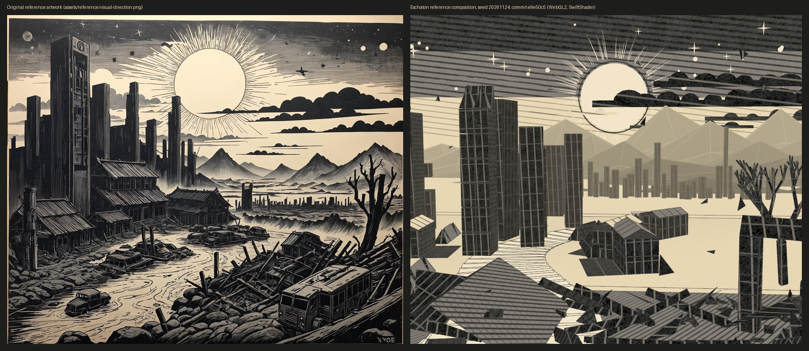

# Phase 0 owner review package (T0)

- Status: **PENDING owner review.** Nothing in this package is an approval, acceptance or waiver. The visual reference scene, ADRs 0001–0013 and the Phase 0 gate are all awaiting your decision.
- Prepared: 2026-11-24, branch `phase-0`, PR #1. The code reviewed is the tree at the PR head; screenshots and benchmarks name the commit they came from.
- Gate report: [`../phase-0-exit.md`](../phase-0-exit.md). Roadmap: [`../master-plan.md`](../master-plan.md) §11 (v1.1).

## 1. Hands-on review (local; no public tunnel)

Run in WSL, then open the URL in Windows Chrome (WSL2 forwards `localhost`, so nothing is exposed publicly):

```sh
cd /home/cuong/Kanna/eschaton/.worktrees/phase-0
pnpm install
STUDIO_PORT=5183 pnpm dev
# open http://localhost:5183/
```

No new public tunnel was started for this package. A Cloudflare tunnel to port 5183 that you accepted earlier in the session may still be registered; it serves nothing while the dev server is stopped. Close it from the Kanna tunnel card if you no longer want it.

What to try (shortcuts in the Shortcuts popover):

| Check | How |
|---|---|
| Primitives P01–P09 | Click each in the left panel; inspector shows footprint, sockets, creases and validation |
| Continuous folding | Select P08 Box shell, drag the Fold slider, press `F` (Play fold), drag single crease sliders in the inspector |
| Overlays | `G` grid, `S` sockets (legend appears), Footprint checkbox, `C` crease axes |
| Assemblies from shared pieces | Roof module, Watchtower, Pitched-roof house, Ruined gate; inspector lists foldon usage and canonical hash |
| Reference composition | Top of the catalog; `O` toggles composition/orbit camera; change Seed / Reroll |
| Look-dev comparison | Look panel: quantize, hatching, grain, haze, outlines, "Compare: flat \| ink" |
| GPU readout | Status bar: backend, GPU name, GPU class (`physical` / `software` / `unknown`) |
| Physical WebGPU test | Follow [`../testing/webgpu-manual-test.md`](../testing/webgpu-manual-test.md) (PENDING; needs your Windows Chrome + RTX 5070) |

## 2. Reference scene vs original artwork

| Image | What it shows |
|---|---|
| [`p0-reference-vs-scene-seed-20261124.png`](p0-reference-vs-scene-seed-20261124.png) | Original artwork (left) beside the reference composition, default seed (right, viewport crop of `../screenshots/p0.5-reference-composition.png`) |
| [`p0-reference-vs-scene-seed-2.png`](p0-reference-vs-scene-seed-2.png) | Same, second seed (`../screenshots/p0.5-reference-seed-2.png`) |

Both scene captures are headless Chromium on a software rasteriser (SwiftShader, WebGL2) at commit `e9e50c5`'s rendering code; a physical-GPU capture is part of the pending manual test.



### Reviewer's observations (agent, not an approval)

What matches the reference's structure: dark tower masses at left, a pale corridor winding from the foreground into the midground, a large pale sun disk with radial strokes in the upper centre, dark horizontal cloud bands, layered ridges and a distant skyline at right, a barren tree at right, monochrome paper/ink palette, no red.

Visible gaps, most important first:

1. **Value weight.** The reference is dominated by near-black masses carved with fine pale lines; the scene's masses are mid-grey with a cell grid, and a large flat pale plain fills the middle. The image reads lighter and emptier.
2. **Linework.** The reference's marks are engraved, organic and follow form; the scene's are uniform 1 px outlines on every Foldon cell (reads as "toy blocks" — master plan §13 risk, ADR 0002) plus regular ruled hatching. The sky is ruled with mechanical horizontal stripes.
3. **Architecture.** The traditional pitched-roof buildings at left of the reference are absent; the scene's houses read as gridded glass boxes.
4. **Foreground.** The reference has layered rubble, rocks, broken beams and vehicles; the scene has a few very large flat slabs (with the second seed a dark slab covers the lower left and hides the corridor entrance) and no vehicles.
5. **Mountains.** Reference ridges are sharp and hatched; the scene's are soft, low-contrast grey tents, large enough to crowd the sun.
6. **Sun and clouds.** A cloud band crosses the sun disk as a hard dark bar; the reference keeps the disk clear.
7. **Tree.** The scene's tree is a candelabra of prisms rather than an organic barren silhouette.
8. **Surface grain** on dark masses reads as mottled stone rather than paper.
9. **Rendering path.** Everything above was seen through SwiftShader WebGL2; WebGPU on a physical GPU has never been viewed.

Some of these are composition (2–7), some are the ink strategy (1, 2, 8; ADR 0006), and the logical-versus-rendered split matters for all of them: the composition places Foldons with free rotation and non-uniform scale outside Foldon validation (ADR 0013, proposed).

## 3. Screenshots (commit `d3e7c8e` regeneration, `pnpm screenshots`)

| File | Content |
|---|---|
| `../screenshots/p0.4-p08-mid-fold-creases.png` | P08 at 50 % fold with crease axes |
| `../screenshots/p0.4-roof-house-sockets.png` | 4×4 roof-house with socket overlay and legend |
| `../screenshots/p0.4-watchtower-composition.png` | Watchtower, composition camera |
| `../screenshots/p0.5-reference-composition.png`, `p0.5-reference-seed-2.png` | Reference composition, two seeds |
| `../screenshots/p0.5-compare-{flat,quantized,hatching,full}.png` | Same camera and light, techniques added one at a time |
| `../screenshots/p0.5-orbit-stability-{a,b}.png` | Two nearby orbit angles for a hatching-stability check by eye |

## 4. ADRs awaiting your decision

All are **Proposed**. 0001–0009 describe what the Phase 0 code already does; 0010–0013 are Phase 1 designs (no code).

| ADR | Proposed decision (one line) | Question for you |
|---|---|---|
| [0001](../decisions/0001-package-layout.md) | One domain package `@eschaton/foldon` (contracts merged in) + `apps/studio` owning the renderer adapter; no further §8 packages yet | Approve the reduced package set for Phase 0, with the split into §8 packages deferred until Phase 1 needs it? |
| [0002](../decisions/0002-cubic-grid-and-yaw-rotations.md) | Cubic integer grid, yaw-only quarter turns; continuous geometry inside cells | Approve, knowing the toy-like-grid risk is not retired (see §2 gaps 2–3)? |
| [0003](../decisions/0003-crease-representation.md) | Panels authored in rest pose, tree-only open hinges, valley-positive sign (matches FOLD); FOLD as a later adapter | Approve tree-only hinges for Phase 1, with closed loops as later research? |
| [0004](../decisions/0004-multi-cell-encoding.md) | Placement-based public contract; placement encoding recommended for the Phase 2 solver | Approve placement as the public contract? |
| [0005](../decisions/0005-renderer-webgpu-tsl-webgl2-fallback.md) | WebGPURenderer + TSL with automatic WebGL2 fallback | Approve, pending the physical WebGPU test result? |
| [0006](../decisions/0006-ink-visual-strategy.md) | World-anchored tri-planar hatching, quantized light, haze, grain, 1 px outlines | Is this the right base to iterate on, given §2 gaps 1, 2, 8? |
| [0007](../decisions/0007-component-data-and-system-order.md) | Components are data-only tagged unions; systems and their order deferred to Phase 1 | Approve? |
| [0008](../decisions/0008-assembly-promotion-and-hashing.md) | Promotion = passing `createCatalog`; canonical recipe hash; duplicate recipes rejected; levels and depth bounded | Approve? |
| [0009](../decisions/0009-socket-compatibility.md) | One symmetric profile table; **the tangent check is inert, so sockets have no orientation** | Approve as Phase 0 state, with ADR 0012 to fix orientation in Phase 1? |
| [0010](../decisions/0010-runtime-identity-ownership-lineage.md) | Phase 1: runtime entity ids, single owner field, lineage, conservation ledger | See the ADR's approval questions |
| [0011](../decisions/0011-atomic-transactions-and-revisions.md) | Phase 1: atomic patches against a base revision, stale rejection, replay log | See the ADR's approval questions |
| [0012](../decisions/0012-directional-sockets.md) | Phase 1: orientation-aware sockets | See the ADR's approval questions |
| [0013](../decisions/0013-logical-vs-rendered-geometry.md) | Phase 1: one authoritative logical model, bounded decorative offsets, separate backdrop | See the ADR's approval questions |

## 5. Decisions needed from you

- **D1 Visual criterion:** choose one:
  - (a) **Accept the proposed narrower Phase 0 visual criterion.** The reference scene counts as a look-development prototype, not final art and not evidence of generation. Phase 0 must show V1–V5: shared primitives read as folded paper, valid assemblies, visible folding, a basic ink/paper language, and documented limitations. Full fidelity is judged at the Genesis, Atmosphere and The Last District gates. See [`../phase-0-exit.md`](../phase-0-exit.md) §1a.
  - (b) Keep the original criterion and approve the scene as-is or with listed amendments.
  - (c) Reject the look direction.
  Under (a) you still judge V1–V5 by eye. Neither (a) nor (b) waives a later visual gate.
  *Agent recommendation:* (a). The scene's gaps are composition and ink-fidelity work that Phase 0 cannot settle honestly: the composition bypasses validation (ADR 0013). Polishing it now would invest in a placement path that is meant to be replaced.
- **D2 2×2 and 4×4 assembly contracts:** §14 asks for "a 2×2 and 4×4 assembly contract". Phase 0 provides them as compiled assemblies with footprints, external socket boundaries, canonical hashes and the tags `module-2x2` / `module-4x4` (`roof-module`, `roof-house`), **not** as a separate typed contract that a placement could require. Is that sufficient for Phase 0, or should a typed module contract (for example a declared footprint plus boundary-socket signature that an assembly must satisfy) be added before the gate?
- **D3 ADRs 0001–0009:** approve, amend or reject each (table above).
- **D4 ADRs 0010–0013:** answer their approval questions before any Phase 1 code.
- **D5 Physical WebGPU test:** run [`../testing/webgpu-manual-test.md`](../testing/webgpu-manual-test.md) on Windows Chrome + RTX 5070, or decide to waive it for the Phase 0 gate and run it at the start of Phase 1.
- **D6 Phase 0 gate:** pass, pass with conditions, or keep open — after reading [`../phase-0-exit.md`](../phase-0-exit.md).
- **D7 Phase 1 (Foundation):** go or no-go. No Phase 1 code will be written before this answer.
